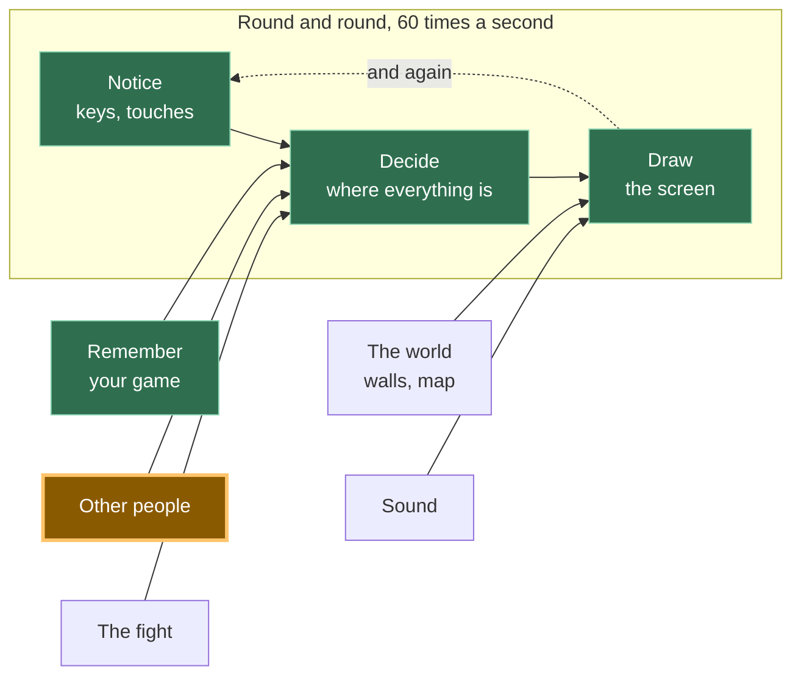

# A12: 他のプレイヤー

誰かがあなたのゲームを自分のコンピューターで開きます。彼らの四角があなたの画面に現れ、彼らが動かすと移動します。これこそが、このコース全体が目指してきたステップです。
{: .lesson-intro }

**必要なもの:** [A11](a11.html)。**得られるもの:** 他のすべてのプレイヤーの四角が、あなたのキャンバス上でリアルタイムに動きます。

## ゲーム全体と本日の部分



今日は「他のプレイヤー」のボックスを作成します。その矢印がどこを指しているかに注目してください。それは、キーボードとまったく同じように、**決定**の箇所を指しています。ゲームの他の部分にとって、別のプレイヤーは、単に変化した一連の数字に過ぎません。

## サーバーはない、というのは半分真実

**サーバー**とは、常に稼働しており、全員のゲームが通信するコンピューターです。ほとんどのオンラインゲームにはサーバーがあります。サーバーはゲームの世界を保持し、停止すればゲームも停止します。

あなたのゲームにはサーバーがありません。あなたのブラウザは相手のブラウザと直接通信します。あなたの画面上の画像は、途中で誰かのコンピューターを経由することはありません。

正直な部分を説明します。2つのブラウザは、何もないところから互いを見つけることはできません。彼らは「*私はここにいます。こうすれば私に連絡できます*」というメモを残す場所が必要です。そこであなたのゲームは**掲示板**を使用します。これは、他の人が運営する公開メッセージサービスで、誰でも小さなメモを投稿できます。両方のブラウザがメモを投稿し、互いのメモを読み、直接接続します。その後、掲示板は関与しません。

したがって、「サーバーレス」というのは半分しか真実ではありません。あなたのゲームを保持するサーバーはありません。導入のために使用される掲示板は*あります*。人々がゲームはサーバーレスだと言うとき、これはほとんどの場合彼らが意味することであり、今あなたは尋ねるべきことを知っています。

**もう一つの真実。**一部の家庭、モバイル、オフィス、学校のネットワークでは、2つのブラウザが直接WebRTC接続を行うことを許可していません。このレッスンでは**p2p-core**を使用しており、そのパブリックリレーが応答しているかどうかを教えてくれるため、推測する代わりに問題を調査できます。もしリレーが応答しているのに2つの異なるネットワークが依然として接続できない場合、問題はゲームのバグではなく、TURNリレーにある可能性があります。p2p-coreは同じブラウザのタブを直接接続するため、A12は2つのタブでテストできます。また、[A14](a14.html)以降はリモートマルチプレイヤーなしで動作します。

## ブロックに分割する

「他のプレイヤーが現れる」は3つの要素で構成されています。

1. **接続** — ルームに参加し、誰かが到着または退出したときに通知を受ける
2. **送信** — 自分の四角の位置を全員に1秒間に10回伝える
3. **描画** — 他の全員の四角を描画する

**なぜ分割するのか？** もしそれが一つの塊で、問題が発生した場合、どの部分が悪いのかを特定できません。部屋に誰もいないということは接続の問題を意味します。部屋に誰かはいるが四角が動かないのは送信の問題を意味します。数字は届いているが画面に何も表示されないのは描画の問題を意味します。3つのブロック、3つの別々の質問 — そして、他の2つに触れることなく、コンソールからそれぞれに答えることができます。

ほとんどの人は最初からこれを機能させることはできません。このコースの他のどこよりも、ここではそれが普通です。

## ブロック1: 接続

接続は、このコースで使われる唯一のマルチプレイヤーライブラリである**[p2p-core](https://github.com/KakkoiDev/p2p-core)**によって行われます。**ライブラリ**とは、誰かが書いたコードで、自分で書く代わりにあなたが使用するものです。p2p-coreは、ピアの発見、共有パブリック掲示板の選択、WebRTCリンクの開設、同ブラウザテスト、接続診断といった面倒な部分を処理してくれるので、あなたは自分のゲームに属する3つのアイデアにこのレッスンを集中させることができます。

以下の正確な固定バージョンを使用してください。リレーリストを作成したり、自分で`RTCPeerConnection`を作成したり、アシスタントがたまたま知っているからといって別のマルチプレイヤーパッケージに交換したり**しないでください**。

```
import { joinRoom, selfId } from 'https://cdn.jsdelivr.net/gh/KakkoiDev/p2p-core@v0.1.0/p2p-core.js';

const room = joinRoom({
  app: 'kakkoi-online',
  room: 'demo',
  kinds: ['move'],
});

const others = {};

room.onMessage('move', (where, id) => {
  if (!Number.isFinite(where?.x) || !Number.isFinite(where?.y)) return;
  others[id] = { x: where.x, y: where.y };
});

room.onPeerJoin((id) => {
  room.send('move', { x: player.x, y: player.y }, id);
});

room.onPeerLeave((id) => {
  delete others[id];
});

window.room = room;
```

`app`はあなたがプレイしているゲームを示します。`room`はそのゲーム内のどの部屋であるかを示します。同じペアを使用している人全員が互いに出会います。`kinds: ['move']`は、このページがどのような種類のメッセージを期待しているかをp2p-coreに事前に伝えます。メッセージの種類を早期に登録することで、ハンドラーが存在する前に最初のネットワークメッセージが到着する競合状態を回避します。

`selfId`は、このページに与えられるランダムな名前で、読み込みごとに新しく生成されます。他のプレイヤーはそのランダムなIDを受け取り、あなたの本当の身元ではありません。

`others`は、このブロックが保持する唯一のゲーム状態です。他の各プレイヤーにつき1つの位置を保持します。`onPeerLeave`はプレイヤーを削除するため、タブを閉じると、幽霊が残るのではなく、その四角が削除されます。

`onPeerJoin`内の行は、あなたの現在の位置をすぐに新しく参加した人に送信します。その後、ブロック2のタイマーが全員を更新し続けます。

### 接続できない場合

アシスタントにネットワークを書き直すよう依頼しないでください。まず、コンソールに以下を入力してください。

```
room.status()
```

`transports.relays`を見てください。もし`open`が`0`であれば、現在のネットワークがパブリック掲示板をブロックしています。1つ以上のリレーが開いているのに、他のコンピューターがまだ現れない場合、2つのネットワークが直接のWebRTCパスをブロックしている可能性があります。その場合、TURNが必要になることがあります。p2p-coreはこの情報を公開しているので、次のステップは証拠に基づいており、推測による新しいネットワークコードの山ではありません。

インポートは、jsDelivrを介して**バージョン管理された**GitHubリリースから直接行われます。まだバンドラーやビルドステップはありません。ブラウザは通常のESモジュールをロードします。`v0.1.0`を固定することで、すべての生徒とアシスタントが同じAPIで作業していることになります。

## ブロック2: 送信

```
setInterval(() => room.send('move', { x: player.x, y: player.y }), 100);
```

`setInterval(f, 100)`は、100ミリ秒ごとに`f`を実行します — これは**1秒間に10回**、指をタップするくらいの頻度です。

あなたの四角は1秒間に60回動きます。1秒間に60回送信することもできます。しかし、そうしないでください。すべてのメッセージはすべてのプレイヤーに送信されるため、6人の部屋では、同じように見える四角を描くために、あなたのコンピューターから1秒間に60メッセージではなく360メッセージが出ることになります。1秒間に10回で、生き生きと見えるのに十分です。

これは、[A11](a11.html)で1秒間に2回保存するのと同じ考え方です。高価な処理は、可能な限りめったに行わないようにします。

## ブロック3: 描画

```
function draw() {
  ctx.fillStyle = '#1b1b22';
  ctx.fillRect(0, 0, canvas.width, canvas.height);

  ctx.font = '12px system-ui, sans-serif';
  for (const id in others) {
    ctx.fillStyle = '#6bb8ff';
    ctx.fillRect(others[id].x, others[id].y, SIZE, SIZE);
    ctx.fillText(id.slice(0, 4), others[id].x, others[id].y - 4);
  }

  ctx.fillStyle = '#7ee081';
  ctx.fillRect(player.x, player.y, SIZE, SIZE);
}
```

他のプレイヤーは青、あなたは緑で、各プレイヤーのIDの最初の4文字が四角の上に表示されるため、2人のプレイヤーを見分けることができます。

このブロックが*しない*ことに注目してください。誰がどこにいるのか尋ねません。`player`を読み取るのとまったく同じ方法で`others`リストを読み取ります。これが、[A10](a10.html)で通知と決定と描画を分離した理由です。あなたの描画コードは、数字がどこから来たのかを気にしたことがないので、他の人の四角は3行追加するだけで済みます。

## なぜこの方法を選んだのか

この全体の構造は、ある一つの決定からきています。サーバーがないことです。なぜなら、サーバーは毎月費用がかかり、誰かが稼働させ続ける必要があるからです。12歳の子どもがこのゲームを公開し、友達にリンクを送り、誰にも支払うことなく1年後も動作するべきです。そのため、ゲームを保持するサーバーは除外され、ブラウザ同士が通信し、無料の公開掲示板が紹介役を務めます。

## 代わりにできたこと

| これの代わりに | そのコスト |
|---|---|
| 世界を保持する実際のサーバー | 厳格な学校ネットワークでも常に動作し、チートを防ぐこともできます。しかし、毎月費用がかかり、稼働し続ける必要があり、停止すればすべてのプレイヤーのゲームが停止します |
| 毎フレーム自分の位置を送信する | 誰も見分けられない絵のために6倍のメッセージが送られる。スマートフォンでは、無駄にバッテリーを消費することになる |
| "私はx,yにいる"の代わりに"右を押した"を送信する | メッセージは少なくなる。しかし、すべてのコンピューターが全員がどこにたどり着いたかを計算する必要があり、1つのメッセージが欠落すると、2人のプレイヤーが永遠に異なる世界を見ることになる |
| 生WebRTC、生Trystero、または別のマルチプレイヤーパッケージ | 発見、リレー選択、ブラウザ接続の詳細を再び解決する必要がある。p2p-coreはすでにこのコースのその役割を担っているので、ライブラリを変更すると、今日のアイデアを教えることなく失敗モードを追加することになる |

## プロンプト

このプロンプトを正確にコピーしてください。ライブラリ名、バージョン、インポートURL、APIはタスクの一部であり、アシスタントが独自のネットワーキングスタックを発明しないようにするためです。

```
I have a canvas game in plain JavaScript. main.js keeps the player in
{x, y}, moves it in update(dt), and paints it in draw().

Use KakkoiDev/p2p-core v0.1.0 directly for multiplayer. Import EXACTLY:
import { joinRoom, selfId } from 'https://cdn.jsdelivr.net/gh/KakkoiDev/p2p-core@v0.1.0/p2p-core.js';

Do not use raw WebRTC, raw Trystero, PeerJS, Socket.IO, Firebase, or a
hand-written relay list. Do not add npm, a build step, or a server.

Create exactly one room:
const room = joinRoom({
  app: 'kakkoi-online',
  room: 'demo',
  kinds: ['move'],
});

Add multiplayer in three separate blocks with a comment above each:
CONNECT (an others object, room.onMessage('move'), room.onPeerJoin,
room.onPeerLeave, and expose window.room = room for room.status()),
SEND (room.send('move', {x, y}) on a setInterval at 10 per second),
DRAW (paint the other squares).

Reject a move unless x and y are finite numbers. Do not change update().
Plain JavaScript, no build step.
```

**出力で5つのことを確認してください。**インポートURLが上記の固定されたp2p-core URLと正確に同じであること。`joinRoom`が1つだけであること。リレーリストや手書きのWebRTCコードがないこと。`requestAnimationFrame`ではなく100ミリ秒タイマーで送信が行われること。そして`onPeerLeave`が四角を削除すること。もしアシスタントがライブラリを変更したり、ネットワーキングを考案したりした場合は、そこで停止し、その考案をデバッグするのではなく、正確なプロンプトに戻してください。

## 動作を確認する


ページを2つのブラウザタブで2回開き、数秒待ちます。

1. 各タブに青い四角が現れ、その上に4文字が表示されます。それがもう一方のタブです。
2. 一方のタブで矢印キーを使って緑色の四角を操作します。もう一方のタブの青い四角も同じように動きます。
3. 2番目のタブでコンソールを開き、`others`と入力します。`{6phtXPzeOsFqgp95188x: {x: 411.696, y: 288}}`のようなオブジェクトが表示されます — そして、これら2つの数字は、1番目のタブの`player`と同じ数字です。これが証拠です。画像は偶然かもしれませんが、小数点以下3桁まで一致する数字は偶然ではありません。
4. 最初のタブを閉じます。数秒以内に、2番目のタブの青い四角が消え、`others`が`{}`になります。
5. 3番目のタブを開きます。2つ目の青い四角が現れます — 上の画像は3人のプレイヤーが部屋にいる状態で撮影されたものです。

もしステップ1が2つのタブで全く起こらない場合、コードを変更する前に`room.status()`と入力してください。p2p-coreでは、2つのタブはブラウザ自体を介して出会うことができるため、このテストはパブリックリレーに依存しません。後で2つの異なるコンピューターをテストする際も、同じステータスオブジェクトがリレー検出が利用可能かどうかを教えてくれます。

## これを試したときに何がうまくいかなかったか

この3つのブロックをゲームに組み込んだ**後**にこれを読んでください。なぜなら、そのときに問題が発生するからです。

2つのタブは、このステップをテストする方法であり、上記のデモでは完璧に動作します。その後、それを実際のゲーム（[A11](a11.html)から名前と位置を保存するゲーム）に追加し、2つのタブを開きました。

**私たちは2人いました。** 同じ名前、同じモンスター、両方とも歩き回り、両方とも本物でした。2番目のタブを閉じても助けにはなりませんでした。なぜなら最初のタブはまだ動作していたからです。

何も壊れていませんでした。両方のタブが同じセーブデータを読み込んでいました。なぜならセーブデータはタブではなく*ブラウザ*に属するからです。したがって、両方のタブは正しく、正直に「あなた」でした。ゲームは、一度に1人しかプレイしてはいけないことを単純に知らなかったのです。

修正策は、**最新のウィンドウが勝つ**と決定することです。

1. 開いたウィンドウは、同じゲームの他のウィンドウに自分自身を通知します。
2. これを聞いた古いウィンドウは、現在の実際の位置を保存し、それを渡し、**部屋を出て**、ゲームを取り戻すボタン付きの静かなメッセージを表示します。
3. 新しいウィンドウはその引き渡しをしばらく待ち（400ミリ秒を許可します）、受け取った位置から開始します。何も応答がない場合、他のウィンドウはなかったので、通常通りセーブデータを読み込みます。

そこには間違えやすい2つの詳細があり、どちらも私たちの時間を費やしました。

**古いウィンドウは描画を停止するだけでなく、本当に退出する必要があります。**一時停止するだけでは、接続されたままであるため、他の全員にはまだ2人のあなたが見え、バグが修正されていないように見えます。

**新しいウィンドウは、保存された位置ではなく、引き渡された位置を使用する必要があります。**ゲームは時々保存されるのであって、毎フレームではありません。保存されたコピーを使用すると、最後の保存が行われた場所にジャンプしてしまい、ゲームがあなたの場所を失ったように感じられます。

*(同じサイトのウィンドウ同士は直接通信できます — 経験豊富なプログラマーはこれを`BroadcastChannel`と呼びます。これであなたもその名前を知りました。これは同じサイトのウィンドウ間でのみ機能し、まさにここでの問題です。)*

## ゲームに組み込む

[A11](a11.html)のゲームを取り出し、上記とまったく同じようにp2p-coreを使って3つのブロックを追加します。既存のものは何も変更されません。`update`とループは元のままです — あなたは2番目の数値ソースを追加しているのであって、最初のものを書き換えているわけではありません。

<div class="takeaways">
<h2>主なポイント</h2>
<ul>
<li>p2p-coreをコースのネットワーク境界として使用する: あなたのゲームはメッセージを送信し、ライブラリが発見とブラウザ間の接続を処理します</li>
<li>他のプレイヤーは、キーボードと同じく、単に変化する数字に過ぎない — だからA10の分割がここで報われるのです</li>
<li>毎フレームではなく、タイマーで稀に送信する。絵は同じで、コストははるかに低い</li>
<li>プレイヤーが退出したら削除する。さもないと彼らの四角が画面に永遠に残ってしまう</li>
<li>リモート接続が失敗した場合、コードを変更する前に`room.status()`を検査する。厳格なネットワークでは、ゲームが正しくてもTURNが必要になる場合がある</li>
<li>セーブデータはタブではなくブラウザに属する — だから、どちらがプレイしているかを決めるまで、2つのタブは2人のあなたとなる</li>
</ul>
</div>

## あなたの番

現在、フリーズしたプレイヤー（ラップトップの蓋を閉じた、接続が切れたなど）は、部屋が彼らが去ったことに気づくまで、あなたの画面に四角が静止したまま残ります。このステップを構築しているときに、私たちにもこれが起こりました。閉じられずに強制終了されたタブが、`{x: 100, y: 100}`の位置に青い四角を数分間放置したのです。なぜなら「さようなら」が送信されなかったからです。各メッセージが到着した時間を保存し、3秒間音沙汰のない四角はフェードアウトするか非表示にしてください。*経験豊富なプログラマーは、そのようなメッセージをハートビートと呼びます。これであなたもその言葉を知りました。*
