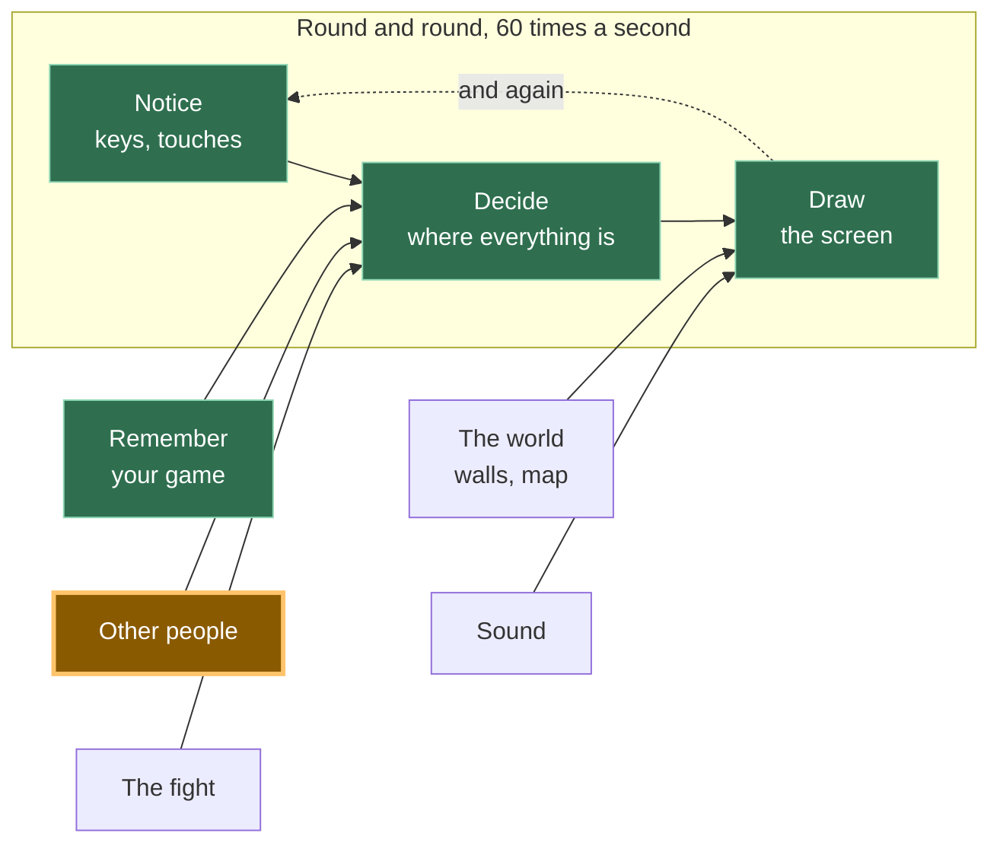

# A12: 他の人

誰かが自分のコンピューターであなたのゲームを開きます。彼らの四角があなたの画面に現れ、彼らが動くと一緒に動きます。これこそが、このトラック全体が目指してきたステップです。
{: .lesson-intro }

**必要:** [A11](a11.html)。 **得られるもの:** 他のすべてのプレイヤーの四角が、あなたのキャンバス上でリアルタイムに動く。

## ゲーム全体と今日の部分



今日は「他の人」ボックスを作成します。その矢印がどこを指しているかに注目してください。あなたのキーボードと全く同じように、**決定**の中です。あなたのゲームの残りから見れば、別のプレイヤーは単に変化した別の数値のセットに過ぎません。

## サーバーは存在しない、そしてそれは半分だけ真実である

**サーバー**とは、常に稼働しており、全員のゲームが通信するコンピューターです。ほとんどのオンラインゲームにはサーバーがあります。サーバーは世界を保持し、もし停止すればゲームも停止します。

あなたのゲームにはサーバーがありません。あなたのブラウザは相手のブラウザと直接通信します。あなたの画面上の画像は、途中で誰かのコンピューターを経由することはありません。

ここが正直な部分です。2つのブラウザは何もなしにはお互いを見つけられません。彼らは「*私はここにいます、これが私に連絡する方法です*」というメモを残す場所が必要です。そこであなたのゲームは**掲示板**を利用します。これは、他の人々が運営する公開メッセージサービスで、誰でも小さなメモを投稿できます。両方のブラウザがメモを投稿し、お互いのメモを読み、その後直接接続します。その後、掲示板は関与しません。

したがって、「サーバーレス」は半分しか真実ではありません。あなたのゲームを保持するサーバーはありません。しかし、導入のために使用される掲示板は*あります*。ゲームがサーバーレスだと言われるとき、これはほとんどの場合彼らが意味することであり、今あなたは尋ねるべきことを知っています。

**もう一つの真実。**一部の家庭、モバイル、オフィス、学校のネットワークでは、2つのブラウザが直接WebRTC接続を行うことを許可しません。このレッスンでは**p2p-core**を使用します。これは、その公開リレーが応答しているかどうかを教えてくれるので、推測する代わりに問題を調査できます。もしリレーが応答しているのに2つの異なるネットワークがまだ接続できない場合、ゲームのバグではなくTURNリレーが必要な部分かもしれません。p2p-coreは同じブラウザのタブを直接接続するため、A12は2つのタブでテストできます。そして、[A14](a14.html)以降のすべてはリモートマルチプレイヤーなしで動作します。

## ブロックに分割する

「他の人が現れる」は3つのことです。

1. **接続** — ルームに参加し、誰かが到着または退出したときに通知を受ける
2. **送信** — 自分の四角の位置を1秒間に10回、全員に伝える
3. **描画** — 他の全員の四角を描く

**なぜわざわざ分割するのか？** もしそれが一つの塊で、うまくいかなかった場合、どの部分が悪いのか判断できないからです。ルームに誰もいないなら、接続に問題があります。ルームに誰かいるのに四角が動かないなら、送信に問題があります。数値は届いているのに画面に何も表示されないなら、描画に問題があります。3つのブロック、3つの別々の質問 — そして、他の2つに触れることなく、コンソールからそれぞれに答えることができます。

ほとんどの人はこれを最初から動作させることはできません。このトラックの他のどの部分よりも、ここではそれが普通です。

## ブロック1: 接続

接続は、このコースで使用される唯一のマルチプレイヤーライブラリである**[p2p-core](https://github.com/KakkoiDev/p2p-core)**によって行われます。**ライブラリ**とは、あなたが自分で書く代わりに、他の誰かが書いたコードのことです。p2p-coreは、ピアの発見、共有公開掲示板の選択、WebRTCリンクの開設、同ブラウザでのテスト、接続診断といった厄介な部分を処理してくれるので、あなたはこのレッスンをあなたのゲームに属する3つのアイデアに集中できます。

以下の正確な固定バージョンを使用してください。リレーリストを作成したり、自分で`RTCPeerConnection`を作成したり、アシスタントがたまたま知っているからといって別のマルチプレイヤーパッケージに切り替えたりしないでください。

```
import { joinRoom, selfId } from 'https://cdn.jsdelivr.net/gh/KakkoiDev/p2p-core@v0.1.0/p2p-core.js';

const room = joinRoom({
  app: 'kakkoi-online',
  room: 'demo',
  kinds: ['move'],
});

const others = {};

room.onMessage('move', (where, id) => {
  if (!Number.isFinite(where?.x) || !Number.isFinite(where?.y)) return;
  others[id] = { x: where.x, y: where.y };
});

room.onPeerJoin((id) => {
  room.send('move', { x: player.x, y: player.y }, id);
});

room.onPeerLeave((id) => {
  delete others[id];
});

window.room = room;
```

`app`はあなたがプレイしているゲームを示します。`room`はそのゲーム内のどのルームかを示します。同じペアを使用している全員がお互いに出会います。`kinds: ['move']`は、このページがどのような種類のメッセージを期待しているかをp2p-coreに事前に伝えます。メッセージの種類を早期に登録することで、ハンドラが存在する前に最初のネットワークメッセージが到着する競合状態を回避します。

`selfId`は、このページのためのランダムな名前で、ロードされるたびに新しく生成されます。他のプレイヤーはそのランダムなIDを受け取り、あなたの本当の身元ではありません。

`others`は、このブロックが保持する唯一のゲーム状態です。他の各プレイヤーの1つの位置です。`onPeerLeave`はプレイヤーを削除するため、タブを閉じると、幽霊を残す代わりにその四角が削除されます。

`onPeerJoin`内の行は、あなたの現在の位置をすぐに新参者に送信します。その後、ブロック2のタイマーが全員を更新し続けます。

### 接続が機能しない場合

アシスタントにネットワーキングを書き直すよう依頼しないでください。まず、これをコンソールに入力してください。

```
room.status()
```

`transports.relays`を見てください。もし`open`が`0`なら、現在のネットワークが公開掲示板をブロックしています。1つ以上のリレーが開いているのに別のコンピューターがまだ表示されない場合、2つのネットワークが直接WebRTCパスをブロックしている可能性があります。その場合、TURNが必要になることがあります。p2p-coreはこの情報を公開しているので、次のステップは推測された新しいネットワーキングコードではなく、証拠に基づいています。

インポートは、jsDelivrを介して**バージョン管理された**GitHubリリースから直接行われます。バンドラーもビルドステップもありません。ブラウザは通常のESモジュールをロードします。`v0.1.0`を固定することで、すべての学生とすべてのアシスタントが同じAPIで作業していることになります。

## ブロック2: 送信

```
setInterval(() => room.send('move', { x: player.x, y: player.y }), 100);
```

`setInterval(f, 100)`は、100ミリ秒ごとに`f`を実行します — **1秒間に10回**、指でタップできるのとほぼ同じ頻度です。

あなたの四角は1秒間に60回動きます。1秒間に60回送信することもできます。しかし、そうしないでください。すべてのメッセージがすべてのプレイヤーに送られるため、6人部屋では、同じに見える四角を描くために、あなたのコンピューターから1秒間に60ではなく360のメッセージが送られることになります。1秒間に10回で十分生き生きと見えます。

これは、[A11](a11.html)で1秒間に2回保存するのと同じ考え方です。高価な処理は、許される限り稀に行うべきです。

## ブロック3: 描画

```
function draw() {
  ctx.fillStyle = '#1b1b22';
  ctx.fillRect(0, 0, canvas.width, canvas.height);

  ctx.font = '12px system-ui, sans-serif';
  for (const id in others) {
    ctx.fillStyle = '#6bb8ff';
    ctx.fillRect(others[id].x, others[id].y, SIZE, SIZE);
    ctx.fillText(id.slice(0, 4), others[id].x, others[id].y - 4);
  }

  ctx.fillStyle = '#7ee081';
  ctx.fillRect(player.x, player.y, SIZE, SIZE);
}
```

他のプレイヤーは青、あなたは緑で、各プレイヤーのIDの4文字が彼らの四角の上に表示されるので、2人を区別できます。

このブロックが*しない*ことを見てください。誰かに彼らがどこにいるか尋ねません。`player`を読むのと全く同じ方法で`others`リストを読み取ります。これが、[A10](a10.html)が通知、決定、描画を分離した理由です。あなたの描画コードは数値がどこから来たか気にする必要がないため、他の人の四角は3行余分なコードで済みます。

## なぜこの方法を採用したのか

全体像は一つの決定から導かれています。サーバーなし、なぜならサーバーは毎月費用がかかり、誰かがそれを稼働させ続ける必要があるからです。12歳の子どもがこのゲームを公開し、友人にリンクを送り、誰にも費用を払うことなく1年後も動作し続けることができるべきです。それはゲームを保持するサーバーを排除します — したがってブラウザがお互いに通信し、無料の公開掲示板が紹介の役割を果たします。

## 代わりにできたこと

| これの代わりに | かかる費用 |
|---|---|
| 世界を保持する実際のサーバー | 厳格な学校ネットワークでも常に動作し、チートを防ぐことができます。しかし、毎月費用がかかり、稼働し続ける必要があり、停止するとすべてのプレイヤーのゲームが停止します |
| 毎フレーム自分の位置を送信する | 誰も区別できない画像のために6倍のメッセージ。電話では無駄にバッテリーを消費することになります |
| 「私はx, yにいます」の代わりに「右を押しました」を送信する | メッセージは少なくなる。しかし、すべてのコンピューターが全員がどこにたどり着いたかを計算する必要があり、1つのメッセージが欠落すると、2人のプレイヤーは永遠に異なる世界を見ることになる |
| 生WebRTC、生Trystero、または別のマルチプレイヤーパッケージ | 発見、リレー選択、ブラウザ接続の詳細を再び解決することになります。p2p-coreはこのコースのために既にその役割を担っているため、ライブラリを変更すると、今日のアイデアを教えることなく失敗モードが増えます |

## プロンプト

このプロンプトを正確にコピーしてください。ライブラリ名、バージョン、インポートURL、APIはタスクの一部であり、アシスタントが独自のネットワーキングスタックを考案しないようにするためです。

```
I have a canvas game in plain JavaScript. main.js keeps the player in
{x, y}, moves it in update(dt), and paints it in draw().

Use KakkoiDev/p2p-core v0.1.0 directly for multiplayer. Import EXACTLY:
import { joinRoom, selfId } from 'https://cdn.jsdelivr.net/gh/KakkoiDev/p2p-core@v0.1.0/p2p-core.js';

Do not use raw WebRTC, raw Trystero, PeerJS, Socket.IO, Firebase, or a
hand-written relay list. Do not add npm, a build step, or a server.

Create exactly one room:
const room = joinRoom({
  app: 'kakkoi-online',
  room: 'demo',
  kinds: ['move'],
});

Add multiplayer in three separate blocks with a comment above each:
CONNECT (an others object, room.onMessage('move'), room.onPeerJoin,
room.onPeerLeave, and expose window.room = room for room.status()),
SEND (room.send('move', {x, y}) on a setInterval at 10 per second),
DRAW (paint the other squares).

Reject a move unless x and y are finite numbers. Do not change update().
Plain JavaScript, no build step.
```

**出力で5つのことを確認してください:** インポートURLが上記の固定されたp2p-coreのURLと完全に一致していること。`joinRoom`が1つしかないこと。リレーリストや手書きのWebRTCコードがないこと。送信が`requestAnimationFrame`ではなく100ミリ秒のタイマーで行われていること。そして`onPeerLeave`が四角を削除すること。もしアシスタントがライブラリを変更したり、ネットワーキングを考案したりした場合は、そこで停止し、その発明をデバッグするのではなく、正確なプロンプトに戻すように指示してください。

## 動作を確認する


ページを2つのブラウザタブで2回開き、数秒待ちます。

1. 各タブに青い四角が現れ、その上に4文字が表示されます。それがもう一方のタブです。
2. 一方のタブで矢印キーを使って緑の四角を操作します。もう一方のタブの青い四角も同じように動きます。
3. 2番目のタブでコンソールを開き、`others`と入力します。`{6phtXPzeOsFqgp95188x: {x: 411.696, y: 288}}`のようなオブジェクトが表示されます — そして、これら2つの数値は、最初のタブの`player`と同じ数値です。これが証拠です。画像は偶然かもしれませんが、小数点以下3桁まで一致する数値は偶然ではありえません。
4. 最初のタブを閉じます。数秒以内に、2番目のタブの青い四角が消え、`others`は`{}`になります。
5. 3番目のタブを開きます。2つ目の青い四角が現れます — 上の画像は、ルームに3人のプレイヤーがいるときに撮影されたものです。

もし2つのタブでステップ1が決して起こらない場合、コードを変更する前に`room.status()`と入力してください。p2p-coreを使えば、2つのタブはブラウザ自体を介して出会うことができるため、このテストは公開リレーに依存しません。後で2つの異なるコンピューターをテストする際、同じステータスオブジェクトがリレーディスカバリが利用可能かどうかを教えてくれます。

## これを行ったときに何がうまくいかなかったか

3つのブロックをゲームに組み込んだ**後に**これを読んでください。なぜなら、そのときにこの問題が発生するからです。

2つのタブはこのステップをテストする方法であり、上記のデモでは完璧に動作します。その後、[A11](a11.html)からあなたの名前と位置を保存する実際のゲームにこれを追加し、2つのタブを開きました。

**私たちが2人いました。**同じ名前、同じモンスター、両方とも歩き回り、両方とも本物でした。2番目のタブを閉じても解決しませんでした。なぜなら、最初のタブがまだ動作していたからです。

何も壊れていませんでした。両方のタブが同じセーブデータを読んでいました。なぜなら、セーブデータはタブではなく*ブラウザ*に属しているからです。したがって、両方のタブは正しく、正直に言って、あなた自身でした。ゲームは、一度に1人しかプレイすべきではないということを単純に知らなかったのです。

解決策は、**最新のウィンドウが勝つ**と決定することです。

1. 開いたウィンドウは、同じゲームの他のすべてのウィンドウに自分自身をアナウンスします。
2. これを聞いた古いウィンドウは、現在の実際の位置を保存し、それを渡し、**ルームを離れ**、ゲームを取り戻すボタン付きの静かなメッセージを表示します。
3. 新しいウィンドウは、その引き渡しをしばらく待ち（400ミリ秒を許容します）、受け取った位置から開始します。何も応答がない場合、他のウィンドウはなかったので、通常通りセーブデータを読み込みます。

そこには間違いやすい2つの詳細があり、どちらも時間を費やしました。

**古いウィンドウは、描画を停止するだけでなく、実際に退室する必要があります。**もし一時停止するだけだと、まだ接続されているため、他の全員からは2人のあなたが見え続け、バグが修正されていないように見えます。

**新しいウィンドウは、保存された位置ではなく、引き渡された位置を使用する必要があります。**ゲームは時々保存されるもので、毎フレームではありません。保存されたコピーを使用すると、前回の保存が行われた場所にジャンプしてしまい、ゲームがあなたの場所を忘れたように感じられます。

*同じサイトのウィンドウは直接お互いに通信できます — 熟練したプログラマーはそれを`BroadcastChannel`と呼びます。これであなたもその名前を知りました。これは同じサイトのウィンドウ間でのみ機能し、まさにここでの問題です。*

## ゲームに組み込む

[A11](a11.html)のゲームを取り、上記の通り正確にp2p-coreを使用して3つのブロックを追加してください。既存のものは何も変更しません。`update`とループは元のままです — あなたは数値の2番目のソースを追加するのであって、最初のものを書き換えるのではありません。

<div class="takeaways">
<h2>重要なポイント</h2>
<ul>
<li>p2p-coreをコースのネットワーキング境界として使用する: あなたのゲームはメッセージを送信し、ライブラリが発見とブラウザ間接続を処理する</li>
<li>他のプレイヤーは、キーボードと同じように、単に変化する数値に過ぎない — これがA10の分割がここで報われる理由です</li>
<li>送信は毎フレームではなく、タイマーで稀に行う。画像は同じで、コストははるかに低い</li>
<li>プレイヤーが退室したら削除する。さもないと、彼らの四角が画面に永遠に残り続ける</li>
<li>リモート接続が失敗した場合、コードを変更する前に<code>room.status()</code>を検査する。厳格なネットワークでは、ゲームが正しくてもTURNが必要な場合がある</li>
<li>セーブデータはタブではなくブラウザに属する — したがって、どちらがプレイしているかを決定するまで、2つのタブは2人のあなたとなる</li>
</ul>
</div>

## あなたの番

現時点では、フリーズしたプレイヤー（ラップトップの蓋を閉じた、接続が切れたなど）は、ルームが彼らが去ったことに気づくまで、あなたの画面に四角を静止させたままにします。これはこのステップを構築中に私たちにも起こりました。閉じられずに終了されたタブは、「さようなら」が送信されなかったため、青い四角を`{x: 100, y: 100}`に数分間駐車させたままにしました。各メッセージが到着した時間を保存し、3秒間応答がない四角はフェードアウトまたは非表示にしてください。*熟練したプログラマーはそのようなメッセージをハートビートと呼びます。これであなたもその言葉を知りました。*
