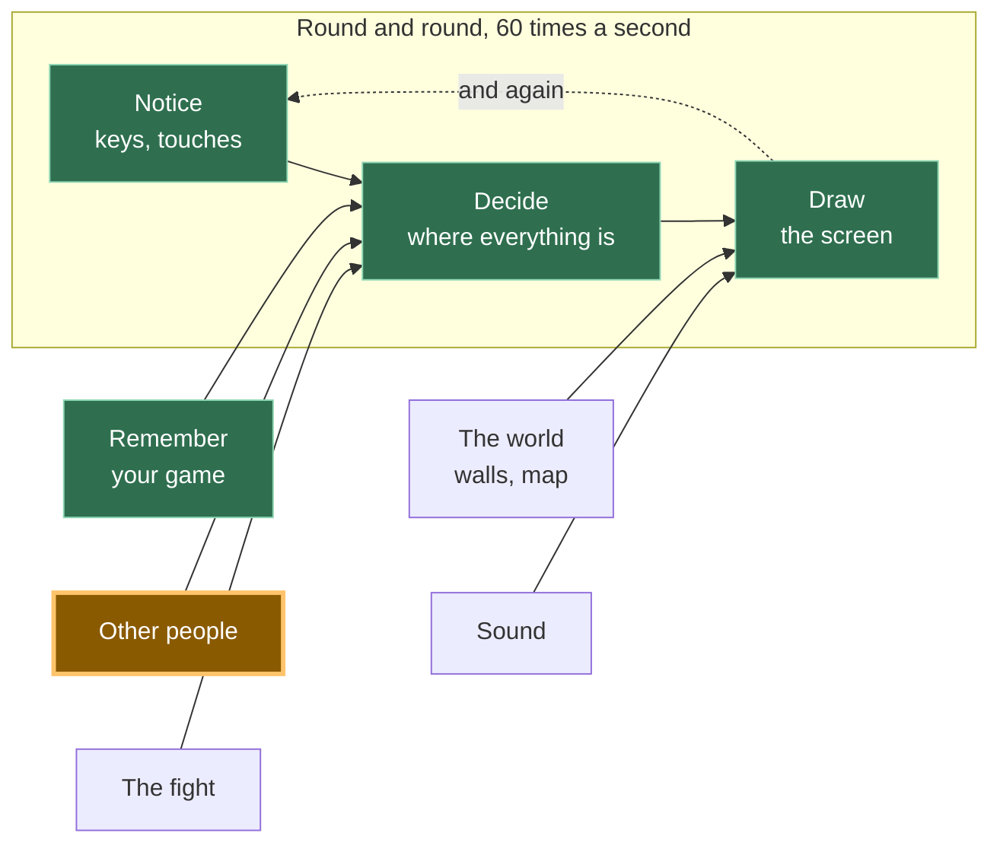

# A12: Outras Pessoas

Outra pessoa abre seu jogo no computador dela. O quadrado dela aparece na sua tela e se move quando ela se move. Este é o passo para o qual todo o percurso tem caminhado.
{: .lesson-intro }

**Precisa de:** [A11](a11.html). **Oferece:** o quadrado de cada outro jogador, movendo-se ao vivo na sua tela.

## O jogo completo e a peça de hoje



Hoje você constrói a caixa "outras pessoas". Observe para onde a seta aponta: para **decidir**, exatamente como seu teclado. Para o resto do seu jogo, outro jogador é apenas outro conjunto de números que mudou.

## Não há servidor, e isso é uma meia-verdade

Um **servidor** é um computador que está sempre ligado, com o qual o jogo de todos se comunica. A maioria dos jogos online tem um. Ele mantém o mundo, e se parar, o jogo para.

Seu jogo não tem um. Seu navegador se comunica diretamente com o navegador da outra pessoa. As imagens na sua tela nunca passam pelo computador de ninguém no meio.

Aqui está a parte honesta. Dois navegadores não conseguem se encontrar do nada. Eles precisam de um lugar para deixar um bilhete dizendo *"Estou aqui, é assim que você me encontra"*. Então seu jogo usa um **quadro de avisos** — um serviço público de mensagens, administrado por outras pessoas, onde qualquer um pode postar pequenos bilhetes. Ambos os navegadores postam um bilhete, leem o do outro e então se conectam diretamente. Depois disso, o quadro de avisos não está envolvido.

Então "sem servidor" é apenas metade verdade. Não há um servidor mantendo seu jogo. *Existe* um quadro de avisos usado para a introdução. Quando as pessoas dizem que um jogo é sem servidor, é quase sempre isso que elas querem dizer, e agora você sabe como perguntar.

**Mais uma verdade.** Algumas redes domésticas, móveis, de escritório e escolares não permitem que dois navegadores façam uma conexão WebRTC direta. Esta lição usa o **p2p-core**, que pode informar se seus retransmissores públicos estão respondendo, para que você possa inspecionar o problema em vez de adivinhar. Se os retransmissores responderem, mas duas redes diferentes ainda não conseguirem se conectar, a peça que falta pode ser um retransmissor TURN, e não um bug no seu jogo. Você ainda pode testar A12 em duas abas porque o p2p-core conecta abas do mesmo navegador diretamente, e tudo de [A14](a14.html) em diante funciona sem multijogador remoto.

## Dividindo em blocos

"Outras pessoas aparecem" são três coisas:

1. **Conectar** — entrar em uma sala e ser informado quando alguém chega ou sai
2. **Enviar** — dizer a todos onde seu quadrado está, dez vezes por segundo
3. **Desenhar** — pintar os quadrados de todos os outros

**Por que se preocupar em dividir?** Porque se fosse um bloco só e desse errado, você não conseguiria dizer qual parte estava errada. Ninguém na sala significa conectar. Alguém na sala, mas nenhum quadrado se movendo significa enviar. Números chegando, mas nada na tela significa desenhar. Três blocos, três perguntas separadas — e você pode responder a cada uma a partir do console sem tocar nas outras duas.

Quase ninguém consegue fazer isso funcionar na primeira vez. Isso é normal aqui, mais do que em qualquer outro lugar do percurso.

## Bloco 1: Conectar

A conexão é feita por **[p2p-core](https://github.com/KakkoiDev/p2p-core)**, a única biblioteca multijogador usada neste curso. Uma **biblioteca** é um código que outra pessoa escreveu e que você usa em vez de escrever o seu próprio. O p2p-core lida com as partes complicadas — encontrar pares, escolher os quadros de avisos públicos compartilhados, abrir links WebRTC, testes no mesmo navegador e diagnósticos de conexão — para que você possa gastar esta lição nas três ideias que pertencem ao seu jogo.

Use a versão exata fixada abaixo. **Não** crie uma lista de retransmissores, crie `RTCPeerConnection` você mesmo, ou troque por um pacote multijogador diferente porque um assistente por acaso o conhece.

```
import { joinRoom, selfId } from 'https://cdn.jsdelivr.net/gh/KakkoiDev/p2p-core@v0.1.0/p2p-core.js';

const room = joinRoom({
  app: 'kakkoi-online',
  room: 'demo',
  kinds: ['move'],
});

const others = {};

room.onMessage('move', (where, id) => {
  if (!Number.isFinite(where?.x) || !Number.isFinite(where?.y)) return;
  others[id] = { x: where.x, y: where.y };
});

room.onPeerJoin((id) => {
  room.send('move', { x: player.x, y: player.y }, id);
});

room.onPeerLeave((id) => {
  delete others[id];
});

window.room = room;
```

`app` diz qual jogo você está jogando. `room` diz qual sala dentro desse jogo. Todos que usam o mesmo par se encontram. `kinds: ['move']` informa ao p2p-core antecipadamente que tipo de mensagem esta página espera; registrar os tipos de mensagem cedo evita uma corrida onde a primeira mensagem de rede chega antes que seu manipulador exista.

`selfId` é um nome aleatório para esta página, gerado novo toda vez que é carregada. Os outros jogadores recebem esse ID aleatório, não sua identidade real.

`others` é o único estado do jogo que este bloco mantém: uma posição para cada outro jogador. `onPeerLeave` exclui um jogador, então fechar uma aba remove o quadrado dele em vez de deixar um fantasma para trás.

A linha dentro de `onPeerJoin` envia sua posição atual para o recém-chegado imediatamente. Depois disso, o temporizador no Bloco 2 mantém todos atualizados.

### Se a conexão não funcionar

Não peça ao assistente para reescrever a rede. Primeiro digite isso no console:

```
room.status()
```

Olhe para `transports.relays`. Se `open` for `0`, a rede atual está bloqueando os quadros de avisos públicos. Se um ou mais retransmissores estiverem abertos, mas outro computador ainda não aparecer, as duas redes podem estar bloqueando um caminho WebRTC direto; é aí que o TURN pode ser necessário. O p2p-core expõe esta informação para que o próximo passo seja baseado em evidências, não em uma nova pilha de código de rede adivinhado.

A importação vem diretamente de um lançamento **versionado** do GitHub através do jsDelivr. Ainda não há bundler e nenhum passo de compilação: o navegador carrega um módulo ES comum. Fixar `v0.1.0` significa que cada aluno e cada assistente estão trabalhando com a mesma API.

## Bloco 2: Enviar

```
setInterval(() => room.send('move', { x: player.x, y: player.y }), 100);
```

`setInterval(f, 100)` executa `f` a cada 100 milissegundos — **dez vezes por segundo**, aproximadamente com a frequência que você pode tocar com um dedo.

Seu quadrado se move 60 vezes por segundo. Você poderia enviar 60 vezes por segundo também. Não faça isso. Cada mensagem vai para cada jogador, então em uma sala de seis pessoas são 360 mensagens por segundo saindo do seu computador em vez de 60, para desenhar quadrados que pareceriam iguais. Dez vezes por segundo é o suficiente para parecer vivo.

Esta é a mesma ideia de salvar duas vezes por segundo em [A11](a11.html): faça a coisa cara o mais raramente possível.

## Bloco 3: Desenhar

```
function draw() {
  ctx.fillStyle = '#1b1b22';
  ctx.fillRect(0, 0, canvas.width, canvas.height);

  ctx.font = '12px system-ui, sans-serif';
  for (const id in others) {
    ctx.fillStyle = '#6bb8ff';
    ctx.fillRect(others[id].x, others[id].y, SIZE, SIZE);
    ctx.fillText(id.slice(0, 4), others[id].x, others[id].y - 4);
  }

  ctx.fillStyle = '#7ee081';
  ctx.fillRect(player.x, player.y, SIZE, SIZE);
}
```

Outros jogadores são azuis, você é verde, e quatro letras do ID de cada jogador ficam acima do seu quadrado para que você possa distinguir dois deles.

Olhe o que este bloco *não* faz. Ele não pergunta a ninguém onde eles estão. Ele lê a lista `others`, exatamente da mesma forma que lê `player`. É por isso que [A10](a10.html) separou a notificação da decisão e do desenho: seu código de desenho nunca se importou de onde os números vieram, então o quadrado de outra pessoa custa três linhas extras.

## Por que fizemos isso desta forma

Toda a estrutura segue uma decisão: nenhum servidor, porque um servidor custa dinheiro todo mês e alguém tem que mantê-lo funcionando. Um jovem de 12 anos deveria ser capaz de publicar este jogo, enviar o link para um amigo e tê-lo funcionando um ano depois sem pagar ninguém. Isso exclui um servidor para hospedar o jogo — então os navegadores conversam entre si, e um quadro de avisos público gratuito faz as introduções.

## O que poderíamos ter feito em vez disso

| Em vez disso | O que custaria |
|---|---|
| Um servidor real hospedando o mundo | Sempre funciona, mesmo em redes escolares restritas, e pode evitar trapaças. Mas custa dinheiro todo mês, precisa ser mantido em funcionamento, e quando cai, o jogo de todos os jogadores cai |
| Enviar sua posição a cada quadro | Seis vezes mais mensagens para uma imagem que ninguém consegue distinguir. Em um telefone, é bateria gasta à toa |
| Enviar "Eu pressionei para a direita" em vez de "Estou em x, y" | Menos mensagens. Mas cada computador teria que calcular onde todos terminaram, e uma mensagem perdida significa que dois jogadores veem mundos diferentes para sempre |
| WebRTC puro, Trystero puro, ou outro pacote multijogador | Você estaria resolvendo novamente os detalhes de descoberta, seleção de retransmissores e conexão do navegador. O p2p-core já cuida desse trabalho para este curso, então mudar de bibliotecas adiciona modos de falha sem ensinar a ideia de hoje |

## O prompt

Copie este prompt exatamente. O nome da biblioteca, a versão, o URL de importação e a API fazem parte da tarefa para que o assistente não invente sua própria pilha de rede.

```
I have a canvas game in plain JavaScript. main.js keeps the player in
{x, y}, moves it in update(dt), and paints it in draw().

Use KakkoiDev/p2p-core v0.1.0 directly for multiplayer. Import EXACTLY:
import { joinRoom, selfId } from 'https://cdn.jsdelivr.net/gh/KakkoiDev/p2p-core@v0.1.0/p2p-core.js';

Do not use raw WebRTC, raw Trystero, PeerJS, Socket.IO, Firebase, or a
hand-written relay list. Do not add npm, a build step, or a server.

Create exactly one room:
const room = joinRoom({
  app: 'kakkoi-online',
  room: 'demo',
  kinds: ['move'],
});

Add multiplayer in three separate blocks with a comment above each:
CONNECT (an others object, room.onMessage('move'), room.onPeerJoin,
room.onPeerLeave, and expose window.room = room for room.status()),
SEND (room.send('move', {x, y}) on a setInterval at 10 per second),
DRAW (paint the other squares).

Reject a move unless x and y are finite numbers. Do not change update().
Plain JavaScript, no build step.
```

**Verifique a saída para cinco coisas:** o URL de importação é exatamente o URL p2p-core fixado acima; há apenas um `joinRoom`; não há lista de retransmissores ou código WebRTC escrito à mão; o envio acontece em um temporizador de 100 ms em vez de `requestAnimationFrame`; e `onPeerLeave` remove o quadrado. Se o assistente mudar a biblioteca ou inventar a rede, pare por aí e aponte-o de volta para o prompt exato em vez de depurar sua invenção.

## Veja funcionar


Abra a página duas vezes, em duas abas do navegador, e espere alguns segundos:

1. Um quadrado azul aparece em cada aba, com quatro letras acima dele. Essa é a outra aba.
2. Mova o quadrado verde em uma aba com as teclas de seta. O quadrado azul na outra aba se move da mesma forma.
3. Abra o console na segunda aba e digite `others`. Você obterá um objeto como `{6phtXPzeOsFqgp95188x: {x: 411.696, y: 288}}` — e esses dois números são os mesmos que `player` na primeira aba. Essa é a prova. A imagem poderia ser uma coincidência; números coincidentes com três casas decimais não podem ser.
4. Feche a primeira aba. Em alguns segundos, o quadrado azul na segunda aba desaparece e `others` se torna `{}`.
5. Abra uma terceira aba. Um segundo quadrado azul aparece — a imagem acima foi tirada com três jogadores na sala.

Se o passo 1 nunca acontecer em duas abas, digite `room.status()` antes de mudar qualquer código. Com p2p-core, duas abas podem se encontrar através do próprio navegador, então este teste não depende de um retransmissor público. Quando você testar dois computadores diferentes, o mesmo objeto de status informará se a descoberta de retransmissores está disponível.

## O que deu errado quando fizemos isso

Leia isso **depois** de ter incorporado os três blocos ao seu jogo, porque é quando isso acontece.

Duas abas é como você testa esta etapa, e para a demonstração acima funciona perfeitamente. Então nós a adicionamos ao jogo real — aquele que salva seu nome e sua posição de [A11](a11.html) — e abrimos duas abas.

**Éramos dois.** Mesmo nome, mesmo monstro, ambos andando, ambos reais. Fechar a segunda aba não ajudou, porque a primeira ainda estava funcionando.

Nada estava quebrado. Ambas as abas liam o mesmo salvamento, porque um salvamento pertence ao *navegador*, não à aba. Então ambas as abas eram corretamente, honestamente, você. O jogo simplesmente não tinha ideia de que apenas um de vocês deveria estar jogando por vez.

A correção é decidir que **a janela mais recente vence**:

1. Uma janela que se abre anuncia-se a qualquer outra janela do mesmo jogo.
2. Uma janela mais antiga que ouve isso salva onde ela realmente está agora, entrega essa informação, **sai da sala**, e mostra uma mensagem discreta com um botão para retomar o jogo.
3. A nova janela espera um momento por essa entrega — permitimos quatrocentos milissegundos — e começa da posição que recebe. Se nada responder, não havia outra janela, e ela apenas lê o salvamento como de costume.

Dois detalhes são fáceis de errar, e ambos nos custaram tempo:

**A janela antiga tem que realmente sair**, não apenas parar de desenhar. Se ela apenas pausar, ainda estará conectada, então todos os outros ainda verão dois de você e o bug parecerá não corrigido.

**A nova janela deve usar a posição entregue, não a salva.** Um jogo salva de tempos em tempos, não a cada quadro. Use a cópia salva e você volta para onde o último salvamento ocorreu, o que parece que o jogo perdeu seu lugar.

*Janelas do mesmo site podem se comunicar diretamente — programadores experientes chamam isso de `BroadcastChannel`, então agora você conhece esse nome também. Funciona apenas entre janelas do mesmo site, o que é exatamente o problema aqui.*

## Coloque no jogo

Pegue seu jogo de [A11](a11.html) e adicione os três blocos usando p2p-core exatamente como acima. Nada que já esteja lá muda. `update` e o loop permanecem exatamente como estavam — você está adicionando uma segunda fonte de números, não reescrevendo a primeira.

<div class="takeaways">
<h2>Principais Pontos</h2>
<ul>
<li>Use p2p-core como o limite de rede do curso: seu jogo envia mensagens; a biblioteca lida com a descoberta e conexões de navegador para navegador</li>
<li>Outros jogadores são apenas números que mudam, o mesmo que seu teclado — é por isso que a divisão de A10 compensa aqui</li>
<li>Envie raramente e em um temporizador, não a cada quadro; a imagem é a mesma e o custo é muito menor</li>
<li>Remova um jogador quando ele sair, ou seu quadrado assombrará sua tela para sempre</li>
<li>Se a conexão remota falhar, inspecione `room.status()` antes de mudar o código; redes restritas podem precisar de TURN mesmo quando seu jogo está correto</li>
<li>Um salvamento pertence ao navegador, não à aba — então duas abas são dois de você até que você decida qual está jogando</li>
</ul>
</div>

## Sua vez

No momento, um jogador que congela — tampa do laptop fechada, conexão perdida — deixa um quadrado parado na sua tela até que a sala perceba que ele se foi. Isso aconteceu conosco ao construir esta etapa: uma aba que foi encerrada em vez de fechada deixou um quadrado azul estacionado em `{x: 100, y: 100}` por minutos, porque nenhum "adeus" foi enviado. Armazene o tempo de chegada de cada mensagem e faça desaparecer ou esconda qualquer quadrado do qual você não tenha recebido notícias por três segundos. *Programadores experientes chamam uma mensagem assim de heartbeat (batimento cardíaco), então agora você também conhece essa palavra.*
