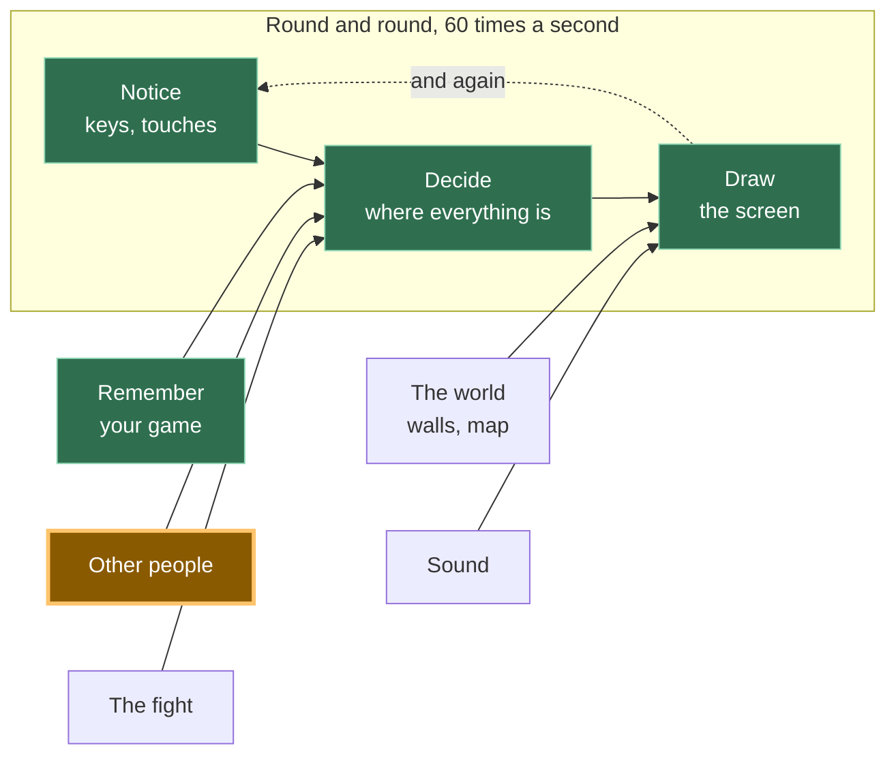

# A13: 安全に話す

他の人があなたの画面に表示されるようになったので、あなたは彼らに何かを言いたくなります。あなたは残酷に使われることのない話し方と、届いた奇妙なものをすべて捨てるチェック機能を作成します。
{: .lesson-intro }

**必要なもの:** [A12](a12.html)。**得られるもの:** タップできる6つのフレーズが、全員の画面上のあなたのマスの上に表示されます。

## ゲーム全体と今日の部分



[A12](a12.html) の後半と同じボックスです。他の人はすでに自分の位置を送信してきていますが、今度は言葉も送信してきます。

## 意図的にテキストボックスはありません

あなたのゲームには6つのボタンがあります。入力する場所はありません。これは決定事項であり、その背後にある理由がここにあります。あなたはこれに異議を唱えることができるはずだからです。

企業が運営するゲームでは、誰かが監視しています。プレイヤーが残酷な行動をとった場合、報告され、警告され、またはBANされることがあり、報告書は担当者が読みます。あなたのゲームにはサーバーがないため、何を言ったかの記録がなく、責任者もおらず、報告する相手もいません。後で何もチェックすることはできません。なぜなら「後で」がないからです — 言葉はブラウザから別のブラウザへと直接送られ、どこにもコピーは存在しません。

したがって、選択肢は次のとおりです。残酷な行為を可能にする方法を構築し、それに対処する方法がないままにするか、構築しないかです。私たちは構築しないことを選びました。*見ることができないものを管理することはできないので、管理できないものを作成してはいけません。*

6つのフレーズで一緒に遊ぶには十分です。「ついてきて」や「戦おう！」はゲームの実際の作業を行います。

### 他の人が見ることができるもの

これは重要であり、短い内容です。あなたのゲームから、他のプレイヤーが見ることができるのは次のとおりです。

- あなたが選んだ、あなたのマスに表示される名前（実名である必要はありません）
- あなたのマスがキャンバス上のどこにあるか
- あなたがタップした6つのフレーズのうちどれか

彼らはあなたの本名、居住地、学校、顔、またはあなたのコンピューター上の何も見ることはできません。あなたのゲームはそれらを要求しないため、渡すものも何もありません。

さらに2つのことをはっきりと述べます。**ここに責任者はいません。** 報告する相手がいないため、報告ボタンもありません。そして、もし誰かがあなたに不親切な態度をとった場合 — 6つの丁寧なフレーズでも、人は方法を見つけます — タブを閉じてください。何も失うものはありません。それから、信頼できる大人に話してください。それは小さくて恥ずかしいことではありません。まさに正しい行動であり、効果的です。

## ブロックに分割する

「話す」は3つのことです。

1. **選択** — 既存のフレーズの1つを選ぶ
2. **送信** — 選択したものを送信する
3. **表示** — 届いたフレーズを送信者のマスの上に、チェック後に表示する

**なぜ分割する手間をかけるのか？** もしそれが一つの塊で、うまくいかなかった場合、どの部分が間違っているのかを特定できないからです。タップしても何も起こらないのは「選択」の問題を意味します。自分のフレーズは表示されるのに相手のフレーズは表示されないのは「送信」の問題を意味します。そして**表示**が最も重要です。これは他人のコンピューターからのデータを扱う唯一のブロックであり、与えられたものを信頼してはいけない唯一のブロックだからです。これを分離しておくことで、意図的にゴミデータを送信して、それが破棄されるのを見ることでテストできます。

## ブロック1: 選択

```
const PHRASES = ["Hi!", "Nice one!", "Let's fight!", "Follow me", "Good game", "Bye"];

for (let i = 0; i < PHRASES.length; i++) {
  const button = document.createElement('button');
  button.textContent = PHRASES[i];
  button.addEventListener('click', () => say(i));
  document.querySelector('#phrases').append(button);
}
```

一つのリストから6つのボタンが作成されます。リストを変更すると、ボタンもそれに合わせて変更されます。

各ボタンは `i` を記憶しています — その**インデックス**、つまりリスト内の位置です。「"Hi!"」はインデックス0、「"Nice one!"」はインデックス1、といった具合です。1ではなく0から数える習慣は、しばらくの間は奇妙に見えるかもしれませんが、やがて気にならなくなります。

## ブロック2: 送信

```
const sendSay = (i) => room.send('say', i);

function say(i) {
  sendSay(i);
  player.said = PHRASES[i];
  player.until = performance.now() + SHOW_FOR;
}
```

**言葉ではなく、番号を送信します。** 相手のプレイヤーのゲームも同じリストを持っており、`PHRASES[2]`を自分で参照するため、`2`を送信するだけで十分です。

これはスペースを節約するためではありません。6つの短いフレーズはごくわずかです。番号は文を含むことができないからです。もし言葉がそのまま送られた場合、変更されたゲームはどんな言葉でも送信できてしまいます。番号はリストにある6つのことのいずれか一つを意味するだけであり — もしそうでなければ、ブロック3がそれを破棄します。

`until` は、このフレーズの描画を停止すべき時間です。`SHOW_FOR` は3000ミリ秒、つまり3秒です — 読むには十分な長さで、画面が古いおしゃべりでいっぱいにならない程度の短さです。

## ブロック3: 表示

```
room.onMessage('say', (i, id) => {
  if (!Number.isInteger(i) || i < 0 || i >= PHRASES.length) {
    window.dropped = (window.dropped || 0) + 1;   // so you can check it worked
    return;
  }
  others[id] = { ...others[id], said: PHRASES[i], until: performance.now() + SHOW_FOR };
});
```

チェック項目を声に出して読んでください: *届いたものが整数でない、またはゼロを下回る、またはリストの末尾を超えている場合、停止 — 何も行わない。*

`Number.isInteger` は「これは整数ですか？」と尋ねます。「"Hi!"」にはノー、`1.5`にはノー、何もなければノーと答えます。その後の2つの比較は、「この番号は、私たちが実際に持っているフレーズを指していますか？」と尋ねます。

**他のコンピューターが送信してきたものを決して信用してはいけません。** あなたのコードはあなたのマシンで実行されていますが、メッセージは他の誰かのマシンから来ており、彼らのゲームのコピーが何をするか全くわかりません。もしかしたら彼らは変更したかもしれません。もしかしたら彼らの接続が何かをかき乱したかもしれません。もしかしたら彼らは意図的に巧妙なことをしているかもしれません。チェックがなければ、`PHRASES[99]`は`undefined`となり、あなたのゲームは彼らのマスの上に「undefined」という単語を描画します。他の不正な値はさらに悪いことを引き起こします。チェックがあれば、何も起こりません — これがまさに起こるべきことです。

そして、それが属するマスの隣に描画します:

```
if (who.until > performance.now()) {
  ctx.fillStyle = '#fff';
  ctx.fillText(who.said, who.x, who.y - 20);
}
```

メッセージのリストも、スクロール履歴もありません。フレーズはマスの周りに浮かび、そして消えます。

## この方法を採用した理由

強制的な制約は、[A12](a12.html) をピアツーピアにしたのと同じものです: サーバーがないこと。サーバーがないということは、ログがなく、モデレーターがなく、禁止もなく、何も元に戻す方法がないことを意味します。他のすべての安全に関するアイデア — 失礼な言葉のフィルタリング、報告、ミュート — は誰かの監視を必要としますが、誰も監視していません。それに耐えられる唯一のアプローチは、そもそも不親切なことを表現できないようにすることです。6つのフレーズという制限を私たちは後悔していません。これは、このゲームがあなたを何から保護できるかについて正直な唯一のデザインです。

## 代わりにできたこと

| これの代わりに | 費用 |
|---|---|
| 失礼な言葉フィルター付きのテキストボックス | フィルターは簡単に回避でき、無害な言葉もブロックします。さらに悪いことに、フィルターは保護されているように見え、人々は安心します — しかし、報告する相手は依然としていません |
| 報告ボタン付きのテキストボックス | そのボタンは何も機能しません。報告を受け取るサーバーも、それを読む人もいません。嘘のボタンはボタンがないよりも悪い |
| 数字の代わりに言葉を送信する | 変更されたゲームのコピーは、あなたの画面にどんなものでも送信できるようになり、あなたの側のチェックでは違いを判別できません |
| 数字をチェックせずに信用する | 最初の奇妙なメッセージが来るまでは完璧に機能しますが、その後誰かの頭の上に「undefined」を描画したり、全員の描画ループを破壊したりします |

## プロンプト

A12はすでにネットワークライブラリを選択済みです。チャットが新機能のように聞こえるからといって、アシスタントにそれを置き換えさせないでください。

```
My canvas game already has multiplayer through KakkoiDev/p2p-core
v0.1.0. There is ONE existing room object from A12, with 'move'
registered and an `others` object of peer positions.

Keep that same p2p-core room. Do not create a second room and do not
switch to Trystero, WebRTC, PeerJS, Socket.IO, Firebase, or a server.

Add preset-phrase chat in three blocks with a comment above each:
PICK (make one button per entry in a PHRASES array of 6 strings),
SEND (register/use the message kind 'say' and send the array INDEX,
not the text, with room.send('say', i)),
SHOW (use room.onMessage('say', ...) and reject the value unless it is
a whole number inside the array, then display the phrase above that
peer's square for 3 seconds).

No text input anywhere. Plain JavaScript. Keep the existing multiplayer
connection from A12 unchanged.
```

**出力の確認:** A12の `p2p-core` ルームを1つ維持しましたか？`room.send('say', i)` と `room.onMessage('say', ...)` を使用し、別のネットワークAPIを考案しませんでしたか？とにかくテキスト入力が追加されていませんか？インデックスと文字列のどちらを送信していますか？そして、チェックは `Number.isInteger` を使用していますか、それとも `-1` や `2.5` を喜んで受け入れてしまう `i < PHRASES.length` のみを使用していますか？

## 動作を見る


2つのタブでページを開き、もう一方のマスが表示されるのを待ちます。

1. 最初のタブで**「戦おう！」**をタップします。フレーズがあなたの緑のマスの上に、そしてもう一方のタブの青いマスの上に表示されます。3秒後に両方から消えます。
2. 両方のタブでフレーズをタップします。各フレーズは、送信したマスの真上に表示され、隅には表示されません。
3. 今度は意図的に壊してみましょう。最初のタブのコンソールで、手動でゴミを送信します: `sendSay(99)`、`sendSay("Hi!")`、`sendSay(1.5)`、`sendSay(-1)`。1つはリストの末尾を超えており、1つは数字の代わりに言葉であり、1つは整数ではなく、1つは開始を下回っています。
4. 2番目のタブを見てください。何も描画されませんでした。何も変わりませんでした — 他のプレイヤーのエントリは以前と全く同じです。そのコンソールで `dropped` と入力すると `4` が表示されます: 4つすべてが到着しましたが、4つすべてが破棄されました。それからあなたのマスを動かし、フレーズをタップしてください。すべてはまだ機能しています。なぜなら、メッセージを拒否することはクラッシュすることと同じではないからです。

ステップ4はこのステップの真のテストです。何も拒否するのを見たことがないチェックは、テストされていないチェックです。

## ゲームに組み込む

[A12](a12.html) のゲームにこれら3つのブロックと、キャンバスの下に空の `<div id="phrases">` を追加してください。`others` オブジェクトは既に存在します。各エントリには `said` と `until` の2つのフィールドが追加されます。移動に関する変更はありません。

<div class="takeaways">
<h2>要点</h2>
<ul>
<li>誰も監視していない状況では、害になることを言えなくすることが唯一機能する安全性です</li>
<li>両方が持つリスト内の場所を指す番号を送信し、決して言葉そのものを送信してはいけません</li>
<li>他のコンピューターが送信してきたものを決して信用してはいけません — 常に使用する前にチェックしてください</li>
<li>他のプレイヤーは、あなたが選んだ名前、あなたのマス、そしてあなたのフレーズを見ます。あなたやあなたのコンピューターに関する情報は何も見えません</li>
<li>もし誰かが不親切な態度をとったら: 立ち去り、信頼できる大人に話してください。ここに報告する相手はいません</li>
</ul>
</div>

## あなたの番です

与えられたプロンプトでは生成されないルールを追加してください: 誰も1秒に1つ以上のフレーズを送信してはならない。誰かが「Bye」を40回連続でタップしても何も言っているわけではなく、これは6つの丁寧なフレーズでも許してしまう唯一の不親切な行為です。最後に送信したフレーズの時間を覚えておき、`say` 関数内で、それが1秒以内であった場合は早期にリターンしてください。それから、より難しい半分を決定してください: *届く*フレーズが速すぎる場合も無視すべきか、それとも自分の送信だけを制限すべきか？*成長したプログラマーはこれをレートリミットと呼ぶので、あなたもそのフレーズを知ったことになります。*
