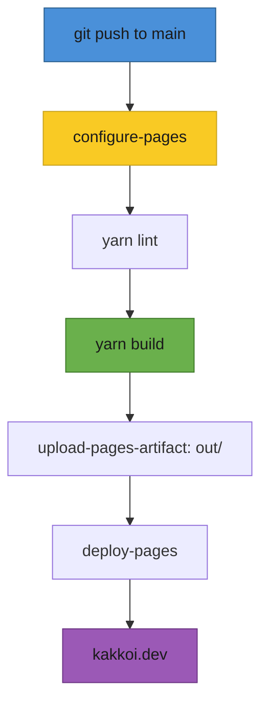
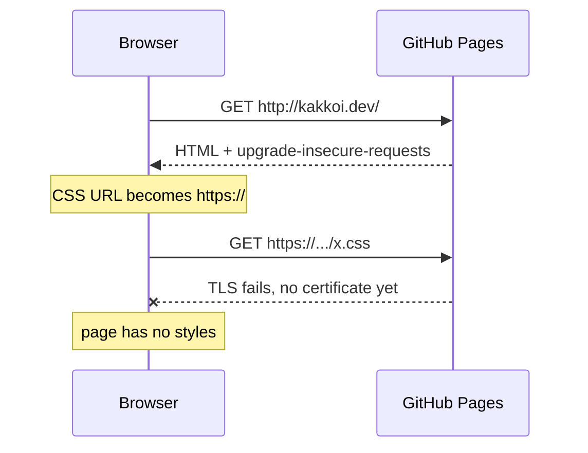
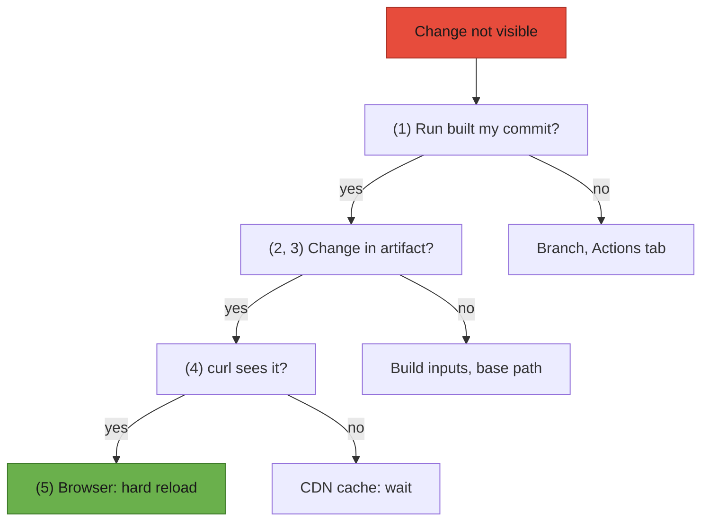

# T40: ケーススタディ - kakkoi.dev の公開

T31とT32では、紙の上でレストランを構築しました。このレッスンでは、開店初日の実際のサイトを訪れます。kakkoi.devは、KakkoiSchoolを運営するCyril Antoni (KakkoiDev) の個人サイトです。これは、英語と日本語に対応した小さなNext.jsサイトで、GitHub Pagesで無料でホストされています。そのソースコードは[github.com/KakkoiDev/website](https://github.com/KakkoiDev/website)で公開されており、以下のすべての抜粋は、そのリポジトリからの実際のコードです。最も役立つ部分は、最初からうまくいったコードではありません。「自分のマシンではビルドできる」から「ライブ公開されている」までの間に何が壊れ、それぞれがどのように発見されたかです。
{: .lesson-intro }

## サイトの概要

同じ構造を持つ2つのページ: `/`が英語、`/ja/`が日本語です。ヘッダー、CSSキューブの上で回転する名前、Cyrilが何をしているかについての2行、連絡先リンク、フッターが含まれます。データベース、ログイン、フォームはありません。重要なファイルは次のとおりです:

```
app/
  (en)/layout.tsx          root layout, <html lang="en">
  (en)/page.tsx            "/"
  (ja)/layout.tsx          root layout, <html lang="ja">
  (ja)/ja/page.tsx         "/ja/"
  global-not-found.tsx     the 404, in both languages
  sitemap.ts, robots.ts    written to files at build time
components/Home.tsx        one server component renders both pages
data/dictionary.ts         every visible string, in en and ja
lib/csp.ts                 the Content-Security-Policy
lib/metadata.ts            canonical, hreflang, Open Graph
public/CNAME               the custom domain: kakkoi.dev
.github/workflows/pages.yml  build and deploy
```

## 静的エクスポートの理由

デフォルトでは、`next build`はリクエストに応じてページをレンダリングするNode.jsサーバーを準備します。`output: "export"`を使用すると、Next.jsはすべてのサーバーコンポーネントをビルド時に一度実行し、プレーンなHTML、CSS、JSを`out/`に書き込みます。どの静的ファイルホストでもそのフォルダーを提供できます。お弁当屋さんを考えてみてください。すべてが朝に一度調理され、梱包され、一日中シェフなしで配られます。

```
// next.config.mjs
const nextConfig = {
  // Static export for GitHub Pages: `next build` writes the site to out/.
  // Pages cannot send custom headers, so the CSP lives in lib/csp.ts.
  output: "export",
  // Emit ja/index.html rather than ja.html next to a ja/ folder of RSC
  // payloads: Pages answers /ja with /ja/ and needs an index.html there.
  trailingSlash: true,
  // Where Pages serves the site: "/website" at kakkoidev.github.io/website/,
  // "" once the custom domain is set. The workflow reads it from Pages.
  basePath: process.env.PAGES_BASE_PATH ?? "",
  experimental: {
    // app/global-not-found.tsx: the 404 for an app with one root layout per language
    globalNotFound: true,
  },
};
```

個人サイトに合う理由:

- **訪問者ごとに何も変わらない。** 誰もが同じページを取得するため、すべてのリクエストでレンダリングするのは無駄な作業です。
- **パッチを適用するサーバーがない。** サイトの2026年10月の監査で、古いNext.js 14の画像オプティマイザーに公開されたリモートコード実行の脆弱性が見つかりました。HTMLファイルのフォルダーには画像オプティマイザーもAPIもないため、この種の問題全体が解消されます。
- **無料、高速ホスティング。** GitHub Pagesは、CDNからフォルダーを無料で提供します。

失うものと、kakkoi.devがそれぞれについて行ったこと:

- **APIルート (T32)** - ビルド時に一度だけ実行できる`GET`ハンドラーのみが残ります。サイトは連絡先フォームとその背後にあるメールAPIを削除しました。`sitemap.ts`と`robots.ts`は`dynamic = "force-static"`を宣言するため、プレーンなファイルになります。
- **config内の`headers()`** - 無視されます。CSPは`<meta>`タグに移動しました（下記参照）。
- **「今」計算される値** - ビルド時に固定されます。サイトはフッターの年を更新するために毎年1月1日に再ビルドされます。

最後のものは微妙です。`Home.tsx`は`new Date().getFullYear()`で年を出力します。サーバー上では、これはすべてのリクエストで実行されます。静的エクスポートでは一度だけ実行され、HTMLは次のビルドまでその番号を保持します。そのため、ワークフローもスケジュールで実行されます。

```
# .github/workflows/pages.yml
on:
  push:
    branches: [main]
  workflow_dispatch:
  # The footer year is rendered at build time; rebuild when it changes.
  schedule:
    - cron: "5 0 1 1 *"
```

`5 0 1 1 *`は、UTCの1月1日00:05です。静的サイトはライブカメラではなく写真です。自動的に変更されるべきものは、新しい写真が必要です。

## 適切な2言語対応

ほとんどのバイリンガルサイトはテキストを翻訳するだけで終わります。残りはブラウザ、スクリーンリーダー、検索エンジンが読み取るものです。kakkoi.devは4つのことを行います。

### 1. 言語ごとのルートレイアウト

ルートレイアウトは`<html>`要素をレンダリングし、`<html lang>`はページがどの言語であるかをブラウザに伝えます。スクリーンリーダーはそれから音声を選択し、ブラウザはそれからフォントを選択し（同じUnicode文字でも日本語と中国語のフォントでは異なる描画がされます）、翻訳ツールは翻訳を提供するべきかを決定します。単一の共有レイアウトでは、日本語ページに`lang="en"`が送られてしまいます。

Next.jsのルートグループがこれを解決します。括弧で囲まれたフォルダー名は、URLに表示されずにファイルを整理し、各グループは独自のルートレイアウトを持つことができます。

```
app/(en)/layout.tsx   ->  <html lang="en">  for  /
app/(ja)/layout.tsx   ->  <html lang="ja">  for  /ja/
```

```
// app/(ja)/layout.tsx
export const metadata = localeMetadata("ja");

export default function RootLayout({
  children,
}: Readonly<{
  children: React.ReactNode;
}>) {
  return (
    <html lang="ja" className={fontVariables}>
      <head>
        <meta httpEquiv="Content-Security-Policy" content={contentSecurityPolicy} />
      </head>
      <body className="font-jp">{children}</body>
    </html>
  );
}
```

代償として、2つのルートレイアウトがあるため、存在しないURLは、それがどの言語であるかを示すものがないため、レンダリングするレイアウトがありません。`app/global-not-found.tsx`（上記のconfigの`experimental.globalNotFound`によって有効化される）は独自の`<html>`をレンダリングし、両方の言語を話します。ページ内の混合言語テキストも独自の`lang`を持ちます。日本語ページでは、日本語の名前の下にラテン文字の名前を`lang={other}`とマークされた要素で表示します。

### 2. 辞書内のすべての文字列

コンポーネントには文は含まれていません。表示されるすべてのものは、1つの型付きファイルにあります。

```
// data/dictionary.ts
type Dictionary = {
  meta: { title: string; description: string };
  nav: { logo: string; switchLabel: string; switchHref: string };
  hero: { name: string; altName: string; title: Phrases };
  about: { heading: string; items: Phrases[] };
  contact: { heading: string };
  footer: (year: number) => string;
};

const en: Dictionary = {
  // ...
  nav: { logo: "KakkoiDev", switchLabel: "日本語", switchHref: "/ja/" },
  hero: {
    name: "Cyril Antoni",
    altName: "キリル アントニ",
    title: "Software engineer · AI",
  },
  // ...
  footer: (year) => `© ${year} Cyril Antoni`,
};

export const dictionary: Record<Locale, Dictionary> = { en, ja };
```

`en`と`ja`の両方が同じ`Dictionary`型を満たす必要があるため、英語で追加されて日本語で忘れられた文字列は、訪問者が見つけるバグではなく、ビルド時のTypeScriptエラーになります。`footer`は関数なので、各言語はその文法が望む場所に年を配置できます。名前の順序もここにあります。英語の文脈では名姓順 (Cyril Antoni)、日本語の文脈では姓名字順 (アントニ キリル) です。

### 3. hreflang と canonical

検索エンジンは、同じコンテンツを異なる言語で表示する2つのページを認識します。`canonical`は「このURLがこのページのオリジナルである」と述べ、`hreflang`の代替は「ここに他の言語の同じページがある」と述べ、それらがどのように関連しているかを説明する2種類のタグがあります。サイトは両方を1つの関数から構築します。

```
// lib/metadata.ts
const SITE_URL = "https://kakkoi.dev";
const PATHS: Record<Locale, string> = { en: "/", ja: "/ja/" };

export function localeMetadata(locale: Locale): Metadata {
  // ...
  return {
    metadataBase: new URL(SITE_URL),
    title,
    description,
    alternates: {
      canonical: PATHS[locale],
      languages: { en: PATHS.en, ja: PATHS.ja, "x-default": PATHS.en },
    },
    // ...Open Graph and Twitter cards
  };
}
```

ビルドされた`out/ja/index.html`に何が書き込まれるか:

```
<link rel="canonical" href="https://kakkoi.dev/ja/"/>
<link rel="alternate" hrefLang="en" href="https://kakkoi.dev/"/>
<link rel="alternate" hrefLang="ja" href="https://kakkoi.dev/ja/"/>
<link rel="alternate" hrefLang="x-default" href="https://kakkoi.dev/"/>
```

`x-default`は、その他のすべての人向けのページです。言語がどちらでもない訪問者は英語のページが表示されます。サイトマップ（`app/sitemap.ts`）も同じペアを繰り返し、言語切り替えリンクには`lang`と`hrefLang`が付いているため、スクリーンリーダーは「日本語」を日本語の音声で発音します。

### 4. 両言語に1つのタイプスケール

最初のバージョンでは、`/ja`が主にスマートフォンで開かれるため、日本語には独自の、より引き締まったサイズを与えていました。しかし、公開後、オーナーは1つのスケールを選択しました。つまり、すべての要素が両方の言語で同じサイズと間隔になります。コードは「同じ」をデフォルトとし、違いを明示的にします。

```
// components/Home.tsx
const shared = {
  header: "h-16",
  hero: "pt-[128px] pb-[136px] gap-10",
  title: "text-[16px] font-medium",
  section: "py-9",
  items: "gap-[18px]",
  // ...
};

const styles = {
  en: {
    ...shared,
    name: "font-display font-normal text-[clamp(56px,9vw,80px)] leading-[0.9] tracking-[0.01em]",
    h2: "mb-4 font-display font-normal text-[28px] tracking-[0.02em]",
    item: "text-[20px] font-semibold leading-[1.4]",
  },
  ja: {
    ...shared,
    name: "font-jp font-bold text-[clamp(34px,5vw,44px)] leading-[1.25] tracking-[0.06em]",
    h2: "mb-4 font-jp font-bold text-[20px]",
    item: "text-[20px] font-bold leading-[1.6]",
  },
};
```

`shared`から広がるすべてのものは同じです。言語ごとに残るのはフォントとそれに依存するものだけです。凝縮されたBebas Neueは、同じサイズとして認識されるためにNoto Sans JPよりも多くのピクセルを必要とし、Bebas Neueには日本語のグリフは全くありません。レビュアーは、両方のページ間のすべての違いをわずか十数行で確認できます。

## 日本語の句読点による改行

英語はスペースで改行します。日本語にはスペースがないため、ブラウザはほぼ任意の2文字間で改行する可能性があります。17文字分のスペースがある場合、「人が問題をもっとうまく解決できるよう手助けします。」という文は次のように折り返す可能性があります。

```
人が問題をもっとうまく解決できるよ
う手助けします。
```

「う」が句から切り離され、2行目に単独で始まっています。日本語の読者は、ハイフンなしで単語が半分に分割されたのを見るように、これを目にします。修正はデータにあります。

```
// data/dictionary.ts
// Japanese text is split into phrases. Each phrase renders as an inline-block,
// so a line only breaks between phrases and never strands a lone character.
export type Phrases = string | string[];

  about: {
    heading: "できること",
    items: [
      ["問題を解決します。"],
      ["人が問題を", "もっとうまく", "解決できるよう", "手助けします。"],
    ],
  },
```

```
// components/Home.tsx
function Text({ phrases }: { phrases: Phrases }) {
  if (typeof phrases === "string") return phrases;
  return phrases.map((phrase) => (
    <span key={phrase} className="ph">
      {phrase}
    </span>
  ));
}
```

```
/* app/globals.css */
/* A Japanese phrase that must not be split across lines. */
.ph {
  display: inline-block;
}
```

インラインブロックは1つのボックスとしてレイアウトされるため、ブラウザはボックス間でのみ折り返すことができます。同じ文は次のように折り返されます。

```
人が問題をもっとうまく
解決できるよう手助けします。
```

英語の文字列はプレーンな文字列のままで、通常通り折り返されます。2つの注意点があります。画面よりも広い句は、折り返さずに溢れてしまうため、句を短く保つ必要があります。また、ネイティブスピーカーが一時停止する場所、通常は「が」や「を」などの助詞の後で分割してください。ブラウザはこれを独自に行い始めていますが（Chromiumの`word-break: auto-phrase`など）、まだサポートは普遍的ではなく、スパンはどこでも機能します。

## GitHub Actions を使用した GitHub Pages へのデプロイ

Pagesはブランチをそのまま公開するか、サイトをビルドして結果をアップロードするワークフローを実行できます。kakkoi.devはワークフローを使用しているため (Settings > Pages > Source: GitHub Actions)、`out/`はコミットされません。



```
# .github/workflows/pages.yml (the "on:" block is shown above)
permissions:
  contents: read
  pages: write
  id-token: write

# One deployment at a time; let an in-progress one finish.
concurrency:
  group: pages
  cancel-in-progress: false

jobs:
  build:
    runs-on: ubuntu-latest
    steps:
      - uses: actions/checkout@v7
      - uses: actions/setup-node@v7
        with:
          node-version: 22
          cache: yarn
      # Reports where Pages serves the site, so the build can prefix its paths.
      - id: pages
        uses: actions/configure-pages@v6
      - run: yarn install --frozen-lockfile
      - run: yarn lint
      - run: yarn build
        env:
          PAGES_BASE_PATH: ${{ steps.pages.outputs.base_path }}
      - uses: actions/upload-pages-artifact@v5
        with:
          path: out

  deploy:
    needs: build
    runs-on: ubuntu-latest
    environment:
      name: github-pages
      url: ${{ steps.deployment.outputs.page_url }}
    steps:
      - id: deployment
        uses: actions/deploy-pages@v5
```

`id-token: write`により、`deploy-pages`は保存されたシークレットではなく、短期的なトークンで自身の認証を行うことができます。`yarn lint`はビルド前に実行されるため、Lintエラーが発生するとデプロイが停止し、そのまま公開されるのを防ぎます。

### ベースパスの罠

リポジトリのPagesサイトは2種類のいずれかのアドレスで公開され、同じビルドで両方を提供することはできません。

- **プロジェクトサイト:** `kakkoidev.github.io/website/` - サイトはホストのサブフォルダーにあります。
- **カスタムドメイン:** `kakkoi.dev/` - サイトはホスト全体です。

Next.jsはホストのルートからのパスを書き込みます。ビルドされた`index.html`からの実際の行:

```
<link rel="stylesheet" href="/_next/static/chunks/3suzm1vgxclso.css" data-precedence="next"/>
```

`kakkoidev.github.io/website/`では、先頭の`/`は`kakkoidev.github.io/_next/...`を意味し、これはプロジェクトの外部です。CSSは404を返し、ページはスタイルなしのテキストとしてレンダリングされ、`/ja/`への言語切り替えは存在しないページに到達します。

解決策は`basePath`です。`actions/configure-pages`はPagesがサイトを提供する場所を`base_path`として報告します。プロジェクトサイトの場合は`/website`、カスタムドメインが設定されると空になります。ワークフローはそれを`PAGES_BASE_PATH`としてビルドに渡し、`next.config.mjs`がそれを読み取り、Next.jsは書き込むすべてのパスにプレフィックスを付けます（`/website/_next/static/...`）。同じコードが両方のアドレスで機能するようになりました。同じ変更から2つのフォローアップ:

- `basePath`はNext.jsが構築するリンクのみに適用されます。プレーンな`<a href="/ja/">`はそのまま書き込まれますが、`next/link`からの`<Link>`はプレフィックスを受け取ります。

```
{/* Link, not <a>, so the href picks up the base path. */}
<Link href={t.nav.switchHref} lang={other} hrefLang={other} className={...}>
  {t.nav.switchLabel}
</Link>
```

- `public/`内のファイルはそのままコピーされるため、`/jp`リダイレクト（言語コードではなく国コードを入力する人のため）は、どちらのアドレスでも機能する相対URLを使用します。

```
<!-- public/jp/index.html -->
<meta name="robots" content="noindex">
<link rel="canonical" href="https://kakkoi.dev/ja/">
<meta http-equiv="refresh" content="0; url=../ja/">
```

そして罠の中の罠：ベースパスはビルド時に焼き付けられます。カスタムドメインが有効になった後、ワークフローが再度実行されるまで、ライブファイルにはまだ`/website/`と表示されます。リポジトリのREADMEには、ドメインを変更したらワークフローを再実行するように1行で記載されています。

### trailingSlash: /ja にフォルダーが必要な理由

`trailingSlash`がない場合、エクスポートはペイロードファイルの`ja/`フォルダーの隣に`ja.html`を書き込みます。Pagesは`/ja`に`/ja/`で応答し、次に`ja/index.html`を探しますが、それはそこにありません。`trailingSlash: true`の場合、すべてのページは内部に`index.html`を持つフォルダーになります。

```
out/
  index.html
  ja/index.html
  ja/index.txt, ja/__next._tree.txt, ...   (payloads for client navigation)
  jp/index.html                            (the redirect from public/)
  404.html
  CNAME, robots.txt, sitemap.xml
```

これは通常よりも重要でした。Cyrilの印刷された名刺のQRコードは、スラッシュなしの`https://kakkoi.dev/ja`を開きます。印刷されたURLは後で修正できないため、サーバー側でそれを受け入れる必要がありました。

## サーバーヘッダーなしのCSP

Content-Security-Policyは、ページがスクリプト、スタイル、画像、フォントをどのオリジンからロードできるかをブラウザに伝えます。他の場所から注入されたものはすべて拒否されます。通常はHTTP応答ヘッダーであり、Pagesに移行する前は、サイトは`next.config.mjs`の`headers()`からそれを送信していました。Pagesでは応答ヘッダーを設定できないため、ポリシーは各ルートレイアウトによって`<head>`内でレンダリングされる`<meta http-equiv>`タグとして出荷されます（上記参照）。

```
// lib/csp.ts
const isDev = process.env.NODE_ENV !== "production";

// GitHub Pages cannot send custom response headers, so the policy ships as a
// <meta http-equiv> tag in each root layout. A meta policy cannot carry
// frame-ancestors; everything else applies as it would from a header. There is
// no upgrade-insecure-requests: Pages' Enforce HTTPS already serves everything
// over HTTPS, and before its certificate exists the directive breaks every
// asset of a page opened over http.
// Next.js inlines its bootstrap scripts, hence 'unsafe-inline'. Fonts are
// self-hosted by next/font, so nothing loads from another origin.
export const contentSecurityPolicy = [
  "default-src 'self'",
  `script-src 'self' 'unsafe-inline'${isDev ? " 'unsafe-eval'" : ""}`,
  "style-src 'self' 'unsafe-inline'",
  "img-src 'self' data:",
  "font-src 'self'",
  `connect-src 'self'${isDev ? " ws:" : ""}`,
  "object-src 'none'",
  "base-uri 'self'",
  "form-action 'self'",
].join("; ");
```

メタバージョンの制限を知っておきましょう。

- **一部のディレクティブは無視される。** `frame-ancestors`（他のサイトがあなたのサイトをフレームに表示するのを防ぐ）、`report-uri`、`sandbox`はヘッダーとしてのみ機能します。
- **それ以降のもののみをカバーする。** メタポリシーは、ブラウザがそれを読み取った時点から適用されます。kakkoi.devの構築されたHTMLでは、Next.jsはCSPタグの上に独自のスタイルシートとスクリプトタグを配置するため、これらはポリシーが存在する前にフェッチされます。これらは訪問者からではなくビルドから来るため、リスクは小さいですが、ヘッダーが利用できる場合はヘッダーの方が強力であるというもう1つの理由です。
- **`'unsafe-inline'`は静的の代償。** Next.jsは小さなブートストラップスクリプトをインライン化します。より厳密な代替策であるノンスは、リクエストごとに新しいランダムな値であり、サーバーが必要です。

### upgrade-insecure-requests が CSS を壊した理由

最初のPagesデプロイには、プロダクションで`upgrade-insecure-requests`が含まれていました。このディレクティブはブラウザに、このページが読み込むすべての`http://` URLを`https://`に書き換えるように指示します。常にHTTPSを使用するサイトでは、無害なセーフティネットです。

しかし、カスタムドメインをPagesにポイントした後、Pagesがそれに対するHTTPS証明書を発行するまでの期間があります。その期間中は`http://kakkoi.dev`のみが機能します。



ページはロードされましたが、すべてのスタイルシートが失敗しました。修正策（プルリクエスト #6）は、ディレクティブを削除することでした。HTTPSが機能し始めると、何も追加されません。なぜなら、「HTTPSを強制する」がオンの場合、Pages自体がすべての`http://`リクエストを`https://`にリダイレクトするからです。`lib/csp.ts`のコメントにはその理由が記録されているため、誰も「改善」としてそれを元に戻すことはありません。一般的な教訓: セキュリティ設定はインフラストラクチャの状態に依存する場合があります。最初のデプロイは、`https://`だけでなく、プレーンな`http://`でも開いてみてください。

## 古いデプロイのデバッグ

「プッシュした、実行は成功した、でもサイトはまだ古いバージョンを表示している。」推測してはいけません。自分のコミットから外側に向かって作業し、次のレイヤーに進む前に各レイヤーを証明してください。



**1. どのコミットがビルドされたか？** 実行のコミットと自分のコミットを比較します。

```
git rev-parse HEAD
gh run list --workflow=pages.yml --limit 3 --json headSha,conclusion,createdAt
```

**2. ビルドは何を認識したか？** ログには各ステップの環境が出力されるため、ベースパスは推測ではなく事実です。カスタムドメインの場合、空の値が正しいです。ドメイン設定後に`/website`と表示される場合、ビルドが切り替えよりも前のものだったことを意味します。

```
gh run view <run-id> --log | grep "PAGES_BASE_PATH"
```

**3. 何がアップロードされたか？** デプロイされたファイルは、実行の`github-pages`アーティファクトとして保持されます。それをダウンロードして検索します。

```
gh run download <run-id> --name github-pages --dir built
tar -xf built/artifact.tar -C built
grep -o 'href="[^"]*_next/static[^"]*\.css"' built/index.html
```

**4. CDNは何を提供しているか？** `curl`はブラウザのキャッシュを完全にスキップします。

```
curl -sI https://kakkoi.dev/ | grep -iE "^(cache-control|age|last-modified):"
curl -s "https://kakkoi.dev/ja/?v=$(date +%s)" | grep -c "upgrade-insecure-requests"
```

PagesはCDNとブラウザにページを数分間保持させる（執筆時点では`cache-control: max-age=600`）ことがあり、`age`は取得したコピーがキャッシュされてからの時間を示します。未見のクエリ文字列は通常、新しいコピーをフェッチします。2番目のコマンドは、修正がライブであることを証明する方法です。`0`は、デプロイされたCSPにディレクティブがなくなったことを意味します。

**5. その後でようやくブラウザ。** `_next/static/`以下のファイル名にはそのコンテンツのハッシュ（`3suzm1vgxclso.css`）が含まれているため、すべてのデプロイで新しい名前が出荷され、古いファイルはなくなります。デプロイ前にブラウザがキャッシュしていたHTMLページは依然として古い名前を指しているため、壊れたビルドと全く同じように見えるスタイルなしのページが数分間表示されます。ハードリロード、または「キャッシュを無効にする」にチェックを入れたDevToolsで解決します。

ビルド時の値も覚えておいてください。ベースパスとフッターの年は、ビルドが実行されたときにのみ変更されます。先週の成功した実行は、今日変更したことの証拠にはなりません。

<div class="takeaways">
<h2>主なポイント</h2>
<ul>
<li>静的エクスポートはビルド時にサーバーコンポーネントを一度実行します。訪問者ごとに何も変わらない場合や、パッチを適用するサーバーがない場合に最適ですが、「今」の値は次のビルドまで固定されます。</li>
<li>言語ごとのルートレイアウト（ルートグループ）により、各ページに適切な&lt;html lang&gt;が付与され、型付き辞書により翻訳漏れがビルドエラーになります。</li>
<li>canonicalとhreflangの代替（x-defaultを含む）は、検索エンジンにページが互いの翻訳であることを伝えます。</li>
<li>日本語は任意の2文字間で改行できますが、display: inline-blockを使用した句のスパンは、句間でのみ改行を可能にします。</li>
<li>GitHub Pagesでは、configure-pagesのbase_pathをbasePathに渡し、内部リンクにはnext/linkを使用し、/jaがja/index.htmlを提供するようにtrailingSlashを有効にします。</li>
<li>サーバーヘッダーがない場合、CSPをメタタグとして出力し、それがカバーできないことと、HTTPSが存在する前にすべての資産を壊すupgrade-insecure-requestsは含めないようにします。</li>
<li>古いデプロイのデバッグはレイヤーごとに実行します: コミット、ビルドログ、アーティファクト、curl、そして最後にブラウザ。</li>
</ul>
</div>

## 演習: 独自の2言語ページをデプロイする

英語と選択した第2言語（以下`xx`）で2ページのサイトを構築し、`<your-user>.github.io/<repo>/`にデプロイします。

1. `npx create-next-app@latest`でアプリを作成します。`next.config.mjs`で`output: "export"`、`trailingSlash: true`、`basePath: process.env.PAGES_BASE_PATH ?? ""`を設定します。
2. `app/layout.tsx`を削除します。`app/(en)/layout.tsx`と`app/(xx)/layout.tsx`をそれぞれ作成し、独自の`<html lang>`を返すようにします。ホームページを`app/(en)/page.tsx`と`app/(xx)/xx/page.tsx`に移動します。表示されるすべての文字列を1つの型付き辞書に入れます。
3. 両方のレイアウトに`alternates`メタデータを与えます: canonical URLと`en`、`xx`、`x-default`を含む`languages`です。
4. 上記のワークフローをコピーし、Settings > Pages > SourceをGitHub Actionsに設定してプッシュします。
5. 意図的に壊してみます: `yarn build`の下の2つの`env:`行を削除し、プッシュしてサイトを開きます。DevTools > Networkで、失敗したCSSリクエストを見つけて、試行されたURLを書き留めます。実行ログで`PAGES_BASE_PATH`を見つけます。行を元に戻して修正を確認します。
6. `lib/csp.ts`のようなメタCSPを追加し、他のウェブサイトから``を追加して、コンソールに表示される違反を読み取ります。

両方のページがプロジェクトURLでスタイル付きでロードされ、ソースを表示すると各ページに正しい`<html lang>`と3つの`<link rel="alternate">`タグが表示され、Actionsログからライブビルドがどのベースパスを使用したかを確認できるようになったら完了です。
