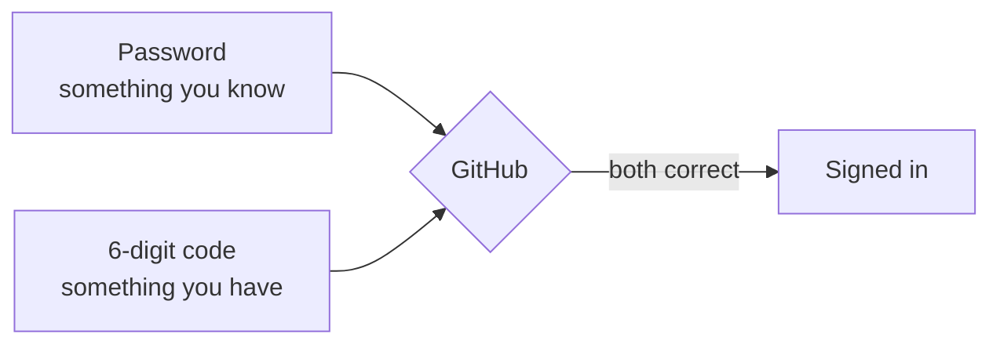

# T41: GitHubアカウント

GitとGitHubは同じものではありません。Gitはあなたの机の上に置いておくノートのようなもので、行った変更をすべて記録し、インターネットなしで動作します。GitHubは、そのノートのコピーを保管し、共有し、他の人と共同で作業できる、町中にある図書館のようなものです。このレッスンでは、その図書館の利用カードを手に入れます。所要時間は約15分で、一度だけ行えば済みます。
{: .lesson-intro }

## GitとGitHubを一行で説明

**Git**はあなたのコンピューター上のプログラムです（[T19](t19.html)）。**GitHub**は、Gitプロジェクトをオンラインで保存する会社が所有するウェブサイトです（[T20](t20.html)）。GitHubなしでGitを使うことはできます。GitなしでGitHubを使うことは実質的にできません。

| | Git | GitHub |
|---|---|---|
| 動作場所 | あなたのコンピューター | ウェブサイト (github.com) |
| インターネット必要 | いいえ | はい |
| 役割 | 履歴を記録 | その履歴を保存・共有 |
| 費用 | 無料 | 学習には無料プランで十分 |

## ステップバイステップのサインアップ

1. [github.com](https://github.com)にアクセスし、「**Sign up**」をクリックします。
2. **メールアドレス**を入力します。5年後も使い続けているであろうアドレスを使用し、消滅する可能性のある学校のアドレスは避けてください。
3. **パスワード**を選択します。パスワードマネージャーをお持ちの場合は使用してください。他のサイトで使い回しているパスワードは使用しないでください。
4. **ユーザー名**を選択します。選択する前に次のセクションを読んでください。
5. GitHubは、あなたが人間であることを証明するために小さなパズルを解くように求める場合があります。その後、あなたのメールアドレスにコードが送信されます。そのコードをページに入力します。
6. プランについて尋ねられたら、「**Free**」プランを選択してください。これには無制限の公開および非公開リポジトリが含まれており、ここでの学習に必要なすべてが提供されます。

## ユーザー名の選択

あなたのユーザー名は単なるログイン名ではありません。あなたの作品へのすべてのリンクに表示されます。

```
https://github.com/your-username
https://github.com/your-username/my-first-site
https://your-username.github.io
```

これはあなたの店の看板に掲げられた名前であり、将来の雇用主も目にすることになります。

- **短く、発音しやすいもの。** `aiko-tanaka`や`atanaka`は`xX_aiko_gamer_2009_Xx`よりも優れています。
- **あなたの本名、または履歴書に記載しても問題ない安定したニックネーム。**
- **文字、数字、単一のハイフンのみ。** GitHubはスペースやアンダースコアを許可していません。
- **生年月日や、後で後悔するようなジョークは避けること。**

後で「**Settings**」で変更できますが、古いリンクは機能しなくなるため、今しっかり選ぶことをお勧めします。

## メールアドレスの確認

GitHubはリンクまたはコードが記載されたメールを送信します。それを開いて確認してください。確認済みのメールアドレスは、より多くの機能のロックを解除し、パスワードを忘れた場合にGitHubがあなたを助ける方法となります。何も届かない場合は、迷惑メールフォルダを確認し、その後、プロフィール画像をクリックし、「**Settings**」、「**Emails**」に進み、あなたのメールアドレスの下にある「**Resend verification email**」をクリックしてください。

## 二段階認証を有効にする

パスワードは一つの鍵です。**二段階認証**（2FA）は2つ目の鍵を追加します。サインインするには、パスワード*と*携帯電話からの6桁のコードが必要です。パスワードを盗んだ泥棒でも、侵入することはできません。

あなたのアカウントは、あなたのコードと、コンピューターが変更をプッシュするためのキーを保持します。GitHubはコードに貢献するすべての人に2FAを要求しているため、今すぐ有効にしてください。

1. 携帯電話に**認証アプリ**をインストールします。無料で利用できる良い選択肢としては、Google Authenticator、Microsoft Authenticator、2FAS、またはパスワードマネージャーに組み込まれているものがあります。
2. GitHubで、プロフィール画像（右上）をクリックし、「**Settings**」を選択します。
3. 左側のサイドバーで、「**Password and authentication**」をクリックします。
4. 「**Enable two-factor authentication**」をクリックします。
5. GitHubにQRコードが表示されます。認証アプリを開き、アカウントを追加してスキャンします。
6. アプリに表示される6桁のコードをGitHubに入力します。



## リカバリーコードの保存

セットアップ中に、GitHubは**リカバリーコード**のリストを表示します。それぞれが、携帯電話を紛失した場合に一度だけ使用できるスペアキーです。**これは人々がスキップして後悔するステップです。** 携帯電話を紛失し、リカバリーコードがない場合、アカウントを完全に失う可能性があります。

- 「**Download**」をクリックし、ファイルを安全な場所に保管してください。パスワードマネージャーが理想的です。
- または印刷して、重要な書類と一緒に保管してください。
- 認証アプリと同じ携帯電話だけに保管しないでください。

## プロフィールの基本設定

あなたのプロフィールページは`github.com/your-username`です。これは人々が最初に目にするものです。あなたの画像をクリックし、「**Your profile**」、そして「**Edit profile**」をクリックします。

- **名前**: あなたの本名、または仕事で使う名前。
- **自己紹介**: 一行で。「ウェブ開発を学習中。小さなゲームを作っています。」といった内容が最適です。
- **写真**: 明瞭な顔写真またはシンプルなロゴ。オプションです。
- **場所**と**リンク**: 公開しても問題ない情報のみ。

## 公開と非公開

すべてのリポジトリ（GitHub上のプロジェクトフォルダ）は、公開または非公開のいずれかです。

- **公開**: インターネット上の誰でも、すべてのファイルとすべての古いバージョンを読み取ることができます。検索エンジンや自動ボットも、多くの場合数分以内に読み取ります。学習プロジェクトや見せたいものに適しています。
- **非公開**: あなたと、あなたが招待した人だけが見ることができます。未完成の作業や個人的なものに適しています。

公開はポートフォリオを構築する方法ですが、「新聞に印刷され、永遠に残るもの」として扱ってください。パスワード、キー、または他人の個人データを公開リポジトリに決して置かないでください。[T43](t43.html)では、秘密情報を除外する方法を説明しています。

<div class="takeaways">
<h2>要点</h2>
<ul>
<li>Gitはあなたのコンピューター上のプログラムです。GitHubはGitプロジェクトを保存し共有するウェブサイトです。</li>
<li>ユーザー名はあなたの作品へのすべてのリンクに表示されます。履歴書に記載しても良いものを選びましょう。</li>
<li>メールアドレスを確認しないと、一部の機能がロックされたままになります。</li>
<li>認証アプリで二段階認証を有効にし、リカバリーコードは携帯電話以外の場所に保管してください。</li>
<li>公開とは、ボットを含む誰でもすべてを永遠に読み取れることを意味します。非公開とは、あなたが招待した人だけが見られることを意味します。</li>
</ul>
</div>
