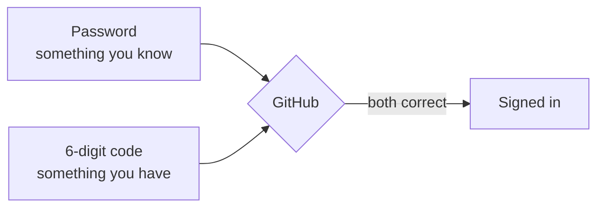

# T41: Your GitHub Account

Git and GitHub are not the same thing. Git is a notebook you keep on your own desk: it records every change you make, and it works without the internet. GitHub is a library across town where you can keep a copy of that notebook, share it, and work on it with other people. This lesson gets you a library card. It takes about fifteen minutes, and you only do it once.
{: .lesson-intro }

## Git vs GitHub in One Line

**Git** is a program on your computer ([T19](t19.html)). **GitHub** is a website owned by a company that stores git projects online ([T20](t20.html)). You can use git without GitHub. You cannot really use GitHub without git.

| | Git | GitHub |
|---|---|---|
| Where it runs | Your computer | A website (github.com) |
| Needs internet | No | Yes |
| What it does | Records history | Stores and shares that history |
| Cost | Free | Free plan is enough for learning |

## Sign Up, Step by Step

1. Go to [github.com](https://github.com) and click **Sign up**.
2. Type your **email**. Use one you will still have in five years, not a school address that will disappear.
3. Choose a **password**. Use a password manager if you have one. Do not reuse a password from another site.
4. Choose a **username**. Read the next section before you pick.
5. GitHub may ask you to solve a small puzzle to prove you are human. Then it sends a code to your email. Type that code into the page.
6. If it asks about plans, stay on the **Free** plan. It gives you unlimited public and private repositories, which is everything you need here.

## Choosing a Username

Your username is not just a login. It appears in every link to your work:

```
https://github.com/your-username
https://github.com/your-username/my-first-site
https://your-username.github.io
```

It is the name on your shop sign, and a future employer will read it:

- **Short and easy to say.** `aiko-tanaka` or `atanaka` beats `xX_aiko_gamer_2009_Xx`.
- **Your real name, or a stable nickname** you are happy to put on a CV.
- **Letters, numbers and single hyphens only.** GitHub does not allow spaces or underscores.
- **No year of birth, no jokes you will regret.**

You can change it later in **Settings**, but old links stop working, so it is better to choose well now.

## Verify Your Email

GitHub sends you an email with a link or a code. Open it and confirm. A verified email unlocks more features, and it is how GitHub helps you if you ever forget your password. If nothing arrives, check your spam folder, then click your profile picture, **Settings**, **Emails**, and **Resend verification email** under your address.

## Turn On Two-Factor Authentication

A password is one lock. **Two-factor authentication** (2FA) adds a second lock: to sign in, you need your password *and* a six-digit code from your phone. A thief who steals your password still cannot get in.

Your account will hold your code and the keys that let your computer push changes. GitHub also requires 2FA for anyone who contributes code, so turn it on now.

1. Install an **authenticator app** on your phone. Good free options: Google Authenticator, Microsoft Authenticator, 2FAS, or the one built into your password manager.
2. On GitHub, click your profile picture (top right), then **Settings**.
3. In the left sidebar, click **Password and authentication**.
4. Click **Enable two-factor authentication**.
5. GitHub shows a QR code. Open your authenticator app, add an account, and scan it.
6. Type the six-digit code the app shows into GitHub.



## Save Your Recovery Codes

During setup, GitHub shows a list of **recovery codes**. Each one is a spare key you can use once if you lose your phone. **This is the step people skip and regret.** If you lose your phone and have no recovery codes, you can lose the account for good.

- Click **Download** and keep the file somewhere safe: a password manager is ideal.
- Or print them and keep the paper with your important documents.
- Do not keep them only on the same phone as your authenticator app.

## Your Profile Basics

Your profile page is `github.com/your-username`. It is the first thing people see. Click your picture, then **Your profile**, then **Edit profile**:

- **Name**: your real name, or the name you use professionally.
- **Bio**: one line. "Learning web development. Building small games." is perfect.
- **Picture**: a clear face or a simple logo. Optional.
- **Location** and **links**: only what you are comfortable sharing publicly.

## Public vs Private

Every repository (a project folder on GitHub) is either public or private.

- **Public**: anyone on the internet can read every file and every old version. Search engines and automated bots read it too, often within minutes. Good for learning projects and anything you want to show.
- **Private**: only you and the people you invite can see it. Good for unfinished work or anything personal.

Public is how you build a portfolio, but treat it as "printed in a newspaper, forever". Never put passwords, keys, or other people's personal data in a public repository. [T43](t43.html) shows you how to keep secrets out.

<div class="takeaways">
<h2>Key Takeaways</h2>
<ul>
<li>Git is the program on your computer. GitHub is the website that stores and shares git projects</li>
<li>Your username appears in every link to your work. Pick one you would put on a CV</li>
<li>Verify your email, or some features stay locked</li>
<li>Turn on two-factor authentication with an authenticator app, and store the recovery codes somewhere other than your phone</li>
<li>Public means anyone, including bots, can read everything, forever. Private means only people you invite</li>
</ul>
</div>
