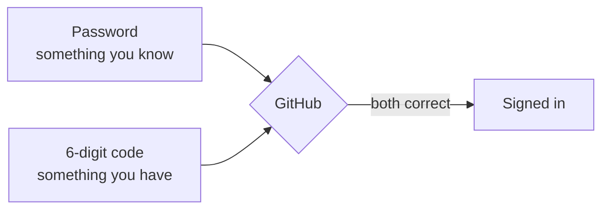

# T41: Sua Conta GitHub

Git e GitHub não são a mesma coisa. Git é um caderno que você mantém em sua própria mesa: ele registra cada mudança que você faz e funciona sem a internet. GitHub é uma biblioteca na cidade onde você pode guardar uma cópia desse caderno, compartilhá-lo e trabalhar nele com outras pessoas. Esta lição lhe dará um cartão de biblioteca. Leva cerca de quinze minutos, e você só faz isso uma vez.
{: .lesson-intro }

## Git vs GitHub em Uma Linha

**Git** é um programa no seu computador ([T19](t19.html)). **GitHub** é um site pertencente a uma empresa que armazena projetos git online ([T20](t20.html)). Você pode usar git sem GitHub. Você não consegue realmente usar GitHub sem git.

| | Git | GitHub |
|---|---|---|
| Onde roda | Seu computador | Um site (github.com) |
| Precisa de internet | Não | Sim |
| O que faz | Registra histórico | Armazena e compartilha esse histórico |
| Custo | Gratuito | Plano gratuito é suficiente para aprender |

## Cadastre-se, Passo a Passo

1. Vá para [github.com](https://github.com) e clique em **Sign up** (Cadastrar-se).
2. Digite seu **email**. Use um que você ainda terá daqui a cinco anos, não um endereço de escola que desaparecerá.
3. Escolha uma **senha**. Use um gerenciador de senhas se tiver um. Não reutilize uma senha de outro site.
4. Escolha um **nome de usuário**. Leia a próxima seção antes de escolher.
5. O GitHub pode pedir para você resolver um pequeno quebra-cabeça para provar que é humano. Em seguida, ele enviará um código para seu e-mail. Digite esse código na página.
6. Se perguntar sobre planos, permaneça no plano **Grátis**. Ele oferece repositórios públicos e privados ilimitados, que é tudo o que você precisa aqui.

## Escolhendo um Nome de Usuário

Seu nome de usuário não é apenas um login. Ele aparece em todos os links para o seu trabalho:

```
https://github.com/your-username
https://github.com/your-username/my-first-site
https://your-username.github.io
```

É o nome na sua placa de loja, e um futuro empregador o lerá:

- **Curto e fácil de dizer.** `aiko-tanaka` ou `atanaka` é melhor que `xX_aiko_gamer_2009_Xx`.
- **Seu nome real, ou um apelido estável** que você se sinta confortável em colocar em um currículo.
- **Apenas letras, números e hífens simples.** O GitHub não permite espaços ou sublinhados.
- **Sem ano de nascimento, sem piadas das quais você se arrependerá.**

Você pode alterá-lo depois em **Settings** (Configurações), mas os links antigos param de funcionar, então é melhor escolher bem agora.

## Verifique Seu Email

O GitHub envia um e-mail com um link ou um código. Abra-o e confirme. Um e-mail verificado desbloqueia mais recursos e é assim que o GitHub o ajuda se você esquecer sua senha. Se nada chegar, verifique sua pasta de spam, então clique na sua foto de perfil, **Settings** (Configurações), **Emails** (E-mails) e **Resend verification email** (Reenviar e-mail de verificação) abaixo do seu endereço.

## Ative a Autenticação de Dois Fatores

Uma senha é um cadeado. A **autenticação de dois fatores** (2FA) adiciona um segundo cadeado: para fazer login, você precisa da sua senha *e* de um código de seis dígitos do seu telefone. Um ladrão que roubar sua senha ainda não conseguirá entrar.

Sua conta conterá seu código e as chaves que permitem que seu computador envie mudanças. O GitHub também exige 2FA para qualquer pessoa que contribua com código, então ative-o agora.

1. Instale um **aplicativo autenticador** no seu telefone. Boas opções gratuitas: Google Authenticator, Microsoft Authenticator, 2FAS, ou o que está integrado ao seu gerenciador de senhas.
2. No GitHub, clique na sua foto de perfil (canto superior direito), então em **Settings** (Configurações).
3. Na barra lateral esquerda, clique em **Password and authentication** (Senha e autenticação).
4. Clique em **Enable two-factor authentication** (Ativar autenticação de dois fatores).
5. O GitHub mostra um código QR. Abra seu aplicativo autenticador, adicione uma conta e escaneie-o.
6. Digite o código de seis dígitos que o aplicativo mostra no GitHub.



## Salve Seus Códigos de Recuperação

Durante a configuração, o GitHub mostra uma lista de **códigos de recuperação**. Cada um é uma chave reserva que você pode usar uma vez se perder seu telefone. **Este é o passo que as pessoas pulam e se arrependem.** Se você perder seu telefone e não tiver códigos de recuperação, você pode perder a conta permanentemente.

- Clique em **Download** e guarde o arquivo em um local seguro: um gerenciador de senhas é ideal.
- Ou imprima-os e guarde o papel com seus documentos importantes.
- Não os mantenha apenas no mesmo telefone que seu aplicativo autenticador.

## Básico do Seu Perfil

Sua página de perfil é `github.com/your-username`. É a primeira coisa que as pessoas veem. Clique na sua foto, depois em **Your profile** (Seu perfil), e então em **Edit profile** (Editar perfil):

- **Name** (Nome): seu nome real, ou o nome que você usa profissionalmente.
- **Bio**: uma linha. "Aprendendo desenvolvimento web. Construindo pequenos jogos." é perfeito.
- **Picture** (Foto): um rosto claro ou um logotipo simples. Opcional.
- **Location** (Localização) e **links**: apenas o que você se sente confortável em compartilhar publicamente.

## Público vs Privado

Cada repositório (uma pasta de projeto no GitHub) é público ou privado.

- **Público**: qualquer pessoa na internet pode ler cada arquivo e cada versão antiga. Motores de busca e bots automatizados também leem, muitas vezes em questão de minutos. Bom para projetos de aprendizado e qualquer coisa que você queira mostrar.
- **Privado**: apenas você e as pessoas que você convidar podem vê-lo. Bom para trabalho inacabado ou qualquer coisa pessoal.

Público é como você constrói um portfólio, mas trate-o como "impresso em um jornal, para sempre". Nunca coloque senhas, chaves ou dados pessoais de outras pessoas em um repositório público. [T43](t43.html) mostra como manter segredos fora.

<div class="takeaways">
<h2>Principais Conclusões</h2>
<ul>
<li>Git é o programa no seu computador. GitHub é o site que armazena e compartilha projetos git</li>
<li>Seu nome de usuário aparece em todos os links para o seu trabalho. Escolha um que você colocaria em um currículo</li>
<li>Verifique seu e-mail, ou algumas funcionalidades permanecerão bloqueadas</li>
<li>Ative a autenticação de dois fatores com um aplicativo autenticador e armazene os códigos de recuperação em outro lugar que não seja seu telefone</li>
<li>Público significa que qualquer pessoa, incluindo bots, pode ler tudo, para sempre. Privado significa apenas as pessoas que você convidar</li>
</ul>
</div>
