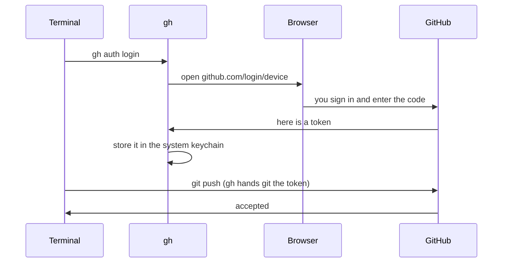

# T42: コンピューターをGitHubに接続する

GitHubアカウント（[T41](t41.html)）と、コンピューターにgit（[T19](t19.html)）がインストールされていますね。今はまだ、これらは別々の存在です。コンピューターがコードをプッシュしようとすると、GitHubは「あなたは誰ですか？」と尋ねますが、コンピューターには良い答えがありません。このレッスンでは、あなたのコンピューターに扉の鍵を渡します。ホテルを考えてみてください。パスワードでフロントデスクでチェックインはできましたが、部屋を開けるにはまだキーカードが必要です。そのキーカードはあなたのコンピューター上にあります。
{: .lesson-intro }

## これがないとプッシュが失敗する理由

初期の頃は、gitが尋ねたときにGitHubのパスワードを入力することができました。しかし、2021年以降、GitHubはgit操作にアカウントパスワードを受け入れなくなりました。試してみると、次のようなメッセージが表示されます。

```
remote: Support for password authentication was removed on August 13, 2021.
fatal: Authentication failed for 'https://github.com/you/my-project.git/'
```

代わりに、gitには**トークン**（GitHubが発行する長い秘密の文字列）または**SSHキー**（あなたが誰であるかを証明するファイルのペア）が必要です。手動でトークンを作成したりコピーしたりする必要はありません。GitHub CLIがそれを代行します。

## 推奨される方法：GitHub CLI

**GitHub CLI**は`gh`というプログラムです。Webブラウザを通じてサインインし、キーを安全に保存し、gitにそれを使用するように指示します。

### 1. ghをインストールする

```
# macOS (with Homebrew)
brew install gh

# Windows (in PowerShell or Terminal)
winget install --id GitHub.cli
```

Linuxでは、[cli.github.com](https://cli.github.com)であなたのディストリビューション向けの手順に従ってください。インストール後、ターミナルを閉じて再度開き、動作を確認してください。

```
gh --version
```

### 2. サインインする

```
gh auth login
```

いくつかの質問が表示されます。矢印キーとEnterキーを使用してください。

1. **Where do you use GitHub?** （どこでGitHubを使用しますか？） **GitHub.com**を選択します。
2. **What is your preferred protocol for Git operations?** （Git操作の優先プロトコルは何ですか？） **HTTPS**を選択します。
3. **Authenticate Git with your GitHub credentials?** （GitHubの認証情報でGitを認証しますか？） **Yes**と答えます。
4. **How would you like to authenticate GitHub CLI?** （GitHub CLIをどのように認証しますか？） **Login with a web browser**を選択します。

`gh`は`ABCD-1234`のようなワンタイムコードを表示し、Enterキーを押すように求めます。あなたのブラウザがGitHubで開きます。必要であればサインインし（二段階認証コードも使用して）、コードを貼り付けて**Authorize**をクリックします。ターミナルに戻ると、ログインしたことを示す行が表示されるはずです。

### 3. ghを使用するようにgitに指示する

```
gh auth setup-git
```

これにより、gitはGitHubと通信するたびに`gh`にキーを要求するようになります。上記のステップ3で「Yes」と答えた場合、これは既に完了しており、再度実行しても問題ありません。

### 4. 確認する

```
gh auth status
```

`Logged in to github.com account your-username`と`Git operations protocol: https`と表示されるはずです。これで完了です。`git push`が機能するようになります。



## Gitにあなたの名前とメールを伝える

すべてのコミットは名前とメールアドレスで署名されます。Gitはコンピューターごとに一度だけこれらを尋ねます。

```
git config --global user.name "Aiko Tanaka"
git config --global user.email "you@example.com"
```

メールアドレスは重要です。GitHubはそれを使用して各コミットをあなたのアカウントにリンクし、その隣にあなたの写真を表示します。GitHubアカウントに登録されているメールアドレスを使用してください。

### メールアドレスを非公開にする

公開リポジトリのコミットは公開されており、その中のメールアドレスも公開されます。ボットはスパムのためにこれらを収集します。GitHubは代わりにプライベートな**noreply**アドレスを提供しています。

1. GitHubで：プロフィール写真 > **Settings** > **Emails**。
2. **Keep my email addresses private**（メールアドレスを非公開にする）にチェックを入れます。
3. GitHubがnoreplyアドレスを表示します。これは`12345678+your-username@users.noreply.github.com`のようになります。
4. そのアドレスをgitで使用します。

```
git config --global user.email "12345678+your-username@users.noreply.github.com"
```

ページから正確なアドレスをコピーしてください。先頭の数字はあなたのアカウントIDであり、人によって異なります。

gitが何を使用するかを確認するには：

```
git config --global --list
```

## 代替案：SSHキー

SSHはあなたが誰であるかを証明するもう一つの方法です。これは**キーペア**を使用します。あなたのコンピューターから決して離れない秘密鍵と、GitHubに提供する公開鍵です。南京錠（公開され、コピーを配布できる）と、それを開ける唯一の鍵（秘密で、あなたが保管する）のようなものです。

`gh`を使ったHTTPSの方がシンプルなので、これは必要ありません。コース、仕事、またはサーバーのセットアップで求められた場合にのみSSHを使用してください。

```
# Make a key pair (press Enter to accept the default file;
# choosing a passphrase is a good idea)
ssh-keygen -t ed25519 -C "you@example.com"

# gh needs one extra permission to upload keys
gh auth refresh -h github.com -s admin:public_key

# Upload the public half (the .pub file, never the other one)
gh ssh-key add ~/.ssh/id_ed25519.pub --title "My laptop"

# Test it
ssh -T git@github.com
```

テストでは`Hi your-username! You've successfully authenticated`と表示されます。SSHを使用する場合、リポジトリのアドレスは`https://github.com/...`ではなく`git@github.com:you/my-project.git`のようになります。

**`.pub`なしのファイルを共有したりアップロードしたりしないでください。** それは秘密鍵です。

## 「Permission denied」または「Authentication failed」と表示された場合

エラーメッセージを読み、以下の点を順番に確認してください。

1. **ログインしていますか？** `gh auth status`を実行してください。ログインしていない、またはトークンが無効であると表示された場合は、`gh auth login`を再度実行してください。
2. **gitはghを使用していますか？** `gh auth setup-git`を再度実行してください。
3. **正しいアカウントですか？** `gh auth status`は現在アクティブなアカウントを表示します。2つのアカウントをお持ちの場合は、`gh auth switch`で切り替えてください。
4. **そのリポジトリにアクセス権がありますか？** 自分のリポジトリ、またはオーナーが共同作業者としてあなたを追加したリポジトリにのみプッシュできます。`git remote -v`でアドレスを確認してください。ユーザー名のタイプミスでも同じエラーが発生します。
5. **HTTPSとSSHのどちらですか？** `git remote -v`が`git@github.com:...`と表示されているのにHTTPSを設定した場合、SSHを設定するか、アドレスを切り替えてください。

```
git remote set-url origin https://github.com/your-username/my-project.git
```

6. **SSHで「Permission denied (publickey)」と表示されますか？** あなたのキーがGitHubにないか、エージェントがそれを使用していません。`ssh -T git@github.com`を実行し、**Settings > SSH and GPG keys**でキーを確認してください。

<div class="takeaways">
<h2>重要なポイント</h2>
<ul>
<li>GitHubはもはやgitのパスワードを受け入れません。コンピューターにはトークンまたはSSHキーが必要です。</li>
<li>GitHub CLIがそれらを代行します：`gh auth login`を実行し、HTTPSとウェブブラウザを選択し、次に`gh auth setup-git`を実行します。</li>
<li>`gh auth status`は、どのユーザーとしてログインしているかを教えてくれます。プッシュが失敗した場合は、まずこれを実行してください。</li>
<li>`user.name`と`user.email`はコンピューターごとに一度設定します。noreplyアドレスを使用すると、あなたの実際のメールアドレスが公開履歴に残るのを防ぎます。</li>
<li>SSHキーは代替手段です。常に`.pub`ファイルのみを共有してください。</li>
</ul>
</div>
