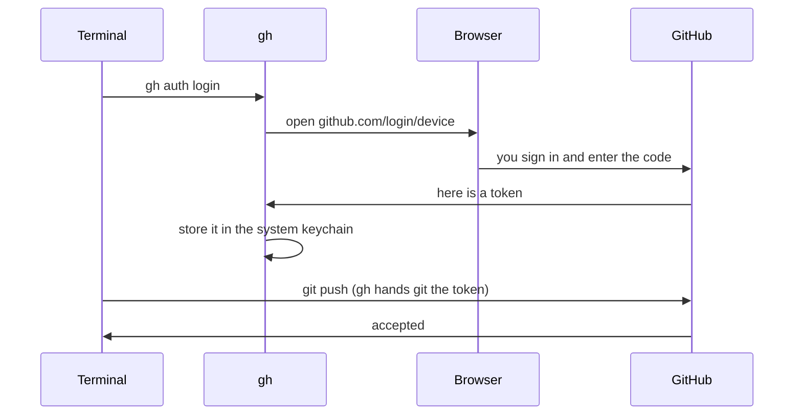

# T42: Connect Your Computer to GitHub

You have a GitHub account ([T41](t41.html)) and git on your computer ([T19](t19.html)). Right now they are strangers. When your computer tries to push code, GitHub asks "who are you?", and your computer has no good answer. This lesson gives your computer a key to the door. Think of it like a hotel: your password got you checked in at the front desk, but you still need a key card to open your room, and that key card lives on your computer.
{: .lesson-intro }

## Why a Push Fails Without It

In the early days you could type your GitHub password when git asked. Since 2021, GitHub no longer accepts account passwords for git. If you try, you will see something like:

```
remote: Support for password authentication was removed on August 13, 2021.
fatal: Authentication failed for 'https://github.com/you/my-project.git/'
```

Instead, git needs a **token** (a long secret string GitHub gives you) or an **SSH key** (a pair of files that prove who you are). You do not need to make or copy a token by hand. The GitHub CLI does it for you.

## The Recommended Path: the GitHub CLI

The **GitHub CLI** is a program called `gh`. It signs you in through your web browser, stores the key safely, and tells git to use it.

### 1. Install gh

```
# macOS (with Homebrew)
brew install gh

# Windows (in PowerShell or Terminal)
winget install --id GitHub.cli
```

On Linux, follow the instructions for your distribution at [cli.github.com](https://cli.github.com). Close and reopen your terminal after installing, then check it worked:

```
gh --version
```

### 2. Sign in

```
gh auth login
```

It asks a few questions. Use the arrow keys and Enter:

1. **Where do you use GitHub?** Choose **GitHub.com**.
2. **What is your preferred protocol for Git operations?** Choose **HTTPS**.
3. **Authenticate Git with your GitHub credentials?** Answer **Yes**.
4. **How would you like to authenticate GitHub CLI?** Choose **Login with a web browser**.

`gh` shows a one-time code like `ABCD-1234` and asks you to press Enter. Your browser opens on GitHub. Sign in if needed (with your two-factor code), paste the code, and click **Authorize**. Back in the terminal you should see a line saying you are logged in.

### 3. Tell git to use gh

```
gh auth setup-git
```

This makes git ask `gh` for the key every time it talks to GitHub. If you answered Yes in step 3 above, it is already done, and running it again is harmless.

### 4. Check

```
gh auth status
```

You should see `Logged in to github.com account your-username` and `Git operations protocol: https`. That is it. `git push` will now work.



## Tell Git Your Name and Email

Every commit is signed with a name and an email. Git asks for them once per computer:

```
git config --global user.name "Aiko Tanaka"
git config --global user.email "you@example.com"
```

The email matters: GitHub uses it to link each commit to your account and show your picture next to it. Use an email that is on your GitHub account.

### Keep your email private

Commits in a public repository are public, and so is the email inside them. Bots collect these for spam. GitHub gives you a private **noreply** address instead:

1. On GitHub: profile picture > **Settings** > **Emails**.
2. Tick **Keep my email addresses private**.
3. GitHub shows your noreply address. It looks like `12345678+your-username@users.noreply.github.com`.
4. Use that address in git:

```
git config --global user.email "12345678+your-username@users.noreply.github.com"
```

Copy the exact address from the page: the number at the start is your account ID, and it is different for everyone.

Check what git will use:

```
git config --global --list
```

## Alternative: SSH Keys

SSH is another way to prove who you are. It uses a **key pair**: a private key that never leaves your computer, and a public key you give to GitHub. It is like a padlock (public, you can hand out copies) and the only key that opens it (private, you keep it).

HTTPS with `gh` is simpler, so you do not need this. Use SSH if a course, a job, or a server setup asks for it.

```
# Make a key pair (press Enter to accept the default file;
# choosing a passphrase is a good idea)
ssh-keygen -t ed25519 -C "you@example.com"

# gh needs one extra permission to upload keys
gh auth refresh -h github.com -s admin:public_key

# Upload the public half (the .pub file, never the other one)
gh ssh-key add ~/.ssh/id_ed25519.pub --title "My laptop"

# Test it
ssh -T git@github.com
```

The test says `Hi your-username! You've successfully authenticated`. With SSH, repository addresses look like `git@github.com:you/my-project.git` instead of `https://github.com/...`.

**Never share or upload the file without `.pub`.** That one is the private key.

## When It Says "Permission denied" or "Authentication failed"

Read the error, then check these in order:

1. **Are you logged in?** Run `gh auth status`. If it says you are not logged in, or that the token is invalid, run `gh auth login` again.
2. **Is git using gh?** Run `gh auth setup-git` again.
3. **Is it the right account?** `gh auth status` shows which account is active. If you have two accounts, switch with `gh auth switch`.
4. **Do you have access to that repository?** You can only push to your own repositories, or ones where the owner added you as a collaborator. Check the address with `git remote -v`. A typo in the username gives the same error.
5. **HTTPS or SSH?** If `git remote -v` shows `git@github.com:...` but you set up HTTPS, either set up SSH, or switch the address:

```
git remote set-url origin https://github.com/your-username/my-project.git
```

6. **SSH says "Permission denied (publickey)"?** Your key is not on GitHub, or the agent is not using it. Run `ssh -T git@github.com` and check your keys at **Settings > SSH and GPG keys**.

<div class="takeaways">
<h2>Key Takeaways</h2>
<ul>
<li>GitHub no longer accepts your password for git. Your computer needs a token or an SSH key</li>
<li>The GitHub CLI does it for you: gh auth login, choose HTTPS and the web browser, then gh auth setup-git</li>
<li>gh auth status tells you who you are logged in as. Run it first whenever a push fails</li>
<li>Set user.name and user.email once per computer. The noreply address keeps your real email out of public history</li>
<li>SSH keys are an alternative. Only ever share the .pub file</li>
</ul>
</div>
