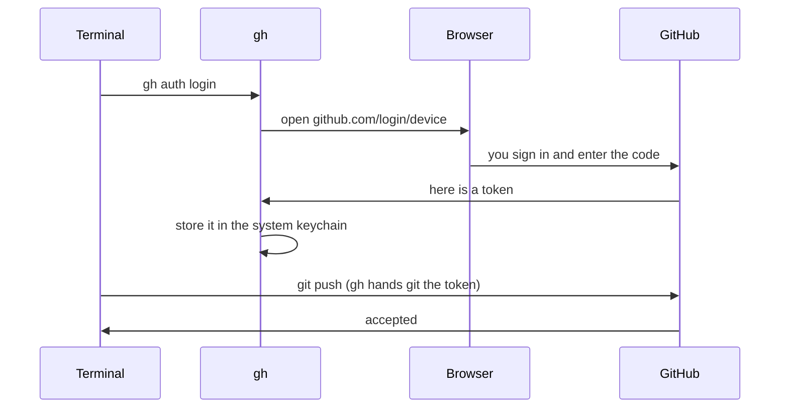

# T42: Conecte Seu Computador ao GitHub

Você tem uma conta GitHub ([T41](t41.html)) e git no seu computador ([T19](t19.html)). No momento, eles são estranhos. Quando seu computador tenta enviar código, o GitHub pergunta "quem é você?", e seu computador não tem uma boa resposta. Esta lição dá ao seu computador uma chave para a porta. Pense nisso como um hotel: sua senha o registrou na recepção, mas você ainda precisa de um cartão-chave para abrir seu quarto, e esse cartão-chave vive no seu computador.
{: .lesson-intro }

## Por que um Push Falha Sem Isso

Antigamente, você podia digitar sua senha do GitHub quando o git perguntava. Desde 2021, o GitHub não aceita mais senhas de conta para git. Se você tentar, verá algo como:

```
remote: Support for password authentication was removed on August 13, 2021.
fatal: Authentication failed for 'https://github.com/you/my-project.git/'
```

Em vez disso, o git precisa de um **token** (uma longa string secreta que o GitHub lhe dá) ou uma **chave SSH** (um par de arquivos que comprovam quem você é). Você não precisa criar ou copiar um token manualmente. O GitHub CLI faz isso por você.

## O Caminho Recomendado: o GitHub CLI

O **GitHub CLI** é um programa chamado `gh`. Ele o conecta através do seu navegador da web, armazena a chave com segurança e informa ao git para usá-la.

### 1. Instalar gh

```
# macOS (with Homebrew)
brew install gh

# Windows (in PowerShell or Terminal)
winget install --id GitHub.cli
```

No Linux, siga as instruções para sua distribuição em [cli.github.com](https://cli.github.com). Feche e reabra seu terminal após a instalação e, em seguida, verifique se funcionou:

```
gh --version
```

### 2. Entrar

```
gh auth login
```

Ele faz algumas perguntas. Use as setas e Enter:

1. **Onde você usa o GitHub?** Escolha **GitHub.com**.
2. **Qual é o seu protocolo preferido para operações Git?** Escolha **HTTPS**.
3. **Autenticar Git com suas credenciais do GitHub?** Responda **Sim**.
4. **Como você gostaria de autenticar o GitHub CLI?** Escolha **Login com um navegador da web**.

`gh` mostra um código de uso único como `ABCD-1234` e pede para você pressionar Enter. Seu navegador abre no GitHub. Faça login se necessário (com seu código de dois fatores), cole o código e clique em **Autorizar**. De volta ao terminal, você deve ver uma linha dizendo que você está logado.

### 3. Diga ao git para usar gh

```
gh auth setup-git
```

Isso faz com que o git peça a `gh` a chave toda vez que se comunica com o GitHub. Se você respondeu Sim na etapa 3 acima, já está feito, e executá-lo novamente é inofensivo.

### 4. Verificar

```
gh auth status
```

Você deve ver `Logged in to github.com account your-username` e `Git operations protocol: https`. É isso. `git push` agora funcionará.



## Diga ao Git Seu Nome e Email

Cada commit é assinado com um nome e um e-mail. O Git pede por eles uma vez por computador:

```
git config --global user.name "Aiko Tanaka"
git config --global user.email "you@example.com"
```

O e-mail importa: o GitHub o usa para vincular cada commit à sua conta e mostrar sua foto ao lado dele. Use um e-mail que esteja na sua conta GitHub.

### Mantenha seu e-mail privado

Commits em um repositório público são públicos, e o e-mail dentro deles também. Bots coletam esses e-mails para spam. O GitHub oferece um endereço **noreply** privado em vez disso:

1. No GitHub: foto de perfil > **Settings** (Configurações) > **Emails**.
2. Marque **Keep my email addresses private** (Manter meus endereços de e-mail privados).
3. O GitHub mostra seu endereço noreply. Ele se parece com `12345678+your-username@users.noreply.github.com`.
4. Use esse endereço no git:

```
git config --global user.email "12345678+your-username@users.noreply.github.com"
```

Copie o endereço exato da página: o número no início é o ID da sua conta, e é diferente para cada pessoa.

Verifique o que o git usará:

```
git config --global --list
```

## Alternativa: Chaves SSH

SSH é outra maneira de provar quem você é. Ele usa um **par de chaves**: uma chave privada que nunca sai do seu computador e uma chave pública que você dá ao GitHub. É como um cadeado (público, você pode distribuir cópias) e a única chave que o abre (privada, você a mantém).

HTTPS com `gh` é mais simples, então você não precisa disso. Use SSH se um curso, um trabalho ou uma configuração de servidor pedir por isso.

```
# Make a key pair (press Enter to accept the default file;
# choosing a passphrase is a good idea)
ssh-keygen -t ed25519 -C "you@example.com"

# gh needs one extra permission to upload keys
gh auth refresh -h github.com -s admin:public_key

# Upload the public half (the .pub file, never the other one)
gh ssh-key add ~/.ssh/id_ed25519.pub --title "My laptop"

# Test it
ssh -T git@github.com
```

O teste diz `Hi your-username! You've successfully authenticated`. Com SSH, os endereços de repositório se parecem com `git@github.com:you/my-project.git` em vez de `https://github.com/...`.

**Nunca compartilhe ou faça upload do arquivo sem `.pub`.** Esse é a chave privada.

## Quando Diz "Permission denied" ou "Authentication failed"

Leia o erro e, em seguida, verifique estes itens em ordem:

1. **Você está logado?** Execute `gh auth status`. Se disser que você não está logado ou que o token é inválido, execute `gh auth login` novamente.
2. **O git está usando gh?** Execute `gh auth setup-git` novamente.
3. **É a conta certa?** `gh auth status` mostra qual conta está ativa. Se você tem duas contas, alterne com `gh auth switch`.
4. **Você tem acesso a esse repositório?** Você só pode enviar para seus próprios repositórios ou para aqueles onde o proprietário o adicionou como colaborador. Verifique o endereço com `git remote -v`. Um erro de digitação no nome de usuário resulta no mesmo erro.
5. **HTTPS ou SSH?** Se `git remote -v` mostra `git@github.com:...` mas você configurou HTTPS, configure SSH ou altere o endereço:

```
git remote set-url origin https://github.com/your-username/my-project.git
```

6. **SSH diz "Permission denied (publickey)"?** Sua chave não está no GitHub, ou o agente não está usando-a. Execute `ssh -T git@github.com` e verifique suas chaves em **Settings > SSH and GPG keys**.

<div class="takeaways">
<h2>Principais Pontos</h2>
<ul>
<li>O GitHub não aceita mais sua senha para o git. Seu computador precisa de um token ou uma chave SSH</li>
<li>O GitHub CLI faz isso por você: gh auth login, escolha HTTPS e o navegador da web, depois gh auth setup-git</li>
<li>gh auth status informa com qual conta você está logado. Execute-o primeiro sempre que um push falhar</li>
<li>Configure user.name e user.email uma vez por computador. O endereço noreply mantém seu e-mail real fora do histórico público</li>
<li>Chaves SSH são uma alternativa. Compartilhe apenas o arquivo .pub</li>
</ul>
</div>
