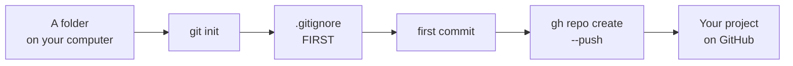

# T43: 初めてのリポジトリ

アカウント([T41](t41.html))とGitHubが信頼するコンピューター([T42](t42.html))を用意できましたね。次に、あなたの作業フォルダをオンラインに置きます。ガラス張りの新しい家に引っ越すようなものだと考えてください。家具を入れる前に、どのアイテムを鍵付きの引き出しに入れておくかを決めます。何かが展示されると、通り過ぎる人々はすでにそれを見てしまっています。
{: .lesson-intro }

## 計画



## 1. フォルダをリポジトリにする

プロジェクトフォルダでターミナルを開きます。まだフォルダがない場合は、作成してください。

```
mkdir my-project
cd my-project
git init -b main
```

`git init`は、履歴が保存される隠し`.git`フォルダを作成します。`-b main`は、GitHubが期待する最初のブランチに`main`という名前を付けます。まだ何も保存されていません。

## 2. 何よりも先に.gitignoreを作成する

`.gitignore`ファイルには、Gitが決して保存してはならないものがリストされています。最初のコミットの**前**に作成してください。一度コミットされたファイルは、後で削除しても履歴からは削除されません。

何を記述するか：

-   **秘密情報。** パスワード、APIキー、トークンなどです。通常、`.env`というファイルに保存されます。
-   **データベース。** ローカルの`app.db`にはテストユーザーや実際のデータが含まれている場合があります。これはコードに含めるべきではありません。
-   **再構築可能なもの。** JavaScriptの`node_modules/`やPythonの`.venv/`は、たった1つのコマンドで再度ダウンロードできる何千ものファイルです。
-   **ジャンク。** ログ、エディタ設定、macOSが至る所に散布する`.DS_Store`ファイルなどです。

プロジェクトフォルダに`.gitignore`というファイルを作成します。

```
# Secrets
.env
.env.*
!.env.example

# Databases
*.db
*.sqlite

# Rebuildable
node_modules/
.venv/
__pycache__/
dist/

# Junk
*.log
.DS_Store
```

`!.env.example`は「これを除く」という意味です。偽の値を含むサンプルファイルは、次に使用する人の役に立ち、安全に共有できます。

## 3. 最初のコミット

```
git status             # check: is anything there that should not be?
git add .
git status             # check again: read the list of green files
git commit -m "First commit"
```

毎回`git status`のリストを読んでください。`.env`ファイルやデータベースが履歴に残る前に見つける最後のチャンスです。

## 4. GitHubでリポジトリを作成し、プッシュする

1つのコマンドでGitHub上にリポジトリを作成し、`origin`として接続し、コミットをプッシュします。

```
gh repo create my-project --public --source=. --push
```

-   `my-project`はGitHub上の名前です。
-   `--public`は誰にでも見えるようにします。あなただけが見るべき場合は、代わりに`--private`を使用してください。
-   `--source=.`は「このフォルダのリポジトリを使用する」という意味です。
-   `--push`は、すぐにコミットをアップロードします。

ブラウザで開きます。

```
gh repo view --web
```

今後、日々の作業ループは[T20](t20.html)で説明されているものになります：編集、`git add`、`git commit`、`git push`。

## 「公開」が実際に意味すること

公開リポジトリは世界中の誰でも読み取ることができます。人間だけでなく、ボットもGitHub上の新しい公開コミットを多くの場合数秒以内にスキャンし、悪用できるパスワードやキーを探しています。検索エンジンはそれをインデックス化します。他の人がコピーすることもできます。一度作成されたコピーを取り戻すことはできません。

したがって、公開リポジトリへのすべてのコミットは、新聞に印刷されたかのように扱ってください。後でリポジトリをプライベートにしても、すでに見られたものを元に戻すことはできません。

## 秘密情報の除外

原則：**秘密情報は決してコードに入れない**。代わりに、コードは環境からそれらを読み取ります。

`.env`ファイルにそれらを記述します。このファイルはすでに`.gitignore`に含まれています。

```
# .env  (never committed)
OPENAI_API_KEY=sk-...your-real-key...
DATABASE_URL=sqlite:///app.db
```

同じ名前と偽の値を含む`.env.example`をコミットします。これにより、他の人が何を入力すべきかを知ることができます。

```
# .env.example  (committed)
OPENAI_API_KEY=put-your-key-here
DATABASE_URL=sqlite:///app.db
```

コードは名前で値を読み取ります。Node.js 20.6以降では、`node --env-file=.env server.js`がファイルをロードし、コードは`process.env.OPENAI_API_KEY`を使用します。Pythonでは、`os.environ["OPENAI_API_KEY"]`がそれを読み取ります（方法は[T45](t45.html)で示されています）。

## 秘密情報をコミットしてしまった場合

プロでもよくあることです。この順序で迅速に行動してください：

1.  **まずキーを無効化またはローテーションします。** キーを発行したサービス（OpenAI、Stripe、データベースホストなど）にアクセスし、そのキーを削除してから新しいキーを作成します。これが実際にあなたを保護する唯一のステップです。古いキーはすでに盗まれていると仮定してください。
2.  **新しいキーを`.env`に入れ**、`.env`が`.gitignore`に含まれていることを確認します。
3.  **コードから秘密情報を削除し**、コミットします。

なぜコミットを削除するだけではだめなのか？履歴を書き換えても、*あなたの*リポジトリからは削除されますが、すでにコピーが存在します：ボット、フォーク、他の人のクローン、GitHub自身のキャッシュなどです。履歴の書き換えはクリーンアップのステップであり、解決策ではありません。解決策は、機能しなくなったキーです。

ここでGitHubが役立ちます：公開リポジトリにプッシュする際に、**プッシュ保護**が多くの既知のキー形式をブロックし、警告を表示します。それを見た場合は、バイパスしないでください。キーを削除してください。

## 役立つREADME

リポジトリのトップにある`README.md`は、GitHubが最初に表示するものです。これは3つの質問に答えます。

```
# My Project

A small to-do list app with a Python server and SQLite.

## Run it

    uv sync
    cp .env.example .env    # then fill in the values
    uv run uvicorn main:app --reload

Open http://127.0.0.1:8000
```

それが何なのか、どうやって実行するのか、最初に何が必要か。見知らぬ人、または6か月後のあなた自身が、READMEだけで実行できるようになるべきです。

<div class="takeaways">
<h2>主なポイント</h2>
<ul>
<li>最初のコミットの前に.gitignoreを作成する：秘密情報、.env、データベース、node_modules、.venv</li>
<li>毎回のコミット前にgit statusを読む。これは秘密情報を見つける最後のチャンスです。</li>
<li>gh repo create my-project --public --source=. --push は、作成、接続、プッシュを一度に行う。非公開にするには--privateを使用する。</li>
<li>「公開」とは、誰でも、どんなボットでも、永遠にそれを読み取り、コピーできることを意味します。</li>
<li>秘密情報をコミットしてしまった場合、まずキーを無効化する。コピーが既に存在するため、履歴の書き換えだけでは不十分です。</li>
<li>READMEは、プロジェクトの内容と実行方法を説明します。</li>
</ul>
</div>
