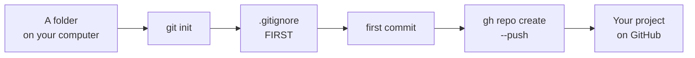

# T43: Your First Repository

You have an account ([T41](t41.html)) and a computer that GitHub trusts ([T42](t42.html)). Now you take a folder of your own work and put it online. Think of it like moving into a new house with glass walls. Before the furniture goes in, you decide what stays in the locked drawer. Once something is on display, people walking past have already seen it.
{: .lesson-intro }

## The Plan



## 1. Turn the Folder into a Repository

Open a terminal in your project folder. If you do not have one yet, make one:

```
mkdir my-project
cd my-project
git init -b main
```

`git init` creates a hidden `.git` folder where the history will live. `-b main` names the first branch `main`, which is what GitHub expects. Nothing is saved yet.

## 2. Write the .gitignore Before Anything Else

A `.gitignore` file lists things git must never save. Write it **before** your first commit. Once a file is committed, removing it later does not remove it from history.

What goes in it:

- **Secrets.** Passwords, API keys, tokens. They usually live in a file called `.env`.
- **Databases.** Your local `app.db` holds test users and maybe real data. It does not belong in the code.
- **Things you can rebuild.** `node_modules/` for JavaScript and `.venv/` for Python are thousands of files you can download again with one command.
- **Junk.** Logs, editor settings, the `.DS_Store` files macOS scatters everywhere.

Create a file called `.gitignore` in the project folder:

```
# Secrets
.env
.env.*
!.env.example

# Databases
*.db
*.sqlite

# Rebuildable
node_modules/
.venv/
__pycache__/
dist/

# Junk
*.log
.DS_Store
```

`!.env.example` means "except this one". An example file with fake values helps the next person, and it is safe to share.

## 3. The First Commit

```
git status             # check: is anything there that should not be?
git add .
git status             # check again: read the list of green files
git commit -m "First commit"
```

Read the `git status` list every time. It is your last chance to spot a `.env` or a database before it goes into history.

## 4. Create the Repository on GitHub and Push

One command creates the repository on GitHub, connects it as `origin`, and pushes your commit:

```
gh repo create my-project --public --source=. --push
```

- `my-project` is the name on GitHub.
- `--public` makes it visible to everyone. Use `--private` instead if only you should see it.
- `--source=.` means "use the repository in this folder".
- `--push` sends your commits up straight away.

Open it in your browser:

```
gh repo view --web
```

From now on the daily loop is the one from [T20](t20.html): edit, `git add`, `git commit`, `git push`.

## What Public Really Means

A public repository can be read by anyone in the world. Not just people: bots scan every new public commit on GitHub, often within seconds, looking for passwords and keys to abuse. Search engines index it. Other people can copy it. You cannot take a copy back once it is made.

So treat every commit to a public repository as if it were printed in a newspaper. Making the repository private later does not undo what was already seen.

## Keeping Secrets Out

The rule: **secrets never go in code**. Your code reads them from the environment instead.

Put them in a `.env` file, which is already in `.gitignore`:

```
# .env  (never committed)
OPENAI_API_KEY=sk-...your-real-key...
DATABASE_URL=sqlite:///app.db
```

Commit a `.env.example` with the same names and fake values, so others know what to fill in:

```
# .env.example  (committed)
OPENAI_API_KEY=put-your-key-here
DATABASE_URL=sqlite:///app.db
```

Your code reads the value by name. In Node.js 20.6 or newer, `node --env-file=.env server.js` loads the file, and the code uses `process.env.OPENAI_API_KEY`. In Python, `os.environ["OPENAI_API_KEY"]` reads it ([T45](t45.html) shows how).

## If You Committed a Secret

It happens to professionals too. Act fast, in this order:

1. **Revoke or rotate the key first.** Go to the service that issued it (OpenAI, Stripe, your database host) and delete that key, then make a new one. This is the only step that actually protects you. Assume the old key is already stolen.
2. **Put the new key in `.env`**, and make sure `.env` is in `.gitignore`.
3. **Remove the secret from the code** and commit.

Why not just delete the commit? Rewriting history removes it from *your* repository, but copies already exist: bots, forks, other people's clones, GitHub's own caches. History rewriting is a clean-up step, never the fix. The fix is a key that no longer works.

GitHub helps here: **push protection** blocks many well-known key formats when you push to a public repository, and shows you a warning. If you see it, do not bypass it. Remove the key.

## A README That Helps

A `README.md` at the top of the repository is the first thing GitHub shows. It answers three questions:

```
# My Project

A small to-do list app with a Python server and SQLite.

## Run it

    uv sync
    cp .env.example .env    # then fill in the values
    uv run uvicorn main:app --reload

Open http://127.0.0.1:8000
```

What is it, how do I run it, and what do I need first. A stranger, or you in six months, should get it running from the README alone.

<div class="takeaways">
<h2>Key Takeaways</h2>
<ul>
<li>Write .gitignore before the first commit: secrets, .env, databases, node_modules, .venv</li>
<li>Read git status before every commit. It is your last chance to catch a secret</li>
<li>gh repo create my-project --public --source=. --push creates, connects and pushes in one step. Use --private to keep it hidden</li>
<li>Public means anyone and any bot can read and copy it, forever</li>
<li>If you commit a secret, revoke the key first. Rewriting history is not enough because copies already exist</li>
<li>A README says what the project is and how to run it</li>
</ul>
</div>
