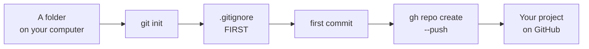

# T43: Seu Primeiro Repositório

Você tem uma conta ([T41](t41.html)) e um computador no qual o GitHub confia ([T42](t42.html)). Agora você pega uma pasta do seu próprio trabalho e a coloca online. Pense nisso como se mudar para uma casa nova com paredes de vidro. Antes que a mobília entre, você decide o que fica na gaveta trancada. Uma vez que algo está em exibição, as pessoas que passam já viram.
{: .lesson-intro }

## O Plano



## 1. Transforme a Pasta em um Repositório

Abra um terminal na pasta do seu projeto. Se você ainda não tem um, crie um:

```
mkdir my-project
cd my-project
git init -b main
```

`git init` cria uma pasta oculta `.git` onde o histórico viverá. `-b main` nomeia a primeira branch `main`, que é o que o GitHub espera. Nada é salvo ainda.

## 2. Escreva o .gitignore Antes de Qualquer Outra Coisa

Um arquivo `.gitignore` lista coisas que o git nunca deve salvar. Escreva-o **antes** do seu primeiro commit. Uma vez que um arquivo é comitado, removê-lo depois não o remove do histórico.

O que incluir nele:

- **Segredos.** Senhas, chaves de API, tokens. Eles geralmente ficam em um arquivo chamado `.env`.
- **Bancos de dados.** Seu `app.db` local contém usuários de teste e talvez dados reais. Ele não pertence ao código.
- **Coisas que você pode reconstruir.** `node_modules/` para JavaScript e `.venv/` para Python são milhares de arquivos que você pode baixar novamente com um único comando.
- **Lixo.** Logs, configurações do editor, os arquivos `.DS_Store` que o macOS espalha por toda parte.

Crie um arquivo chamado `.gitignore` na pasta do projeto:

```
# Secrets
.env
.env.*
!.env.example

# Databases
*.db
*.sqlite

# Rebuildable
node_modules/
.venv/
__pycache__/
dist/

# Junk
*.log
.DS_Store
```

`!.env.example` significa "exceto este". Um arquivo de exemplo com valores falsos ajuda a próxima pessoa, e é seguro compartilhar.

## 3. O Primeiro Commit

```
git status             # check: is anything there that should not be?
git add .
git status             # check again: read the list of green files
git commit -m "First commit"
```

Leia a lista do `git status` toda vez. É sua última chance de identificar um `.env` ou um banco de dados antes que ele vá para o histórico.

## 4. Crie o Repositório no GitHub e Faça Push

Um comando cria o repositório no GitHub, o conecta como `origin` e envia seu commit:

```
gh repo create my-project --public --source=. --push
```

- `my-project` é o nome no GitHub.
- `--public` o torna visível para todos. Use `--private` em vez disso, se apenas você deve vê-lo.
- `--source=.` significa "usar o repositório nesta pasta".
- `--push` envia seus commits imediatamente.

Abra-o no seu navegador:

```
gh repo view --web
```

A partir de agora, o ciclo diário é o de [T20](t20.html): editar, `git add`, `git commit`, `git push`.

## O Que "Público" Realmente Significa

Um repositório público pode ser lido por qualquer pessoa no mundo. Não apenas pessoas: bots escaneiam cada novo commit público no GitHub, muitas vezes em segundos, procurando senhas e chaves para abusar. Motores de busca o indexam. Outras pessoas podem copiá-lo. Você não pode reaver uma cópia depois de feita.

Portanto, trate cada commit para um repositório público como se fosse impresso em um jornal. Tornar o repositório privado mais tarde não desfaz o que já foi visto.

## Mantendo Segredos Fora

A regra: **segredos nunca vão no código**. Seu código os lê do ambiente em vez disso.

Coloque-os em um arquivo `.env`, que já está no `.gitignore`:

```
# .env  (never committed)
OPENAI_API_KEY=sk-...your-real-key...
DATABASE_URL=sqlite:///app.db
```

Comite um `.env.example` com os mesmos nomes e valores falsos, para que outros saibam o que preencher:

```
# .env.example  (committed)
OPENAI_API_KEY=put-your-key-here
DATABASE_URL=sqlite:///app.db
```

Seu código lê o valor pelo nome. No Node.js 20.6 ou mais recente, `node --env-file=.env server.js` carrega o arquivo, e o código usa `process.env.OPENAI_API_KEY`. Em Python, `os.environ["OPENAI_API_KEY"]` o lê ([T45](t45.html) mostra como).

## Se Você Comitou um Segredo

Isso acontece com profissionais também. Aja rápido, nesta ordem:

1.  **Revogue ou rotacione a chave primeiro.** Vá para o serviço que a emitiu (OpenAI, Stripe, seu host de banco de dados) e exclua essa chave, depois crie uma nova. Este é o único passo que realmente o protege. Assuma que a chave antiga já foi roubada.
2.  **Coloque a nova chave em `.env`**, e certifique-se de que `.env` esteja no `.gitignore`.
3.  **Remova o segredo do código** e faça commit.

Por que não apenas deletar o commit? Reescrever o histórico o remove do *seu* repositório, mas cópias já existem: bots, forks, clones de outras pessoas, caches do próprio GitHub. A reescrita do histórico é uma etapa de limpeza, nunca a solução. A solução é uma chave que não funciona mais.

O GitHub ajuda aqui: a **proteção de push** bloqueia muitos formatos de chave conhecidos quando você faz push para um repositório público e mostra um aviso. Se você o vir, não o ignore. Remova a chave.

## Um README Que Ajuda

Um `README.md` no topo do repositório é a primeira coisa que o GitHub mostra. Ele responde a três perguntas:

```
# My Project

A small to-do list app with a Python server and SQLite.

## Run it

    uv sync
    cp .env.example .env    # then fill in the values
    uv run uvicorn main:app --reload

Open http://127.0.0.1:8000
```

O que é, como executá-lo e o que preciso primeiro. Um estranho, ou você em seis meses, deve conseguir executá-lo apenas com o README.

<div class="takeaways">
<h2>Principais Conclusões</h2>
<ul>
<li>Escreva o .gitignore antes do primeiro commit: segredos, .env, bancos de dados, node_modules, .venv</li>
<li>Leia o git status antes de cada commit. É sua última chance de pegar um segredo</li>
<li>gh repo create my-project --public --source=. --push cria, conecta e faz push em uma única etapa. Use --private para mantê-lo oculto</li>
<li>Público significa que qualquer pessoa e qualquer bot pode ler e copiar, para sempre</li>
<li>Se você comitar um segredo, revogue a chave primeiro. Reescrever o histórico não é suficiente porque cópias já existem</li>
<li>Um README diz o que o projeto é e como executá-lo</li>
</ul>
</div>
