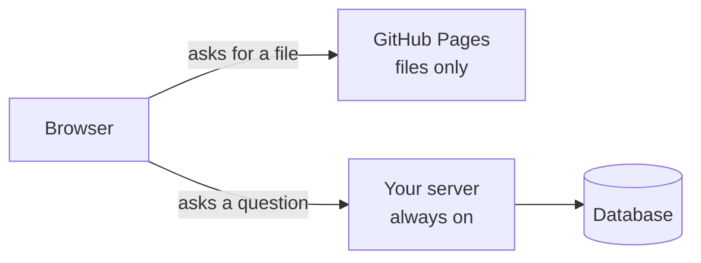

# T44: サーバーをオンラインにする

HTML、CSS、JavaScriptで作られたウェブサイトは印刷されたメニューのようなものです。コピーを配れば、誰もキッチンにいる必要はありません。サーバーアプリはレストランです。お客さんが来るたびに、誰かが料理を作ってそこにいなければなりません。GitHub Pagesは無料でメニューを配ることができます。レストランを運営するには、常に開いている建物が必要です。このレッスンでは、3種類の建物を比較します。
{: .lesson-intro }

## ファイルとサーバー

**GitHub Pages**はファイルを配信します。フォルダーを受け取り、各ファイルにウェブアドレスを付与します。これは、[A18](a18.html)のゲームや[T40](t40.html)のNext.js静的エクスポートのような、プレーンなHTML、CSS、JavaScriptサイトに最適です。

これは、サーバー側でコードを実行することはできません。アプリが以下のいずれかを持っている場合、常に稼働している実際のコンピューターが必要です。

- Pythonで書かれたサーバー ([T45](t45.html)) またはNode.jsで書かれたサーバー ([T21](t21.html))
- データベース、たとえSQLiteファイルであっても ([T24](t24.html))
- ログイン、セッション、またはブラウザから秘密にすべきあらゆるもの



そのコンピューターがどこにあるべきかについて、唯一の正解はありません。ここに3つの正直な選択肢を挙げます。**料金と無料の制限は頻繁に変更される**ため、選択する前に各プロバイダーの料金ページを確認してください。

## 選択肢1: Tailscale Funnelを使った自分のマシン

自分が所有するコンピューター（古いノートパソコン、ミニPC、Raspberry Piなど）でサーバーを実行し、**Tailscale Funnel**に公開HTTPSアドレスを提供させます。

```
# after installing Tailscale and signing in
# your app is running on port 8000
tailscale funnel 8000
```

Tailscaleは、誰でも開ける`https://my-laptop.your-tailnet.ts.net`のようなアドレスを表示し、HTTPSは自動で処理されます。初回利用時には、ブラウザでHTTPSとFunnelを有効にするよう求められる場合があります。

- **費用:** 個人利用は無料。電気代がかかります。
- **良い点:** レンタルするものがなく、データは自宅に保管されます。
- **悪い点:** マシンは常時起動し、スリープ状態にならないようにする必要があります。スリープしたり、電源が落ちたり、自宅のインターネット接続が切断されたりすると、サイトはダウンします。Funnelには帯域幅の制限があるため、デモや小規模プロジェクトには適していますが、トラフィックの多いサイトには向きません。

## 選択肢2: Caddyを使った小さなVPS

**VPS**（仮想プライベートサーバー）は、Hetzner、DigitalOcean、Vultrなど多くのプロバイダーから月額でレンタルできるデータセンター内のコンピューターです。最小サイズで学習プロジェクトには十分です。

新鮮なLinuxマシンが手に入ります。アプリをインストールし、`systemd`で稼働させ続け、その前に**Caddy**を配置します。CaddyはHTTPS証明書を自動的に取得・更新するウェブサーバーです。サーバーのIPアドレスにドメイン名を向け、Caddyの構成全体はこれだけで済みます。

```
# /etc/caddy/Caddyfile
myapp.example.com {
    reverse_proxy localhost:8000
}
```

CaddyはHTTPSで訪問者からのリクエストを受け取り、各リクエストをポート8000で動作するアプリに渡します。

- **費用:** 月に数ドル、加えてドメイン名（年間約10～15ドル）。
- **良い点:** 常に稼働し、料金が予測可能で、サーバーがどのように機能するかを実際に学べます。
- **悪い点:** あなたがメンテナーです。セキュリティ更新、ファイアウォール、バックアップ、午前2時の再起動など、すべてあなたの責任です。

## 選択肢3: プラットフォーム (Fly.io, Render, Railway)

**プラットフォーム**はあなたのアプリを代わりに実行します。GitHubリポジトリを接続するか、1つのコマンドを実行するだけで、アプリをビルドし、HTTPSアドレスを付与し、クラッシュした場合に再起動します。

- **費用:** 使用量またはプランに応じて支払います。無料枠がある場合、アイドル時にスリープすることが多く（最初の訪問者は数秒待つことになります）。
- **良い点:** 最も簡単な方法。パッチを当てるサーバーはありません。GitHubにプッシュすることでデプロイできます。
- **悪い点:** 制御が最も少なく、制限や料金が変更される可能性があります。多くのプラットフォームはデプロイごとにディスクを消去するため、SQLiteファイルには**永続ボリューム**が必要です。実際のデータを保存する前に確認してください。

## 3つの比較

| | 自分のマシン + Funnel | VPS + Caddy | プラットフォーム |
|---|---|---|---|
| 費用 | 無料 | 月数ドル | さまざま、多くの場合高価 |
| 開始の労力 | 低い | 中～高い | 最も低い |
| メンテナンスの労力 | 常時起動を維持 | 更新、バックアップ、セキュリティ | ほとんどない |
| 常時稼働 | マシンが稼働していれば | はい | はい（有料プラン） |
| 学べること | ネットワークの基本 | サーバーの仕組み | デプロイの仕組み |

## 本番環境での変更点

「本番環境」とは、他の人が使用する実際の公開バージョンを意味します。ラップトップと比較して4つのことが変わります。

### シークレットは環境変数になる

コードに鍵を直接書かないでください ([T43](t43.html))。VPSでは、アプリだけが読み取れる環境ファイルに保存します。プラットフォームでは、その**シークレット**ページを使用します。コードはどこでも同じ方法でそれらを読み取ります。

```
import os
api_key = os.environ["OPENAI_API_KEY"]
```

### どこでもHTTPS

ログインとフォームは暗号化されて送信される必要があります。これら3つの選択肢はすべて、HTTPSを自動的に提供します。平文の`http://`でパスワードを送信しないでください。

### データベースの置き場所とバックアップ

データがどこに存在するかを決定します。同じマシン上のSQLiteファイル、またはマネージドデータベースです。そして尋ねてください:**今夜このディスクが故障したら、何を失うのか？** SQLiteの場合、独自のバックアップコマンド（アプリが書き込み中でも安全）で作成された日次コピーが良い出発点です。

```
sqlite3 app.db ".backup 'backup-2026-10-15.db'"
```

別のマシンやクラウドストレージにコピーを保管してください。同じディスク上のバックアップはバックアップではありません。一度リストアして、それが機能することを確認してください。

### ログはあなたの目

ラップトップではターミナルを監視します。本番環境では誰も監視していないため、アプリは何が起こったかをログに出力し、ホストがそれを保持します。

- systemd付きのVPS: `journalctl -u myapp -f` でライブログが表示されます。
- プラットフォーム: ダッシュボード内の**ログ**タブ、またはCLIコマンド。

ユーザーが「壊れた」と言ったとき、ログが何が起こったかを教えてくれます。

<div class="takeaways">
<h2>重要なポイント</h2>
<ul>
<li>GitHub Pagesはファイルのみを配信します。サーバー、データベース、またはログインには、常時稼働するコンピューターが必要です</li>
<li>Tailscale Funnelを使った自分のマシン: 無料ですが、マシンは常時稼働している必要があり、帯域幅に制限があります</li>
<li>Caddyを使った小さなVPS: 月数ドルで自動HTTPSが利用できますが、すべて自分でメンテナンスします</li>
<li>Fly.io、Render、Railwayのようなプラットフォーム: 最も簡単で有料、制限と料金が変更されます</li>
<li>本番環境では: シークレットは環境変数に、HTTPSは常に使用し、データベースの既知の場所にはテスト済みのバックアップがあり、ログを読めるようにしておく必要があります</li>
</ul>
</div>
