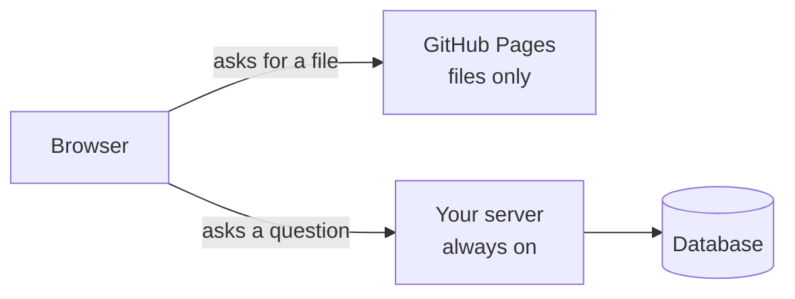

# T44: Putting a Server Online

A website made of HTML, CSS and JavaScript is like a printed menu: you hand out copies and nobody needs to be in the kitchen. A server app is a restaurant. Someone has to be there, cooking, every time a customer walks in. GitHub Pages can hand out menus for free. To run a restaurant, you need a building that stays open. This lesson compares three kinds of building.
{: .lesson-intro }

## Files vs a Server

**GitHub Pages** serves files. It takes a folder and gives each file a web address. That is perfect for plain HTML, CSS and JavaScript sites, like the game in [A18](a18.html) or the Next.js static export in [T40](t40.html).

It cannot run your code on the server side. If your app has any of these, it needs a real computer that is always on:

- A server written in Python ([T45](t45.html)) or Node.js ([T21](t21.html))
- A database, even a SQLite file ([T24](t24.html))
- Login, sessions, or anything that must stay secret from the browser



There is no single right answer for where that computer lives. Here are three honest options. **Prices and free limits change often**, so check each provider's pricing page before you choose.

## Option 1: Your Own Machine with Tailscale Funnel

Run the server on a computer you own (an old laptop, a mini PC, a Raspberry Pi) and let **Tailscale Funnel** give it a public HTTPS address.

```
# after installing Tailscale and signing in
# your app is running on port 8000
tailscale funnel 8000
```

Tailscale prints an address like `https://my-laptop.your-tailnet.ts.net` that anyone can open, with HTTPS handled for you. The first time, it may ask you to enable HTTPS and Funnel in the browser.

- **Cost:** free for personal use. You pay for electricity.
- **Good:** nothing to rent, and your data stays at home.
- **Bad:** the machine must stay on and awake. If it sleeps, loses power, or your home internet drops, the site is down. Funnel has bandwidth limits, so it suits demos and small projects, not a busy site.

## Option 2: A Small VPS with Caddy

A **VPS** (virtual private server) is a computer in a data centre that you rent by the month, from Hetzner, DigitalOcean, Vultr and many others. The smallest size is enough for a learning project.

You get a fresh Linux machine. You install your app, keep it running with `systemd`, and put **Caddy** in front: a web server that gets and renews HTTPS certificates by itself. Point a domain name at the server's IP address, and the whole Caddy config can be this short:

```
# /etc/caddy/Caddyfile
myapp.example.com {
    reverse_proxy localhost:8000
}
```

Caddy receives visitors on HTTPS and passes each request to your app on port 8000.

- **Cost:** a few dollars a month, plus a domain name (about 10 to 15 dollars a year).
- **Good:** always on, predictable price, and you learn how servers really work.
- **Bad:** you are the maintainer. Security updates, firewall, backups, restarting things at 2 a.m.: all yours.

## Option 3: A Platform (Fly.io, Render, Railway)

A **platform** runs your app for you. Connect a GitHub repository or run one command, and it builds your app, gives it an HTTPS address, and restarts it if it crashes.

- **Cost:** paid by usage or by plan. Free tiers, where they exist, often sleep when idle (the first visitor waits several seconds).
- **Good:** the easiest path. No server to patch. Deploy by pushing to GitHub.
- **Bad:** least control, and limits and prices change. Many platforms wipe the disk on every deploy, so a SQLite file needs a **persistent volume**. Check before you store real data.

## Comparing the Three

| | Own machine + Funnel | VPS + Caddy | Platform |
|---|---|---|---|
| Money | Free | A few $/month | Varies, often more |
| Effort to start | Low | Medium to high | Lowest |
| Effort to maintain | Keep it on | Updates, backups, security | Little |
| Always on | Only if your machine is | Yes | Yes (paid plans) |
| What you learn | Networking basics | How servers work | How deploys work |

## What Changes in Production

"Production" means the real, public copy that other people use. Four things change compared with your laptop.

### Secrets become environment variables

Never put keys in the code ([T43](t43.html)). On a VPS, keep them in an environment file only the app can read. On a platform, use its **secrets** page. The code reads them the same way everywhere:

```
import os
api_key = os.environ["OPENAI_API_KEY"]
```

### HTTPS everywhere

Logins and forms must travel encrypted. All three options give you HTTPS automatically. Never send passwords over plain `http://`.

### The database has a home, and backups

Decide where the data lives: a SQLite file on the same machine, or a managed database. Then ask: **if this disk dies tonight, what do I lose?** For SQLite, a daily copy made with its own backup command (safe even while the app is writing) is a good start:

```
sqlite3 app.db ".backup 'backup-2026-10-15.db'"
```

Keep copies on another machine or in cloud storage: a backup on the same disk is not a backup. Restore one once, to know it works.

### Logs are your eyes

On your laptop you watch the terminal. In production nobody is watching, so your app prints what happens and the host keeps it:

- VPS with systemd: `journalctl -u myapp -f` shows the live log.
- Platforms: a **Logs** tab in the dashboard, or a CLI command.

When a user says "it broke", the logs tell you what happened.

<div class="takeaways">
<h2>Key Takeaways</h2>
<ul>
<li>GitHub Pages serves files only. A server, a database or a login needs a computer that is always on</li>
<li>Own machine with Tailscale Funnel: free, but the machine must stay on, and bandwidth is limited</li>
<li>Small VPS with Caddy: a few dollars a month and automatic HTTPS, but you maintain everything</li>
<li>A platform like Fly.io, Render or Railway: easiest, paid, and its limits and prices change</li>
<li>In production: secrets in environment variables, HTTPS always, a known home for the database with tested backups, and logs you can read</li>
</ul>
</div>
