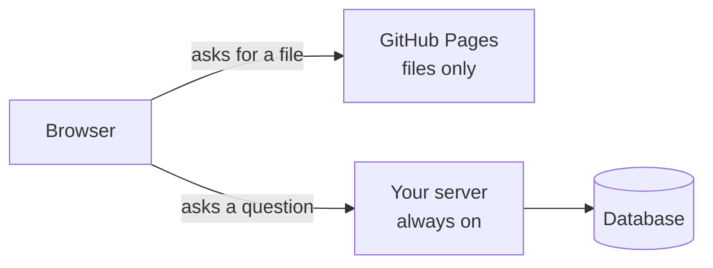

# T44: Colocando um Servidor Online

Um site feito de HTML, CSS e JavaScript é como um cardápio impresso: você distribui cópias e ninguém precisa estar na cozinha. Um aplicativo de servidor é um restaurante. Alguém tem que estar lá, cozinhando, toda vez que um cliente entra. GitHub Pages pode distribuir cardápios gratuitamente. Para administrar um restaurante, você precisa de um "prédio" que permaneça aberto. Esta lição compara três tipos de "prédios".
{: .lesson-intro }

## Arquivos vs um Servidor

**GitHub Pages** serve arquivos. Ele pega uma pasta e dá a cada arquivo um endereço web. Isso é perfeito para sites simples de HTML, CSS e JavaScript, como o jogo em [A18](a18.html) ou a exportação estática do Next.js em [T40](t40.html).

Ele não pode executar seu código no lado do servidor (server-side). Se seu aplicativo tiver alguma destas características, ele precisa de um computador real que esteja sempre ligado:

- Um servidor escrito em Python ([T45](t45.html)) ou Node.js ([T21](t21.html))
- Um banco de dados, mesmo um arquivo SQLite ([T24](t24.html))
- Login, sessões ou qualquer coisa que precise permanecer secreta para o navegador



Não há uma única resposta certa para onde esse computador reside. Aqui estão três opções honestas. **Preços e limites gratuitos mudam frequentemente**, então verifique a página de preços de cada provedor antes de escolher.

## Opção 1: Sua Própria Máquina com Tailscale Funnel

Execute o servidor em um computador que você possui (um laptop antigo, um mini PC, um Raspberry Pi) e deixe o **Tailscale Funnel** dar a ele um endereço HTTPS público.

```
# after installing Tailscale and signing in
# your app is running on port 8000
tailscale funnel 8000
```

O Tailscale imprime um endereço como `https://my-laptop.your-tailnet.ts.net` que qualquer pessoa pode abrir, com HTTPS gerenciado para você. Na primeira vez, ele pode pedir para você habilitar HTTPS e Funnel no navegador.

- **Custo:** gratuito para uso pessoal. Você paga pela eletricidade.
- **Bom:** nada para alugar, e seus dados permanecem em casa.
- **Ruim:** a máquina deve permanecer ligada e acordada. Se ela entrar em modo de suspensão, perder energia ou sua internet doméstica cair, o site ficará fora do ar. O Funnel tem limites de largura de banda, então é adequado para demonstrações e pequenos projetos, não para um site movimentado.

## Opção 2: Um Pequeno VPS com Caddy

Um **VPS** (servidor virtual privado) é um computador em um data center que você aluga mensalmente, de Hetzner, DigitalOcean, Vultr e muitos outros. O tamanho menor é suficiente para um projeto de aprendizado.

Você obtém uma máquina Linux nova. Você instala seu aplicativo, o mantém funcionando com `systemd` e coloca o **Caddy** na frente: um servidor web que obtém e renova certificados HTTPS por conta própria. Aponte um nome de domínio para o endereço IP do servidor, e a configuração completa do Caddy pode ser assim:

```
# /etc/caddy/Caddyfile
myapp.example.com {
    reverse_proxy localhost:8000
}
```

O Caddy recebe visitantes em HTTPS e passa cada requisição para o seu aplicativo na porta 8000.

- **Custo:** alguns dólares por mês, mais um nome de domínio (cerca de 10 a 15 dólares por ano).
- **Bom:** sempre ligado, preço previsível e você aprende como os servidores realmente funcionam.
- **Ruim:** você é o mantenedor. Atualizações de segurança, firewall, backups, reiniciar coisas às 2 da manhã: tudo é sua responsabilidade.

## Opção 3: Uma Plataforma (Fly.io, Render, Railway)

Uma **plataforma** executa seu aplicativo para você. Conecte um repositório GitHub ou execute um comando, e ela construirá seu aplicativo, dará a ele um endereço HTTPS e o reiniciará se ele falhar.

- **Custo:** pago por uso ou por plano. Camadas gratuitas (free tiers), onde existem, frequentemente entram em modo de suspensão quando ociosas (o primeiro visitante espera vários segundos).
- **Bom:** o caminho mais fácil. Nenhum servidor para corrigir. Faça o deploy (implantação) enviando para o GitHub.
- **Ruim:** menor controle, e limites e preços mudam. Muitas plataformas limpam o disco a cada deploy, então um arquivo SQLite precisa de um **volume persistente**. Verifique antes de armazenar dados reais.

## Comparando as Três Opções

| | Máquina própria + Funnel | VPS + Caddy | Plataforma |
|---|---|---|---|
| Dinheiro | Gratuito | Alguns $/mês | Varia, geralmente mais |
| Esforço para iniciar | Baixo | Médio a alto | Mais baixo |
| Esforço para manter | Mantê-la ligada | Atualizações, backups, segurança | Pouco |
| Sempre ligada | Apenas se sua máquina estiver | Sim | Sim (planos pagos) |
| O que você aprende | Fundamentos de rede | Como os servidores funcionam | Como os deploys funcionam |

## O Que Muda em Produção

"Produção" significa a cópia real e pública que outras pessoas usam. Quatro coisas mudam em comparação com seu laptop.

### Segredos se tornam variáveis de ambiente

Nunca coloque chaves no código ([T43](t43.html)). Em um VPS, mantenha-as em um arquivo de ambiente que apenas o aplicativo possa ler. Em uma plataforma, use sua página de **segredos**. O código as lê da mesma forma em todos os lugares:

```
import os
api_key = os.environ["OPENAI_API_KEY"]
```

### HTTPS em todos os lugares

Logins e formulários devem viajar criptografados. Todas as três opções oferecem HTTPS automaticamente. Nunca envie senhas por `http://` simples.

### O banco de dados tem um lar, e backups

Decida onde os dados residem: um arquivo SQLite na mesma máquina, ou um banco de dados gerenciado. Então pergunte: **se este disco morrer esta noite, o que eu perco?** Para SQLite, uma cópia diária feita com seu próprio comando de backup (seguro mesmo enquanto o aplicativo está escrevendo) é um bom começo:

```
sqlite3 app.db ".backup 'backup-2026-10-15.db'"
```

Mantenha cópias em outra máquina ou em armazenamento na nuvem: um backup no mesmo disco não é um backup. Restaure um uma vez, para saber se funciona.

### Logs são seus olhos

No seu laptop, você observa o terminal. Em produção, ninguém está observando, então seu aplicativo imprime o que acontece e o host o mantém:
- VPS com systemd: `journalctl -u myapp -f` mostra o log ao vivo.
- Plataformas: uma aba de **Logs** no painel de controle, ou um comando CLI.

Quando um usuário diz "quebrou", os logs te dizem o que aconteceu.

<div class="takeaways">
<h2>Principais Conclusões</h2>
<ul>
<li>GitHub Pages serve apenas arquivos. Um servidor, um banco de dados ou um login precisa de um computador que esteja sempre ligado</li>
<li>Máquina própria com Tailscale Funnel: gratuito, mas a máquina deve permanecer ligada, e a largura de banda é limitada</li>
<li>Pequeno VPS com Caddy: alguns dólares por mês e HTTPS automático, mas você mantém tudo</li>
<li>Uma plataforma como Fly.io, Render ou Railway: mais fácil, pago, e seus limites e preços mudam</li>
<li>Em produção: segredos em variáveis de ambiente, HTTPS sempre, um local conhecido para o banco de dados com backups testados e logs que você pode ler</li>
</ul>
</div>
