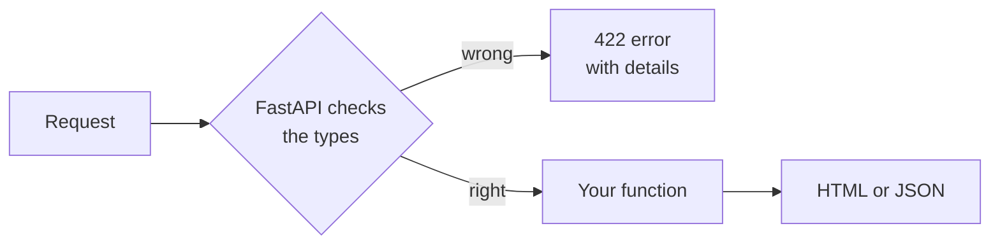

# T45: FastAPIでPythonサーバーを構築する

[T21](t21.html) と [T23](t23.html) では、Node.jsでサーバーを構築しました。このレッスンでは、**FastAPI**を使ってPythonで同じ種類の「キッチン」を構築します。FastAPIは、すべての注文がコンロに届く前に読み取るヘッドシェフだと考えてください。顧客が「abc」ピザを注文した場合、シェフは丁寧なメモを添えて注文を差し戻し、料理人はそれを目にすることはありません。このチェックは、記述した**型**から来ており、多くの間違いを無料で捕捉します。
{: .lesson-intro }

## uvのインストール

**uv** は、Pythonをインストールし、プロジェクトごとにパッケージのプライベートフォルダーを作成し、コードを実行するツールです。複数のツールではなく、1つのツールです。

```
# macOS and Linux
curl -LsSf https://astral.sh/uv/install.sh | sh

# Windows (PowerShell)
powershell -ExecutionPolicy ByPass -c "irm https://astral.sh/uv/install.ps1 | iex"
```

ターミナルを閉じて再度開き、`uv --version` で確認してください。他のインストール方法は [docs.astral.sh/uv](https://docs.astral.sh/uv/) にあります。

## プロジェクトの開始

```
uv init --no-package hello-api
cd hello-api
uv add fastapi uvicorn jinja2 python-multipart
```

- `uv init` はプロジェクトを作成します: `pyproject.toml` (Node.jsの `package.json` のように、プロジェクトが必要とするもののリスト)、`main.py`、および `.gitignore`。`--no-package` は、`main.py` がトップにあるシンプルなアプリとして保持します。
- `uv add` は、パッケージをプライベートな `.venv` フォルダーにインストールし、それらを `pyproject.toml` に書き込みます。
- **fastapi** はフレームワーク、**uvicorn** はそれを実行するサーバープログラム、**jinja2** はHTMLテンプレートを埋めます ([T46](t46.html))、**python-multipart** はFastAPIがHTMLフォームを読み取ることを可能にします。

## HTMLを返す最初のルート

`main.py` の内容をすべて以下に置き換えてください。

```
from fastapi import FastAPI, Form, HTTPException
from fastapi.responses import HTMLResponse

app = FastAPI()


@app.get("/", response_class=HTMLResponse)
def home() -> str:
    return "<h1>Hello from Python</h1><p>The kitchen is open.</p>"
```

`@app.get("/")` は「ブラウザがGETで `/` を要求したときに、この関数を実行する」という意味です。この関数は文字列を返し、`response_class=HTMLResponse` はFastAPIにそれをウェブページとして送信するよう指示します。

実行します:

```
uv run uvicorn main:app --reload
```

`main:app` は「`main.py` 内の `app` オブジェクト」を意味します。`--reload` は、保存するたびにサーバーを再起動します。[http://127.0.0.1:8000](http://127.0.0.1:8000) を開いてください。Ctrl+Cで停止します。

## JSONルート

書籍の小さなリストと、それを返すルートを追加します。FastAPIはPythonのリストと辞書を自動的にJSONに変換します。

```
books = [
    {"id": 1, "title": "The Hobbit", "pages": 310},
    {"id": 2, "title": "Dune", "pages": 412},
]


@app.get("/api/books")
def list_books() -> list[dict]:
    return books
```

`/api/books` を開きます。次に `/docs` を開きます。FastAPIは、すべてのルートをリストアップしたインタラクティブなページを構築し、そこでそれぞれを試すことができます。これらはあなたが何も書いていません。

## 型: なぜ役立つのか

Pythonでは、名前の後に**型ヒント**を記述できます: `book_id: int` は「これは整数であるべきだ」を意味し、`title: str` は「これはテキストであるべきだ」を意味し、`-> dict` は「この関数は辞書を返す」を意味します。

通常のPythonはそれらを強制しません。これらは単なるメモです。しかし、それでも役立ちます:

- エディタがそれらを読み取り、コードを実行する前であっても、テキストを数値に追加するなどの混同があった場合に警告してくれます。
- 関数の本体を読まずに、その関数が何を期待しているかを次に読む人に伝えます。

FastAPIはさらに踏み込みます:**すべてのリクエストをチェックするために型を使用します**。型が `int` で、リクエストが `abc` を送信した場合、FastAPIは何が間違っていたかを説明する `422` エラーで応答し、あなたの関数は決して実行されません。

## パスパラメータ

アドレスの波括弧で囲まれた部分は、関数の引数になります。

```
@app.get("/api/books/{book_id}")
def get_book(book_id: int) -> dict:
    for book in books:
        if book["id"] == book_id:
            return book
    raise HTTPException(status_code=404, detail="Book not found")
```

- `/api/books/1` は『ホビット』を返します。`book_id` はテキストの `"1"` ではなく、数値の `1` として届きます。
- `/api/books/99` は `raise` から `404 Not Found` を返します。
- `/api/books/abc` は、有効な整数であるべきだと伝えるメッセージとともに `422` を返します。あなたはそれについて何もコードを書いていません。

## フォームパラメータ

`Form()` はHTMLフォームによって送信されたフィールドを読み取ります。型は引き続き適用されます。

```
@app.post("/api/books", status_code=201)
def add_book(title: str = Form(), pages: int = Form()) -> dict:
    book = {"id": len(books) + 1, "title": title, "pages": pages}
    books.append(book)
    return book
```

次のようなフォームがこれに送信されます。

```
<form method="post" action="/api/books">
  <input name="title">
  <input name="pages" type="number">
  <button>Add</button>
</form>
```

各入力の `name` は引数名と一致します。`pages` が欠落しているか、数値でない場合、FastAPIは `422` で応答します。



## SQLiteでデータを保存する

上記のリストは、サーバーが再起動すると失われます。Pythonには `sqlite3` モジュールを通じてSQLiteが組み込まれています。インストールは不要です。SQLは [T24](t24.html) で学習した内容と全く同じです。

```
import sqlite3

db = sqlite3.connect("app.db")
db.execute("CREATE TABLE IF NOT EXISTS books (id INTEGER PRIMARY KEY, title TEXT, pages INTEGER)")
db.execute("INSERT INTO books (title, pages) VALUES (?, ?)", ("Dune", 412))
db.commit()
rows = db.execute("SELECT id, title, pages FROM books").fetchall()
```

常に `?` プレースホルダーを使用し、文字列を結合してSQLを作成しないでください。これにより、ユーザー入力がクエリを変更することを防ぎます。

## TestClientを使ったテスト

テストとは、アプリを使用し、その応答をチェックする小さなプログラムのことです。FastAPIの**TestClient**は、実際のサーバーを起動せずにアプリにリクエストを送信します。テストツールを開発専用パッケージとしてインストールします。

```
uv add --dev pytest httpx2
```

`main.py` の隣に `test_main.py` を作成します。

```
from fastapi.testclient import TestClient

from main import app

client = TestClient(app)


def test_home_says_hello():
    response = client.get("/")
    assert response.status_code == 200
    assert "Hello from Python" in response.text


def test_missing_book_is_404():
    response = client.get("/api/books/999")
    assert response.status_code == 404


def test_book_id_must_be_a_number():
    response = client.get("/api/books/abc")
    assert response.status_code == 422


def test_add_book():
    response = client.post("/api/books", data={"title": "Emma", "pages": "474"})
    assert response.status_code == 201
    assert response.json()["pages"] == 474
```

それらを実行します。

```
uv run pytest
```

`test_` で始まる名前の各関数が1つのテストです。`assert` は「これは真でなければならず、そうでなければテストは失敗する」という意味です。最後のテストが実際のフォームのように `"474"` をテキストとして送信し、数値 `474` を返していることに注目してください。これは型によって行われました。

<div class="takeaways">
<h2>主なポイント</h2>
<ul>
<li>uvはPythonとプロジェクトごとのパッケージをインストールします: uv init, uv add, uv run</li>
<li>ルートは@app.get("/path")のようなデコレータを持つ関数です。HTMLには文字列、JSONには辞書またはリストを返します。</li>
<li>型ヒントはエディタと読者の助けになります。FastAPIはそれらを使ってすべてのリクエストをチェックし、入力が間違っている場合は422で応答します。</li>
<li>パスパラメータはアドレスの{波括弧}から来ます。フォームパラメータはForm()から来て、python-multipartが必要です。</li>
<li>Pythonの組み込みsqlite3モジュールはT24と同じSQLを扱います。常に?プレースホルダーを使用してください。</li>
<li>TestClientとpytestはサーバーを起動せずにアプリをテストします: uv run pytest</li>
</ul>
</div>
