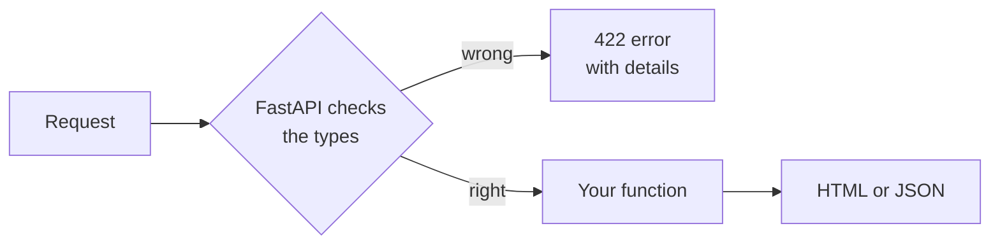

# T45: A Python Server with FastAPI

In [T21](t21.html) to [T23](t23.html) you built a server in Node.js. This lesson builds the same kind of kitchen in Python, with **FastAPI**. Think of FastAPI as a head chef who reads every order before it reaches the stove. If a customer orders "abc" pizzas, the chef sends the order back with a polite note, and the cooks never see it. That checking comes from the **types** you write, and it catches many mistakes for free.
{: .lesson-intro }

## Install uv

**uv** is a tool that installs Python, creates a private folder of packages for each project, and runs your code. One tool instead of several.

```
# macOS and Linux
curl -LsSf https://astral.sh/uv/install.sh | sh

# Windows (PowerShell)
powershell -ExecutionPolicy ByPass -c "irm https://astral.sh/uv/install.ps1 | iex"
```

Close and reopen your terminal, then check with `uv --version`. Other install methods are at [docs.astral.sh/uv](https://docs.astral.sh/uv/).

## Start a Project

```
uv init --no-package hello-api
cd hello-api
uv add fastapi uvicorn jinja2 python-multipart
```

- `uv init` creates the project: a `pyproject.toml` (the list of what the project needs, like `package.json` in Node.js), a `main.py`, and a `.gitignore`. `--no-package` keeps it a simple app with `main.py` at the top.
- `uv add` installs packages into a private `.venv` folder and writes them into `pyproject.toml`.
- **fastapi** is the framework, **uvicorn** is the server program that runs it, **jinja2** fills HTML templates ([T46](t46.html)), and **python-multipart** lets FastAPI read HTML forms.

## A First Route Returning HTML

Replace everything in `main.py` with:

```
from fastapi import FastAPI, Form, HTTPException
from fastapi.responses import HTMLResponse

app = FastAPI()


@app.get("/", response_class=HTMLResponse)
def home() -> str:
    return "<h1>Hello from Python</h1><p>The kitchen is open.</p>"
```

`@app.get("/")` means "when a browser asks for `/` with GET, run this function". The function returns a string, and `response_class=HTMLResponse` tells FastAPI to send it as a web page.

Run it:

```
uv run uvicorn main:app --reload
```

`main:app` means "the `app` object in `main.py`". `--reload` restarts the server every time you save. Open [http://127.0.0.1:8000](http://127.0.0.1:8000). Stop it with Ctrl+C.

## A JSON Route

Add a small list of books and a route that returns it. FastAPI turns Python lists and dictionaries into JSON by itself:

```
books = [
    {"id": 1, "title": "The Hobbit", "pages": 310},
    {"id": 2, "title": "Dune", "pages": 412},
]


@app.get("/api/books")
def list_books() -> list[dict]:
    return books
```

Open `/api/books`. Then open `/docs`: FastAPI builds an interactive page listing every route, where you can try each one. You did not write any of it.

## Types: Why They Help

In Python you can write a **type hint** after a name: `book_id: int` means "this should be a whole number", `title: str` means "this should be text", `-> dict` means "this function returns a dictionary".

Plain Python does not enforce them. They are notes. But they still help:

- Your editor reads them and warns you when you mix things up, like adding text to a number, before you even run the code.
- They tell the next reader what a function expects without reading its body.

FastAPI goes further: **it uses the types to check every request**. If the type says `int` and the request sends `abc`, FastAPI answers with a `422` error explaining what was wrong, and your function never runs.

## Path Parameters

A part of the address in curly braces becomes a function argument:

```
@app.get("/api/books/{book_id}")
def get_book(book_id: int) -> dict:
    for book in books:
        if book["id"] == book_id:
            return book
    raise HTTPException(status_code=404, detail="Book not found")
```

- `/api/books/1` returns The Hobbit. `book_id` arrives as the number `1`, not the text `"1"`.
- `/api/books/99` returns `404 Not Found`, from the `raise`.
- `/api/books/abc` returns `422` with a message saying it should be a valid integer. You wrote no code for that.

## Form Parameters

`Form()` reads a field sent by an HTML form. The type still applies:

```
@app.post("/api/books", status_code=201)
def add_book(title: str = Form(), pages: int = Form()) -> dict:
    book = {"id": len(books) + 1, "title": title, "pages": pages}
    books.append(book)
    return book
```

A form like this one sends to it:

```
<form method="post" action="/api/books">
  <input name="title">
  <input name="pages" type="number">
  <button>Add</button>
</form>
```

The `name` of each input matches an argument name. If `pages` is missing or is not a number, FastAPI answers `422`.



## Saving Data with SQLite

The list above is lost when the server restarts. Python comes with SQLite built in, through the `sqlite3` module. No install needed. The SQL is exactly what you learned in [T24](t24.html):

```
import sqlite3

db = sqlite3.connect("app.db")
db.execute("CREATE TABLE IF NOT EXISTS books (id INTEGER PRIMARY KEY, title TEXT, pages INTEGER)")
db.execute("INSERT INTO books (title, pages) VALUES (?, ?)", ("Dune", 412))
db.commit()
rows = db.execute("SELECT id, title, pages FROM books").fetchall()
```

Always use `?` placeholders, never build SQL by joining strings, so user input cannot change your query.

## Testing with TestClient

A test is a small program that uses your app and checks the answers. FastAPI's **TestClient** sends requests to your app without starting a real server. Install the test tools as development-only packages:

```
uv add --dev pytest httpx2
```

Create `test_main.py` next to `main.py`:

```
from fastapi.testclient import TestClient

from main import app

client = TestClient(app)


def test_home_says_hello():
    response = client.get("/")
    assert response.status_code == 200
    assert "Hello from Python" in response.text


def test_missing_book_is_404():
    response = client.get("/api/books/999")
    assert response.status_code == 404


def test_book_id_must_be_a_number():
    response = client.get("/api/books/abc")
    assert response.status_code == 422


def test_add_book():
    response = client.post("/api/books", data={"title": "Emma", "pages": "474"})
    assert response.status_code == 201
    assert response.json()["pages"] == 474
```

Run them:

```
uv run pytest
```

Each function whose name starts with `test_` is one test. `assert` means "this must be true, or the test fails". Notice the last test sends `"474"` as text, like a real form does, and gets back the number `474`: the type did that.

<div class="takeaways">
<h2>Key Takeaways</h2>
<ul>
<li>uv installs Python and packages per project: uv init, uv add, uv run</li>
<li>A route is a function with a decorator like @app.get("/path"). Return a string for HTML, a dict or list for JSON</li>
<li>Type hints help your editor and readers. FastAPI also uses them to check every request and answers 422 when the input is wrong</li>
<li>Path parameters come from {braces} in the address. Form parameters come from Form() and need python-multipart</li>
<li>Python's built-in sqlite3 module speaks the same SQL as T24. Always use ? placeholders</li>
<li>TestClient plus pytest tests your app without starting a server: uv run pytest</li>
</ul>
</div>
