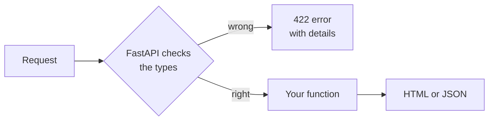

# T45: Um Servidor Python com FastAPI

Em [T21](t21.html) a [T23](t23.html) você construiu um servidor em Node.js. Esta lição constrói o mesmo tipo de cozinha em Python, com **FastAPI**. Pense em FastAPI como um chef de cozinha que lê cada pedido antes que ele chegue ao fogão. Se um cliente pede pizzas "abc", o chef devolve o pedido com uma nota educada, e os cozinheiros nunca o veem. Essa verificação vem dos **tipos** que você escreve, e ela pega muitos erros gratuitamente.
{: .lesson-intro }

## Instalar uv

**uv** é uma ferramenta que instala Python, cria uma pasta privada de pacotes para cada projeto e executa seu código. Uma ferramenta em vez de várias.

```
# macOS and Linux
curl -LsSf https://astral.sh/uv/install.sh | sh

# Windows (PowerShell)
powershell -ExecutionPolicy ByPass -c "irm https://astral.sh/uv/install.ps1 | iex"
```

Feche e reabra seu terminal, então verifique com `uv --version`. Outros métodos de instalação estão em [docs.astral.sh/uv](https://docs.astral.sh/uv/).

## Iniciar um Projeto

```
uv init --no-package hello-api
cd hello-api
uv add fastapi uvicorn jinja2 python-multipart
```

- `uv init` cria o projeto: um `pyproject.toml` (a lista do que o projeto precisa, como `package.json` em Node.js), um `main.py` e um `.gitignore`. `--no-package` o mantém como um aplicativo simples com `main.py` no topo.
- `uv add` instala pacotes em uma pasta privada `.venv` e os escreve em `pyproject.toml`.
- **fastapi** é o framework, **uvicorn** é o programa de servidor que o executa, **jinja2** preenche templates HTML ([T46](t46.html)), e **python-multipart** permite que o FastAPI leia formulários HTML.

## Uma Primeira Rota Retornando HTML

Substitua tudo em `main.py` por:

```
from fastapi import FastAPI, Form, HTTPException
from fastapi.responses import HTMLResponse

app = FastAPI()


@app.get("/", response_class=HTMLResponse)
def home() -> str:
    return "<h1>Hello from Python</h1><p>The kitchen is open.</p>"
```

`@app.get("/")` significa "quando um navegador solicita `/` com GET, execute esta função". A função retorna uma string, e `response_class=HTMLResponse` diz ao FastAPI para enviá-la como uma página web.

Execute-o:

```
uv run uvicorn main:app --reload
```

`main:app` significa "o objeto `app` em `main.py`". `--reload` reinicia o servidor toda vez que você salva. Abra [http://127.0.0.1:8000](http://127.0.0.1:8000). Pare-o com Ctrl+C.

## Uma Rota JSON

Adicione uma pequena lista de livros e uma rota que a retorne. FastAPI transforma listas e dicionários Python em JSON por conta própria:

```
books = [
    {"id": 1, "title": "The Hobbit", "pages": 310},
    {"id": 2, "title": "Dune", "pages": 412},
]


@app.get("/api/books")
def list_books() -> list[dict]:
    return books
```

Abra `/api/books`. Então abra `/docs`: FastAPI constrói uma página interativa listando cada rota, onde você pode experimentar cada uma. Você não escreveu nada disso.

## Tipos: Por Que Eles Ajudam

Em Python você pode escrever uma **dica de tipo** após um nome: `book_id: int` significa "isso deve ser um número inteiro", `title: str` significa "isso deve ser texto", `-> dict` significa "esta função retorna um dicionário".

Python puro não os impõe. Eles são notas. Mas eles ainda ajudam:

- Seu editor os lê e avisa quando você mistura as coisas, como adicionar texto a um número, antes mesmo de executar o código.
- Eles dizem ao próximo leitor o que uma função espera sem ler seu corpo.

FastAPI vai além: **ele usa os tipos para verificar cada requisição**. Se o tipo diz `int` e a requisição envia `abc`, FastAPI responde com um erro `422` explicando o que estava errado, e sua função nunca é executada.

## Parâmetros de Caminho

Uma parte do endereço entre chaves se torna um argumento de função:

```
@app.get("/api/books/{book_id}")
def get_book(book_id: int) -> dict:
    for book in books:
        if book["id"] == book_id:
            return book
    raise HTTPException(status_code=404, detail="Book not found")
```

- `/api/books/1` retorna O Hobbit. `book_id` chega como o número `1`, não o texto `"1"`.
- `/api/books/99` retorna `404 Not Found`, do `raise`.
- `/api/books/abc` retorna `422` com uma mensagem dizendo que deveria ser um número inteiro válido. Você não escreveu nenhum código para isso.

## Parâmetros de Formulário

`Form()` lê um campo enviado por um formulário HTML. O tipo ainda se aplica:

```
@app.post("/api/books", status_code=201)
def add_book(title: str = Form(), pages: int = Form()) -> dict:
    book = {"id": len(books) + 1, "title": title, "pages": pages}
    books.append(book)
    return book
```

Um formulário como este envia para ele:

```
<form method="post" action="/api/books">
  <input name="title">
  <input name="pages" type="number">
  <button>Add</button>
</form>
```

O `name` de cada input corresponde a um nome de argumento. Se `pages` estiver faltando ou não for um número, FastAPI responde `422`.



## Salvando Dados com SQLite

A lista acima é perdida quando o servidor reinicia. Python vem com SQLite integrado, através do módulo `sqlite3`. Nenhuma instalação é necessária. O SQL é exatamente o que você aprendeu em [T24](t24.html):

```
import sqlite3

db = sqlite3.connect("app.db")
db.execute("CREATE TABLE IF NOT EXISTS books (id INTEGER PRIMARY KEY, title TEXT, pages INTEGER)")
db.execute("INSERT INTO books (title, pages) VALUES (?, ?)", ("Dune", 412))
db.commit()
rows = db.execute("SELECT id, title, pages FROM books").fetchall()
```

Sempre use marcadores `?`, nunca construa SQL juntando strings, para que a entrada do usuário não possa alterar sua consulta.

## Testando com TestClient

Um teste é um pequeno programa que usa seu aplicativo e verifica as respostas. O **TestClient** do FastAPI envia requisições para seu aplicativo sem iniciar um servidor real. Instale as ferramentas de teste como pacotes apenas de desenvolvimento:

```
uv add --dev pytest httpx2
```

Crie `test_main.py` ao lado de `main.py`:

```
from fastapi.testclient import TestClient

from main import app

client = TestClient(app)


def test_home_says_hello():
    response = client.get("/")
    assert response.status_code == 200
    assert "Hello from Python" in response.text


def test_missing_book_is_404():
    response = client.get("/api/books/999")
    assert response.status_code == 404


def test_book_id_must_be_a_number():
    response = client.get("/api/books/abc")
    assert response.status_code == 422


def test_add_book():
    response = client.post("/api/books", data={"title": "Emma", "pages": "474"})
    assert response.status_code == 201
    assert response.json()["pages"] == 474
```

Execute-os:

```
uv run pytest
```

Cada função cujo nome começa com `test_` é um teste. `assert` significa "isso deve ser verdadeiro, ou o teste falha". Observe que o último teste envia `"474"` como texto, como um formulário real faz, e recebe de volta o número `474`: o tipo fez isso.

<div class="takeaways">
<h2>Principais Conclusões</h2>
<ul>
<li>uv instala Python e pacotes por projeto: uv init, uv add, uv run</li>
<li>Uma rota é uma função com um decorador como @app.get("/path"). Retorne uma string para HTML, um dict ou list para JSON</li>
<li>Dicas de tipo (type hints) ajudam seu editor e leitores. O FastAPI também as usa para verificar cada requisição e responde 422 quando a entrada está errada</li>
<li>Parâmetros de caminho vêm de {chaves} no endereço. Parâmetros de formulário vêm de Form() e precisam de python-multipart</li>
<li>O módulo sqlite3 embutido do Python usa o mesmo SQL que T24. Sempre use marcadores ?</li>
<li>TestClient mais pytest testa seu aplicativo sem iniciar um servidor: uv run pytest</li>
</ul>
</div>
