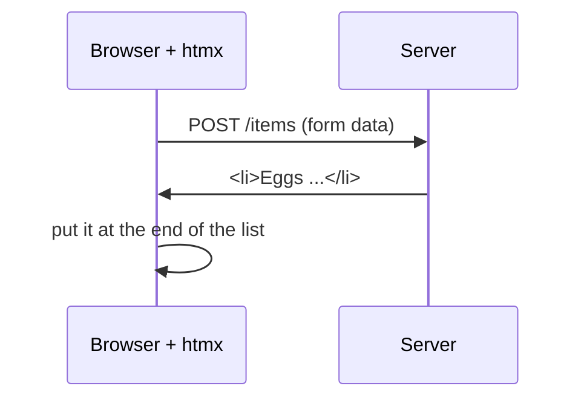

# T46: htmxによるHTMLオーバー・ザ・ワイヤー

[T15](t15.html)では、ブラウザがJSONをフェッチし、JavaScriptがHTMLを構築していました。これは、レシピカードと一緒に生の食材をテーブルに送ってくるレストランのようなものです。自分で料理をするわけです。**htmx**はその逆の動作をします。キッチンが完成した料理、つまり既製のHTMLの断片を送り、ウェイターがそれをテーブルの正しい場所に置きます。JavaScriptをほとんど書く必要はありません。HTMLにいくつかの属性を追加するだけで、残りはサーバーが行います。
{: .lesson-intro }

## 考え方

通常、リンクとフォームだけがサーバーと通信し、ページ全体を再読み込みします。htmxは**あらゆる要素**がリクエストを送信することを可能にし、返ってきたHTMLをページの**あらゆる部分**に、再読み込みなしで挿入します。



4つの質問、4つの属性：

| 質問 | 属性 | 例 |
|---|---|---|
| どのリクエストをどこへ？ | `hx-get`, `hx-post`, `hx-delete` | `hx-post="/items"` |
| 応答はどこへ行くか？ | `hx-target` | `hx-target="#items"` |
| どのように挿入されるか？ | `hx-swap` | `hx-swap="beforeend"` |
| 最初に尋ねるか？ | `hx-confirm` | `hx-confirm="Sure?"` |

一般的な`hx-swap`の値：`innerHTML`（ターゲットの中身を置き換える、デフォルト）、`outerHTML`（ターゲット全体を置き換える）、`beforeend`（内側の末尾に追加する）、`delete`（ターゲットを削除する）。

`hx-target`は、`#items`のようなCSSセレクター、または`this`（要素自体）、`closest li`（要素の周りにある最も近い`<li>`）を取ります。

このレッスンでは、2026年にリリースされた**htmx 4**を使用します。オンラインの多くのチュートリアルはhtmx 2向けであり、いくつかの詳細が異なります。

## 例：買い物リスト

項目を追加するためのリストとフォーム、そして各項目には削除ボタンがあります。[T45](t45.html)のFastAPIプロジェクトを基にして、**Jinja**テンプレート（Pythonが`{{ holes }}`を埋めるHTMLファイル）を使用します。

```
shopping/
  main.py
  templates/
    index.html     the full page
    _item.html     one <li>
    _form.html     the add form
    _added.html    the answer after a successful add
```

`_`で始まるファイルは**フラグメント**です。これらはページ全体ではなく、ページの一部です。ページ全体がこれらをインクルードし、サーバーも単体でこれらを返します。

### ページ全体

```
<!doctype html>
<html lang="en">
<head>
  <meta charset="utf-8">
  <title>Shopping list</title>
  <script src="https://cdn.jsdelivr.net/npm/htmx.org@4.0.0/dist/htmx.min.js"></script>
</head>
<body>
  <h1>Shopping list</h1>
  <ul id="items">
    
      
    
  </ul>
  
</body>
</html>
```

意図的にバージョンを`@4.0.0`に固定しています。これを指定しないと、CDNからhtmx 2が提供される可能性があります。

### 削除ボタン付きの1つの項目

```
<li>
  {{ item.text }}
  <button hx-delete="/items/{{ item.id }}"
          hx-confirm="Delete {{ item.text }}?"
          hx-target="closest li"
          hx-swap="delete">Delete</button>
</li>
```

クリックすると、ブラウザは「Delete Buy rice?」と尋ねます。はいと答えると、htmxは`DELETE /items/1`を送信します。サーバーが応答すると、`hx-swap="delete"`が`<li>`を削除します。

### フォーム

```
<form hx-post="/items" hx-target="this" hx-swap="outerHTML">
  <input name="text" placeholder="Add an item">
  <button>Add</button>
  <p class="error">{{ error }}</p>
</form>
```

送信すると、htmxはフォームフィールドを`POST /items`で送信し、その後、返ってきた内容でフォーム全体（`this`の`outerHTML`）を置き換えます。これにより、項目を追加するたびに新しい空のフォーム、またはエラーメッセージ付きの同じフォームが得られます。

### 2番目の場所を更新する：hx-partial

項目を正常に追加した後、2つの場所が変更される必要があります。フォームは空になり、新しい項目がリストに表示される必要があります。応答の主要なコンテンツはフォームに送られます。リストには、新しい項目を`<hx-partial>`でラップし、独自のターゲットとスワップを持たせます。

```

<hx-partial hx-target="#items" hx-swap="beforeend">
  
</hx-partial>
```

htmxはまず主要なコンテンツをスワップし、その後各パーシャルを独自のターゲットにスワップします。

### サーバー

```
from fastapi import FastAPI, Form, Request
from fastapi.responses import HTMLResponse
from fastapi.templating import Jinja2Templates

app = FastAPI()
templates = Jinja2Templates(directory="templates")

items = [{"id": 1, "text": "Buy rice"}, {"id": 2, "text": "Call grandma"}]
next_id = 3


@app.get("/", response_class=HTMLResponse)
def home(request: Request):
    return templates.TemplateResponse(request, "index.html", {"items": items})


@app.post("/items", response_class=HTMLResponse)
def add_item(request: Request, text: str = Form("")):
    global next_id
    text = text.strip()
    if not text:
        return templates.TemplateResponse(
            request, "_form.html", {"error": "Write something first."}, status_code=422
        )
    item = {"id": next_id, "text": text}
    next_id += 1
    items.append(item)
    return templates.TemplateResponse(request, "_added.html", {"item": item})


@app.delete("/items/{item_id}", response_class=HTMLResponse)
def delete_item(item_id: int):
    items[:] = [i for i in items if i["id"] != item_id]
    return ""
```

`uv run uvicorn main:app --reload`で実行し、[http://127.0.0.1:8000](http://127.0.0.1:8000)を開いてください。リストはメモリ上に存在するため、サーバーが再起動するとリセットされます。[T45](t45.html)のSQLiteに置き換えることで、データを保持できます。

## エラーもHTMLとして返される

空のテキストの場合を見てみましょう。サーバーはステータス**422**（リクエストは理解されたが、データが受け入れられない）と、エラーメッセージが中に含まれたフォームで応答します。

htmx 4では、**エラー応答も入れ替えられます**。`204 No Content`と`304 Not Modified`のみがスキップされます。そのため、422応答はフォームを置き換え、ユーザーは入力の下に「Write something first.」というメッセージを見ます。ステータスコードはテストやログのために正直なままであり、ページは依然としてメッセージを表示します。（htmx 2はデフォルトでエラー応答を無視していたため、古いチュートリアルではこれを回避していました。）

裏を返せば、サーバーがクラッシュしてエラーページを返した場合、そのページもターゲットに表示されます。エラー応答は小さく、表示されるべき場所に合わせたものにしてください。

## htmxが不適切な場面

htmxは、サーバーがデータを所有し、ページが主にそれを表示する場合に力を発揮します。リスト、フォーム、ダッシュボード、管理ページ、検索結果などです。すべての変更がサーバーへのアクセスを伴いますが、そのアクセスが数十ミリ秒で完了するなら問題ありません。

一方、ブラウザ内で1秒間に何度も、サーバーなしで処理が行われる場合は不適切なツールです。

- **ゲーム。** ゲームループは1秒間に約60回画面を描画します ([A10](a10.html))。これはJavaScriptの役割です。
- **高度なエディター。** 描画アプリ、スプレッドシート、リアルタイムの書式設定機能を備えたリッチテキストエディターなど。これらはブラウザ内に多くの状態を保持し、すべてのキー入力に対して即座のフィードバックを必要とします。
- **オフラインアプリ。** 応答するサーバーがない場合、htmxは何も入れ替えることができません。

htmxとJavaScriptを組み合わせることもできます。フォームやリストにはhtmxを使い、特定のウィジェットが必要とする部分に少しのJavaScriptを使用する、といった具合です。

<div class="takeaways">
<h2>主なポイント</h2>
<ul>
<li>htmxを使用すると、サーバーがHTMLの断片を送り、ページがそれらを挿入します。JavaScriptは大幅に少なくなります。</li>
<li>`hx-get`、`hx-post`、`hx-delete`は送信内容を示し、`hx-target`は応答の送信先を示し、`hx-swap`は挿入方法を示します。</li>
<li>`hx-confirm`は送信前にユーザーに尋ねます。`hx-swap="delete"`はターゲットを削除します。</li>
<li>応答内の`<hx-partial hx-target hx-swap>`は、ページの2番目の場所を更新します。</li>
<li>htmx 4では、422のようなエラー応答も入れ替えられるため、フォームはエラーメッセージ付きで返されることがあります。</li>
<li>スクリプトURLでhtmxをバージョン4に固定してください。ゲーム、高度なエディター、オフラインアプリにはhtmxを使用しないでください。</li>
</ul>
</div>
