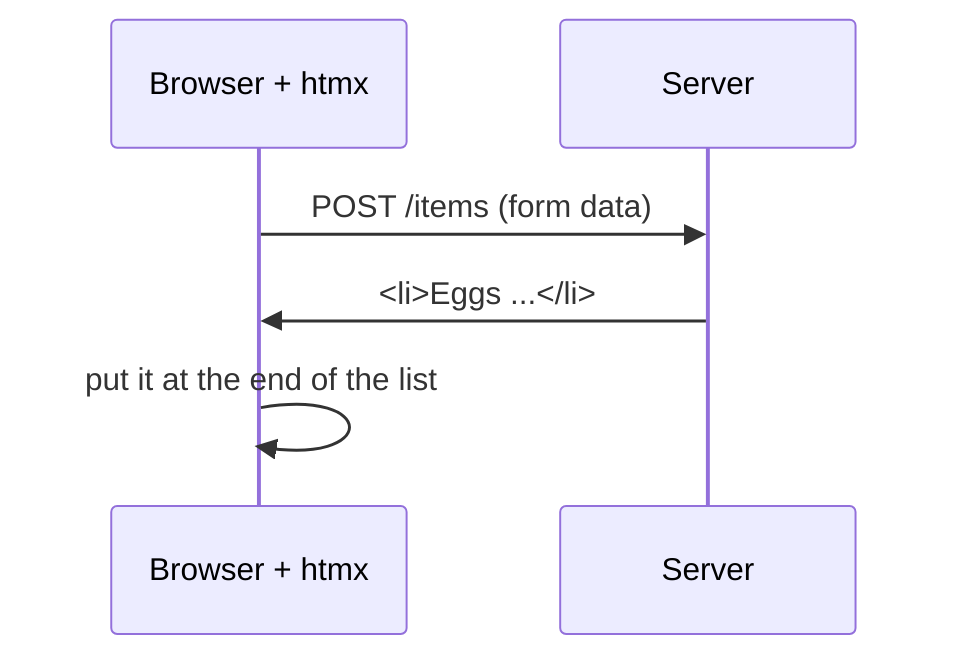

# T46: HTML over the Wire with htmx

In [T15](t15.html) the browser fetched JSON and your JavaScript built the HTML. That is like a restaurant that sends raw ingredients to your table with a recipe card: you do the cooking yourself. **htmx** works the other way. The kitchen sends a finished plate, a piece of ready-made HTML, and the waiter puts it in the right spot on the table. You write almost no JavaScript. You add a few attributes to your HTML, and the server does the rest.
{: .lesson-intro }

## The Idea

Normally only links and forms talk to the server, and they reload the whole page. htmx lets **any element** send a request, and puts the HTML that comes back into **any part** of the page, without a reload.



Four questions, four attributes:

| Question | Attribute | Example |
|---|---|---|
| What request, to where? | `hx-get`, `hx-post`, `hx-delete` | `hx-post="/items"` |
| Where does the answer go? | `hx-target` | `hx-target="#items"` |
| How does it go in? | `hx-swap` | `hx-swap="beforeend"` |
| Ask first? | `hx-confirm` | `hx-confirm="Sure?"` |

Common `hx-swap` values: `innerHTML` (replace what is inside the target, the default), `outerHTML` (replace the whole target), `beforeend` (add at the end, inside), `delete` (remove the target).

`hx-target` takes a CSS selector like `#items`, or `this` (the element itself), or `closest li` (the nearest `<li>` around the element).

This lesson uses **htmx 4**, released in 2026. Many tutorials online are for htmx 2, and some details differ.

## The Example: a Shopping List

A list, a form to add items, and a delete button on each item. It builds on the FastAPI project from [T45](t45.html), using **Jinja** templates: HTML files with `{{ holes }}` that Python fills in.

```
shopping/
  main.py
  templates/
    index.html     the full page
    _item.html     one <li>
    _form.html     the add form
    _added.html    the answer after a successful add
```

Files starting with `_` are **fragments**: pieces of a page, not whole pages. The full page includes them, and the server also sends them back alone.

### The full page

```
<!doctype html>
<html lang="en">
<head>
  <meta charset="utf-8">
  <title>Shopping list</title>
  <script src="https://cdn.jsdelivr.net/npm/htmx.org@4.0.0/dist/htmx.min.js"></script>
</head>
<body>
  <h1>Shopping list</h1>
  <ul id="items">
    
      
    
  </ul>
  
</body>
</html>
```

The version is pinned to `@4.0.0` on purpose. Without it, the CDN could give you htmx 2.

### One item, with a delete button

```
<li>
  {{ item.text }}
  <button hx-delete="/items/{{ item.id }}"
          hx-confirm="Delete {{ item.text }}?"
          hx-target="closest li"
          hx-swap="delete">Delete</button>
</li>
```

Click: the browser asks "Delete Buy rice?". If you say yes, htmx sends `DELETE /items/1`. When the server answers, `hx-swap="delete"` removes the `<li>`.

### The form

```
<form hx-post="/items" hx-target="this" hx-swap="outerHTML">
  <input name="text" placeholder="Add an item">
  <button>Add</button>
  <p class="error">{{ error }}</p>
</form>
```

On submit, htmx sends the form fields with `POST /items`, then replaces the whole form (`outerHTML` of `this`) with whatever comes back. That gives us a fresh, empty form after each add, or the same form with an error message.

### Updating a second place: hx-partial

After a successful add, two places must change: the form must be emptied, and the new item must appear in the list. The answer's main content goes to the form. For the list, wrap the new item in `<hx-partial>`, which carries its own target and swap:

```

<hx-partial hx-target="#items" hx-swap="beforeend">
  
</hx-partial>
```

htmx swaps the main content first, then each partial into its own target.

### The server

```
from fastapi import FastAPI, Form, Request
from fastapi.responses import HTMLResponse
from fastapi.templating import Jinja2Templates

app = FastAPI()
templates = Jinja2Templates(directory="templates")

items = [{"id": 1, "text": "Buy rice"}, {"id": 2, "text": "Call grandma"}]
next_id = 3


@app.get("/", response_class=HTMLResponse)
def home(request: Request):
    return templates.TemplateResponse(request, "index.html", {"items": items})


@app.post("/items", response_class=HTMLResponse)
def add_item(request: Request, text: str = Form("")):
    global next_id
    text = text.strip()
    if not text:
        return templates.TemplateResponse(
            request, "_form.html", {"error": "Write something first."}, status_code=422
        )
    item = {"id": next_id, "text": text}
    next_id += 1
    items.append(item)
    return templates.TemplateResponse(request, "_added.html", {"item": item})


@app.delete("/items/{item_id}", response_class=HTMLResponse)
def delete_item(item_id: int):
    items[:] = [i for i in items if i["id"] != item_id]
    return ""
```

Run it with `uv run uvicorn main:app --reload` and open [http://127.0.0.1:8000](http://127.0.0.1:8000). The list lives in memory, so it resets when the server restarts. Swap in SQLite from [T45](t45.html) to keep it.

## Errors Come Back as HTML

Look at the empty-text case. The server answers with status **422** (the request was understood, but the data is not acceptable) and the form with an error message inside.

In htmx 4, **error responses are swapped too**. Only `204 No Content` and `304 Not Modified` are skipped. So the 422 answer replaces the form, and the user sees "Write something first." right under the input. The status code stays honest for tests and logs, and the page still shows the message. (htmx 2 ignored error responses by default, so older tutorials work around this.)

The flip side: if your server crashes and returns an error page, that page lands in the target too. Keep error answers small and meant for where they will go.

## When htmx Is the Wrong Tool

htmx shines when the server owns the data and the page mostly shows it: lists, forms, dashboards, admin pages, search with results. Every change is a trip to the server, and that is fine when a trip takes a few dozen milliseconds.

It is the wrong tool when the work happens in the browser, many times a second, without the server:

- **Games.** A game loop redraws the screen about 60 times a second ([A10](a10.html)). That is JavaScript's job.
- **Heavy editors.** A drawing app, a spreadsheet, a rich text editor with live formatting. These keep a lot of state in the browser and need instant feedback on every key press.
- **Offline apps.** If there is no server to answer, htmx has nothing to swap in.

You can mix: htmx for the forms and lists, a bit of JavaScript for the one widget that needs it.

<div class="takeaways">
<h2>Key Takeaways</h2>
<ul>
<li>With htmx the server sends HTML fragments, and the page swaps them in. Much less JavaScript</li>
<li>hx-get, hx-post, hx-delete say what to send. hx-target says where the answer goes. hx-swap says how</li>
<li>hx-confirm asks the user before sending. hx-swap="delete" removes the target</li>
<li>&lt;hx-partial hx-target hx-swap&gt; in a response updates a second place on the page</li>
<li>In htmx 4, error responses like 422 are swapped too, so a form can come back with its error message</li>
<li>Pin htmx to version 4 in the script URL. Do not use htmx for games, heavy editors or offline apps</li>
</ul>
</div>
