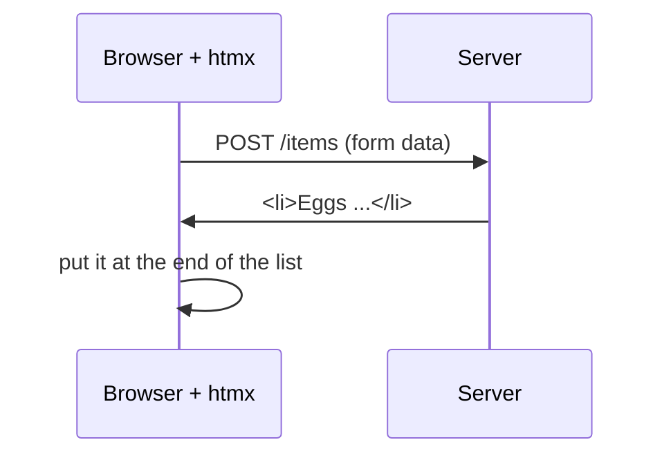

# T46: HTML sobre o Fio com htmx

Em [T15](t15.html) o navegador buscou JSON e seu JavaScript construiu o HTML. Isso é como um restaurante que envia ingredientes crus para sua mesa com uma receita: você mesmo cozinha. O **htmx** funciona de outra maneira. A cozinha envia um prato pronto, um pedaço de HTML já feito, e o garçom o coloca no lugar certo na mesa. Você escreve quase nenhum JavaScript. Você adiciona alguns atributos ao seu HTML, e o servidor faz o resto.
{: .lesson-intro }

## A Ideia

Normalmente, apenas links e formulários se comunicam com o servidor, e eles recarregam a página inteira. O htmx permite que **qualquer elemento** envie uma requisição e coloque o HTML que retorna em **qualquer parte** da página, sem recarregamento.



Quatro perguntas, quatro atributos:

| Pergunta | Atributo | Exemplo |
|---|---|---|
| Que requisição, para onde? | `hx-get`, `hx-post`, `hx-delete` | `hx-post="/items"` |
| Para onde vai a resposta? | `hx-target` | `hx-target="#items"` |
| Como ela entra? | `hx-swap` | `hx-swap="beforeend"` |
| Perguntar primeiro? | `hx-confirm` | `hx-confirm="Tem certeza?"` |

Valores comuns de `hx-swap`: `innerHTML` (substitui o que está dentro do alvo, o padrão), `outerHTML` (substitui o alvo inteiro), `beforeend` (adiciona no final, por dentro), `delete` (remove o alvo).

`hx-target` aceita um seletor CSS como `#items`, ou `this` (o próprio elemento), ou `closest li` (o `<li>` mais próximo ao redor do elemento).

Esta lição usa o **htmx 4**, lançado em 2026. Muitos tutoriais online são para o htmx 2, e alguns detalhes diferem.

## O Exemplo: uma Lista de Compras

Uma lista, um formulário para adicionar itens e um botão de exclusão em cada item. Baseia-se no projeto FastAPI de [T45](t45.html), usando templates **Jinja**: arquivos HTML com `{{ holes }}` que o Python preenche.

```
shopping/
  main.py
  templates/
    index.html     the full page
    _item.html     one <li>
    _form.html     the add form
    _added.html    the answer after a successful add
```

Arquivos que começam com `_` são **fragmentos**: pedaços de uma página, não páginas inteiras. A página completa os inclui, e o servidor também os envia de volta sozinhos.

### A página completa

```
<!doctype html>
<html lang="en">
<head>
  <meta charset="utf-8">
  <title>Shopping list</title>
  <script src="https://cdn.jsdelivr.net/npm/htmx.org@4.0.0/dist/htmx.min.js"></script>
</head>
<body>
  <h1>Shopping list</h1>
  <ul id="items">
    
      
    
  </ul>
  
</body>
</html>
```

A versão está fixada em `@4.0.0` de propósito. Sem isso, o CDN poderia entregar o htmx 2.

### Um item, com um botão de exclusão

```
<li>
  {{ item.text }}
  <button hx-delete="/items/{{ item.id }}"
          hx-confirm="Delete {{ item.text }}?"
          hx-target="closest li"
          hx-swap="delete">Delete</button>
</li>
```

Clique: o navegador pergunta "Excluir Comprar arroz?". Se você disser sim, o htmx envia `DELETE /items/1`. Quando o servidor responde, `hx-swap="delete"` remove o `<li>`.

### O formulário

```
<form hx-post="/items" hx-target="this" hx-swap="outerHTML">
  <input name="text" placeholder="Add an item">
  <button>Add</button>
  <p class="error">{{ error }}</p>
</form>
```

Ao enviar, o htmx envia os campos do formulário com `POST /items`, então substitui o formulário inteiro (`outerHTML` de `this`) com o que quer que retorne. Isso nos dá um formulário novo e vazio após cada adição, ou o mesmo formulário com uma mensagem de erro.

### Atualizando um segundo lugar: hx-partial

Após uma adição bem-sucedida, dois lugares devem mudar: o formulário deve ser esvaziado, e o novo item deve aparecer na lista. O conteúdo principal da resposta vai para o formulário. Para a lista, envolva o novo item em `<hx-partial>`, que carrega seu próprio alvo e tipo de troca:

```

<hx-partial hx-target="#items" hx-swap="beforeend">
  
</hx-partial>
```

O htmx troca o conteúdo principal primeiro, depois cada `partial` em seu próprio alvo.

### O servidor

```
from fastapi import FastAPI, Form, Request
from fastapi.responses import HTMLResponse
from fastapi.templating import Jinja2Templates

app = FastAPI()
templates = Jinja2Templates(directory="templates")

items = [{"id": 1, "text": "Buy rice"}, {"id": 2, "text": "Call grandma"}]
next_id = 3


@app.get("/", response_class=HTMLResponse)
def home(request: Request):
    return templates.TemplateResponse(request, "index.html", {"items": items})


@app.post("/items", response_class=HTMLResponse)
def add_item(request: Request, text: str = Form("")):
    global next_id
    text = text.strip()
    if not text:
        return templates.TemplateResponse(
            request, "_form.html", {"error": "Write something first."}, status_code=422
        )
    item = {"id": next_id, "text": text}
    next_id += 1
    items.append(item)
    return templates.TemplateResponse(request, "_added.html", {"item": item})


@app.delete("/items/{item_id}", response_class=HTMLResponse)
def delete_item(item_id: int):
    items[:] = [i for i in items if i["id"] != item_id]
    return ""
```

Execute-o com `uv run uvicorn main:app --reload` e abra [http://127.0.0.1:8000](http://127.0.0.1:8000). A lista reside na memória, então ela é redefinida quando o servidor reinicia. Substitua por SQLite de [T45](t45.html) para mantê-la.

## Erros Retornam como HTML

Observe o caso de texto vazio. O servidor responde com o status **422** (a requisição foi compreendida, mas os dados não são aceitáveis) e o formulário com uma mensagem de erro dentro.

No htmx 4, **respostas de erro também são trocadas**. Apenas `204 No Content` e `304 Not Modified` são ignoradas. Assim, a resposta 422 substitui o formulário, e o usuário vê "Escreva algo primeiro." logo abaixo do campo de entrada. O código de status permanece fiel para testes e logs, e a página ainda exibe a mensagem. (O htmx 2 ignorava respostas de erro por padrão, então tutoriais antigos contornam isso.)

O outro lado: se o seu servidor travar e retornar uma página de erro, essa página também aparecerá no alvo. Mantenha as respostas de erro pequenas e destinadas ao local onde serão exibidas.

## Quando htmx É a Ferramenta Errada

O htmx brilha quando o servidor é o proprietário dos dados e a página os exibe principalmente: listas, formulários, painéis, páginas de administração, pesquisa com resultados. Cada alteração é uma ida ao servidor, e isso é aceitável quando uma ida leva algumas dezenas de milissegundos.

É a ferramenta errada quando o trabalho acontece no navegador, muitas vezes por segundo, sem o servidor:

- **Jogos.** Um loop de jogo redesenha a tela cerca de 60 vezes por segundo ([A10](a10.html)). Esse é o trabalho do JavaScript.
- **Editores pesados.** Um aplicativo de desenho, uma planilha, um editor de texto rico com formatação em tempo real. Eles mantêm muito estado no navegador e precisam de feedback instantâneo a cada tecla pressionada.
- **Aplicativos offline.** Se não houver servidor para responder, o htmx não tem nada para inserir.

Você pode misturar: htmx para os formulários e listas, um pouco de JavaScript para o widget que precisar.

<div class="takeaways">
<h2>Principais Lições</h2>
<ul>
<li>Com htmx, o servidor envia fragmentos de HTML, e a página os insere. Muito menos JavaScript.</li>
<li>hx-get, hx-post, hx-delete dizem o que enviar. hx-target diz para onde a resposta vai. hx-swap diz como.</li>
<li>hx-confirm pergunta ao usuário antes de enviar. hx-swap="delete" remove o alvo.</li>
<li>&lt;hx-partial hx-target hx-swap&gt; em uma resposta atualiza um segundo local na página.</li>
<li>No htmx 4, respostas de erro como 422 também são trocadas, então um formulário pode retornar com sua mensagem de erro.</li>
<li>Fixe o htmx na versão 4 na URL do script. Não use htmx para jogos, editores pesados ou aplicativos offline.</li>
</ul>
</div>
