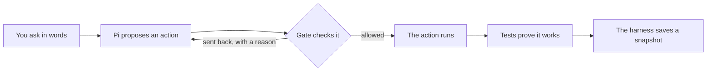

# W01: What the Workbench Is (and the Three AI Risks)

Imagine hiring a fast, tireless apprentice for your workshop. They never sleep and they know a lot. They also make things up when they are unsure, and they say "done!" a little too often. So you put a foreman beside them. The foreman checks every tool before it touches the wood, writes down every job in a notebook, and only stamps a job "finished" after testing it. **Pi Workbench** is that workshop. Pi is the apprentice. The harness around Pi is the foreman.
{: .lesson-intro }

## What You Get

Pi Workbench (the project is called **pi-local-harness**) runs on your own computer. You start it by typing one command in a terminal:

```
plh
```

That starts three things:

- **Pi**, the AI agent, in the terminal ("terminal Pi"). You can talk to it right there.
- **Gate**, the checker. Every command Pi wants to run goes through Gate first.
- **The web workbench**, normally at [http://127.0.0.1:3000](http://127.0.0.1:3000). This is where you will spend most of your time: your projects, one chat per project, and your files.

Quitting Pi (Ctrl-C twice, or typing `/quit`) stops everything. Today the model is a local one, running on your machine through Ollama. Nothing about your project leaves your computer.

Setting it up the first time takes a few steps (Python, `uv`, Ollama and a model, then `python3 harness/install.py` from the project). They are in the [pi-local-harness README](https://github.com/KakkoiDev/pi-local-harness). If your computer is too slow for a local model, Pi Workbench will soon let you choose a cloud model instead, and tell you exactly what leaves your machine.

## A Project, a Chat, a Plan

In the workbench, **New Project…** makes a folder with two plan files: `ROADMAP.md` (the list of jobs) and a `tasks/` folder (one file per job). **Add Existing Folder…** uses a folder you already have. Each project has exactly one chat with Pi.

You write what you want in plain words. Pi writes code and tests and runs them. The harness keeps the paperwork ([W03](w03.html)).



**The model proposes. Gate checks. Pi executes.** That sentence is the whole design.

## One Stack, Done Very Well

Most AI tools try to build anything in any language. Pi Workbench is **opinionated**: it builds apps one way, and knows that way completely. The stack is:

- **Python** with **FastAPI** for the server, and **Jinja** templates for the HTML pages.
- **htmx 4** to make pages interactive without much JavaScript.
- **Basecoat** and **Tailwind** for good looks by default.
- **SQLite** to save data in one file.
- **Typed code**, checked by **pyright**, so the computer catches mistakes.
- **English and Japanese** from the start.

Why so strict? A small local model does well when the path is known and badly when it must choose. Every choice the stack makes is one the model does not have to make.

## The Three Risks (Keep Them Forever)

The workbench checks a lot. It does not make the AI trustworthy. The same three rules from [A01](a01.html) apply here, every day:

- **It is not your friend.** It is trained to please you, and it does not care about you. Use it, never trust it. The evidence is in [R20: Never Trust an AI](r20.html).
- **Verify the output.** Confident and correct are different things. When Pi says "fixed", look at the proof: did a test fail before and pass after? Open the app and try it yourself.
- **Never feed it secrets.** No passwords, bank details or private data in the chat, in your files, or in Pi's memory. A local model keeps your words on your machine, but your files can still end up on GitHub later ([W12](w12.html)).

What the harness adds is a second pair of eyes that is not a model. Gate refuses dangerous commands, like deleting your home folder. A change is **verified** only when the harness saw a test fail without it and pass with it. Otherwise the answer is marked **Not verified**, whatever Pi says: your cue to look closer.

AI is a force multiplier, not a replacement ([R15](r15.html)). You stay the person who decides what gets built and whether it is right.

## What It Is Not

- **Not a sandbox.** Gate is an accident guard. Pi works in your project folder, but a script could reach further.
- **Not for every project.** A project on another stack gets the general harness only, with less help.

## This Week's Exercise

1. Read [R20](r20.html) and write your own three AI rules, one sentence each.
2. Install Pi Workbench following its README. Type `plh` and find the Web address in the first lines.
3. Open the workbench in your browser and make a **New Project…** called `hello`. Open `ROADMAP.md` and look at it.
4. In terminal Pi, type `/guide` and read "What is this?".

<div class="takeaways">
<h2>Key Takeaways</h2>
<ul>
<li>Pi Workbench runs on your computer: type plh to start Pi, Gate and the web workbench</li>
<li>The model proposes, Gate checks, Pi executes. Each project has one chat, a ROADMAP.md and a tasks/ folder</li>
<li>One stack, done very well: FastAPI and Jinja, htmx 4, Basecoat and Tailwind, SQLite, typed Python, English and Japanese</li>
<li>The three rules still hold: not your friend, verify the output, never feed it secrets</li>
<li>Verified means a test failed without the change and passed with it. Not verified is your cue to look closer</li>
</ul>
</div>
