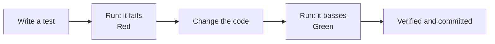

# W03: Reading What Pi Did

When a builder says "the wiring is done", a good inspector does not take their word for it. They switch the lights on. Then they check the logbook: what was changed, when, and who signed it off. Pi Workbench keeps that logbook for you. Pi does the work, and the harness writes down what happened and only signs off when a test proves it. This lesson teaches you to read the logbook in two minutes, and to roll back when something is wrong.
{: .lesson-intro }

## The Task File

The moment Pi changes its first file, the harness makes a **task** for your request: a new file in `tasks/`, and a line for it in `ROADMAP.md`. Pi does not write these. The harness does, so they cannot be faked. A finished one looks like this:

```
# 003: Show each note's date under its title

Kind: code

Request 2026-10-15: “Show each note's date under its title”

## Progress (kept by the harness)
- [x] Started at 14:02: app/templates/fragments/note_item.html, tests/test_app.py
- [x] Red: `uv run pytest` failed at 14:04
- [x] Green: `uv run pytest` passed at 14:07
- [x] Done at 14:07: verified and committed
```

Read it top to bottom:

- **Kind** says what sort of job it is. `code` needs a failing and a passing test run. `docs` is only words and needs no runs.
- **Request** quotes what you asked, word for word.
- **Started** lists the files the request changed.
- **Red** and **Green** are the proof. More on them below.
- **Done** means the harness committed it.

You can open the task in the **Work** view like any file. **Activity** (⌘3) lists every request in every project, with its state: running, waiting, completed, stopped, failed.

## Red, Then Green

A **test** is a small program that uses your app and checks one thing ([T45](t45.html) showed pytest). The harness wants two runs:

1. **Red:** a test run that **fails**. It shows the test really checks the new behaviour, because without the change, the behaviour is missing.
2. **Green:** a test run that **passes**, on exactly the final code.

Why both? A test that passes before and after a change proves nothing. It might not test the change at all. If Pi did not show a red run itself, the harness proves it: it puts the old code back, runs the tests, and expects them to fail. When they pass without the change too, the harness says so: the tests "do not test it".



## Verified, or Not Verified

At the end of a request:

- **Verified:** Red and Green both happened. The harness ticks the task, ticks `ROADMAP.md`, and commits.
- **Not verified:** something is missing, for example no test passed on the final code. The task stays open with a line saying why, like `Not verified at 14:20: no test passed on the final code (Green). The task stays open.`

"Not verified" is not a disaster. It is honesty. Read the reason, then open the app and try the change yourself. Often the next request is just: *"Write a test for this and make it pass."*

Remember [R20](r20.html): what Pi *says* about its work is not evidence. The task file is.

## The Commit

A **commit** is a saved snapshot of your project, with a message ([T19](t19.html)). When a request is verified, the harness commits only the files that request changed, plus its task and `ROADMAP.md`. The message is the task's title and number, like `Show each note's date under its title (task 003)`, signed by "Pi Workbench". Your own unrelated edits stay out.

Pi itself is not allowed to run `git commit` during a request (Gate rule G-013). Only the harness commits, and only verified work. The commit stays on your computer: nothing is pushed to the internet ([W12](w12.html)).

One requirement: the project must be a git repository. If yours is not yet, see [W11](w11.html).

## Gate's Ledger

**Gate** (⌘4) lists every command Pi tried, whether Gate allowed it or sent it back, and why. You do not need to read it daily. It is useful when something odd happened: "Why did Pi stop?" is usually answered there. In terminal Pi, `/gate rules` lists the rules, each with a short reason.

## Going Back

Every verified request is one commit, so undoing one is a git command. In a terminal, in the project folder:

```
git log --oneline          # the snapshots, newest first
git revert --no-edit HEAD  # undo the newest one with a new commit
```

`git revert` does not erase history. It adds a new commit that undoes the old one, so you can change your mind again later. To undo an older request, use its id from `git log` instead of `HEAD`.

Pi Workbench will do this step for you soon: an **Undo This Request** button under each verified answer.

## This Week's Exercise

1. In any project with a finished request, open its task file. Find Kind, Red, Green and Done.
2. Open **Activity** (⌘3) and find the same request.
3. In a terminal in the project folder, run `git log --oneline` and match the commit to the task number.
4. Find one "Not verified" answer (or ask Pi for a change without a test) and read the reason.

<div class="takeaways">
<h2>Key Takeaways</h2>
<ul>
<li>The harness, not Pi, writes each request's task in tasks/ and its line in ROADMAP.md</li>
<li>Red is a test run that fails without the change; Green is a run that passes on the final code</li>
<li>Verified means both happened; then the harness ticks the task and commits only that request's files</li>
<li>Not verified comes with a reason: read it, then try the app yourself</li>
<li>Each verified request is one commit, so git revert undoes it without erasing history</li>
</ul>
</div>
