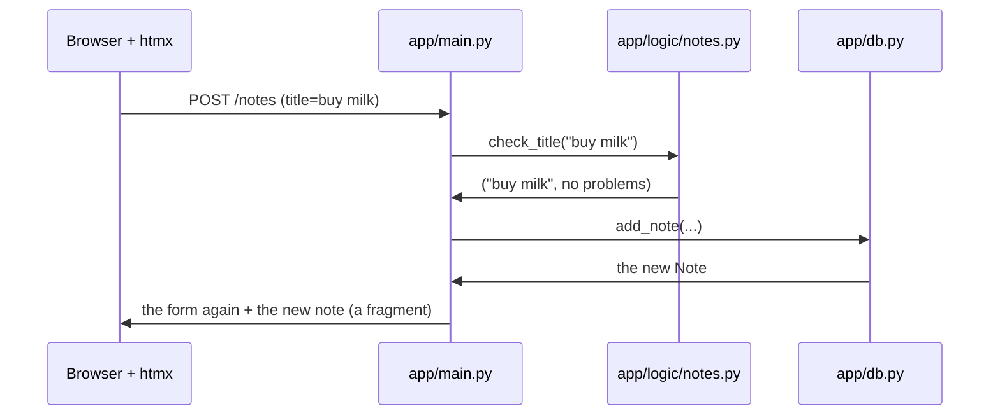

# W04: Your First App from the Starter

New cooks do not invent a kitchen. They walk into one that already works: the stove is lit, the knives are in the drawer, the fridge is labelled. Their first job is to cook one dish in it and learn where everything lives. The **starter** is that kitchen. It is a small notes app that already runs, already has tests that pass, and already follows every rule of the stack. You and Pi change it, piece by piece, into your app.
{: .lesson-intro }

## Make Your Copy

The starter lives in the Pi Workbench project, in `kit/starter/`. A small script copies it into a new folder and adds the pinned libraries (htmx and Basecoat) beside it. In a terminal, from the folder where you downloaded pi-local-harness:

```
python3 kit/new_project.py ~/Projects/notes
```

The folder must be new or empty. Then go into it and install what it needs, once:

```
cd ~/Projects/notes
uv sync
```

`uv` reads `pyproject.toml`, the list of what the project needs, and installs it into a private `.venv` folder ([T45](t45.html) explains uv).

## Run It

Two commands: one builds the styles, one starts the server.

```
TAILWINDCSS_VERSION=v4.3.3 uv run tailwindcss -i styles/input.css -o static/app.css --minify
uv run uvicorn app.main:app --reload
```

Open [http://127.0.0.1:8000](http://127.0.0.1:8000). Add a note. Delete it. Click 日本語 and the page switches to Japanese. Stop the server with Ctrl+C.

Now run the checks:

```
uv run pytest
uv run pyright
```

`pytest` runs the tests. `pyright` checks the types ([W09](w09.html)). Both should pass before you change anything. That is your baseline.

## Give It to Pi

In the workbench, choose **Add Existing Folder…** and pick `~/Projects/notes`. Open it. In the Plan section you will see "No roadmap or tasks in this folder" and a **Create Roadmap** button. Click it: it adds `ROADMAP.md` and `tasks/001-first-task.md`, nothing else. The harness needs those two to keep its paperwork.

Then make the folder a git repository, so the harness can commit verified work ([W11](w11.html) explains this):

```
git init
git add -A
git commit -m "The starter"
```

Pi Workbench will do this step for you soon: **New Project…** will offer a "Web app" kind that makes all of this in one click, and a **Preview** beside the chat will run the app and the styles for you, so you can watch each change appear.

## A Walk Through the Folders

```
notes/
  app/
    main.py          the routes: which address shows what
    db.py            the data: open the database, one function per question
    i18n.py          the two languages: t("key")
    logic/
      notes.py       the rules, as pure functions
    templates/
      base.html      the frame every page shares
      pages/         whole pages
      fragments/     pieces htmx swaps into a page
  migrations/
    001-notes.sql    the database's shape, one numbered step at a time
  messages/
    en.json          every visible word, in English
    ja.json          the same keys, in Japanese
  static/            files sent as they are: htmx, the built CSS, the icon, the PWA files
  styles/input.css   the Tailwind and Basecoat entry point
  tests/             test_app.py, test_logic.py, test_i18n.py
  pyproject.toml     what the project needs
```

The big idea is that **each kind of thing has one home**:

- A new address? `app/main.py`.
- A rule, like "a title cannot be empty"? `app/logic/`.
- A new kind of data? A new file in `migrations/` and functions in `app/db.py`.
- A new word on the page? `messages/en.json` and `messages/ja.json`.

This is why the app stays maintainable. You, Pi, or another person can open it in a year and know where to look.

## Follow One Note

Here is what happens when you type "buy milk" and click **Add Note**:



The route in `main.py` is short on purpose. It asks the logic whether the title is fine, asks the database to save it, and renders a fragment. Each piece does one thing. The next lessons open each piece in turn.

## Your First Request

Back in the workbench chat, try a small, safe change:

*"Change the app's name from Notes to My Notes, in English and Japanese (マイメモ)."*

Watch the "Pi sees:" line, wait for the answer, then open the task file ([W03](w03.html)). Restart the server and reload the page to see it. If it says "Not verified", read why. Here the likely reason is that the tests pass without the change too: nothing tests the name yet. The fix is a follow-up request: *"Add a test that checks the page title says My Notes."*

## This Week's Exercise

1. Make your copy of the starter, run it, and run `uv run pytest` and `uv run pyright`.
2. Add the folder to the workbench, click **Create Roadmap**, and make the first commit.
3. Open each file in `app/` once. For each, write one sentence: what is it for?
4. Send the "My Notes" request, then read its task file and its commit with `git log --oneline`.

<div class="takeaways">
<h2>Key Takeaways</h2>
<ul>
<li>Pi never starts from nothing: kit/new_project.py copies the starter, a working notes app with tests</li>
<li>uv sync installs; Tailwind builds the CSS; uv run uvicorn app.main:app --reload runs it on port 8000</li>
<li>uv run pytest and uv run pyright must pass before you change anything</li>
<li>In the workbench: Add Existing Folder…, Create Roadmap, then git init and a first commit</li>
<li>Each kind of thing has one home: routes in main.py, rules in logic/, data in db.py and migrations/, words in messages/</li>
</ul>
</div>
