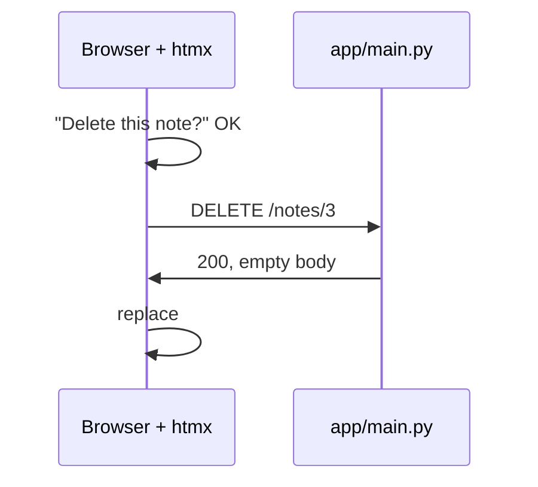

# W07: HTML over the Wire: htmx

In a restaurant, you do not get raw ingredients and a recipe at your table. The kitchen cooks, and the waiter puts a finished plate exactly where it belongs: the soup here, the bread there. **htmx** is that waiter. When you click a button, htmx asks the server, the server sends back a finished piece of HTML, and htmx puts it in the right spot on the page, without reloading. Your app gets fast and interactive, and you write almost no JavaScript.
{: .lesson-intro }

## The Idea, Again

[T46: HTML over the Wire with htmx](t46.html) explains htmx step by step, with a shopping list. Read it if you have not. Here we read the starter, which uses exactly the same ideas.

Four questions, four attributes:

| Question | Attribute |
|---|---|
| What request, to which address? | `hx-get`, `hx-post`, `hx-delete` |
| Where does the answer go? | `hx-target` |
| How does it go in? | `hx-swap` |
| Ask first? | `hx-confirm` |

The server always answers with **HTML fragments**, never JSON. That is the first rule.

## Read the Starter: Adding a Note

The form, in `fragments/note_form.html`:

```
<form id="note-form" class="card" hx-post="/notes" hx-target="this" hx-swap="outerHTML">
```

On submit, htmx sends the form to `POST /notes`, and replaces **the form itself** (`this`, `outerHTML`) with the answer. Why replace the form? Because the answer contains a fresh, empty form, and also the new note:

```

<hx-partial hx-target="#notes" hx-swap="afterbegin"></hx-partial>
```

That is `fragments/note_created.html`. The `<hx-partial>` tag is htmx 4's way to send a second piece to a second place: the new note goes to the top (`afterbegin`) of the list `#notes`. One answer, two places, no JavaScript.

## Read the Starter: an Error

Submit an empty title. In `app/main.py`:

```
if problems:
    return render(request, "fragments/note_form.html", status=422, title=clean, problems=problems)
```

The server sends the form back, with the error message inside, and the status **422** ("I understood, but this input is not acceptable"). In htmx 4, error answers are swapped into the target too. So the form is replaced by the same form, now showing "Write something first." The stack's rule: **validation errors come back as the form fragment, with a 422.**

## Read the Starter: Deleting

Each note's button, in `fragments/note_item.html`:

```
<button class="btn" data-variant="ghost" hx-delete="/notes/{{ note.id }}" hx-target="#note-{{ note.id }}"
        hx-swap="outerHTML" hx-confirm="{{ t('notes.confirm_delete') }}">
```

htmx asks "Delete this note?" first. If you agree, it sends `DELETE /notes/3`. The server deletes it and answers with an empty body. htmx replaces the note's `<li>` (its whole outer HTML) with nothing, and the note is gone.



## htmx 4, Not htmx 2

htmx 4 came out in 2026. AI models were trained before that, so they tend to write htmx 2. Some things changed, and the harness carries the new rules so Pi does not rely on memory. The ones that matter most:

1. **No implicit inheritance.** In htmx 2, an `hx-target` on a parent applied to everything inside. In htmx 4 it does not, unless you write `:inherited`, like `hx-target:inherited="#main"`. `hx-inherit` and `hx-disinherit` are gone.
2. **Errors reach the target too**, as you saw above. Use `hx-status` to send an error code to another target.
3. **Some attributes were removed**: `hx-vars`, `hx-params`, `hx-ext`, `hx-history`. `hx-request` is now `hx-config`.
4. **Event names use colons**: `htmx:after:swap`, not `afterSwap`.

When you search the web for htmx help, check the version. If an answer uses `hx-inherit` or `afterSwap`, it is htmx 2.

The kit keeps htmx's own checker beside the pinned htmx (`scripts/upgrade-check.py`), which finds htmx 2 leftovers in templates. Pi Workbench will do this step for you soon: it will run that checker after every edit, and also check that each `hx-target` matches something and each `hx-post` has a route.

## A Few More Patterns

From the kit's htmx card, lines that are almost always right:

```
<input name="q" hx-get="/search" hx-trigger="input changed delay:300ms" hx-target="#results">
<div hx-get="/status" hx-trigger="every 5s">...</div>
```

The first searches as you type, waiting until you pause for 300 milliseconds. The second refreshes itself every five seconds.

## Asking Pi for Interaction

Describe what the person sees, and Pi chooses the attributes:

- *"Let me edit a note's title in place: click it, type, press Enter to save."*
- *"Add a search box that filters the notes as I type."*

Then check: each new route returns a fragment, the fragment's template is in `fragments/`, and errors come back as a 422 with the form.

## This Week's Exercise

1. Open your browser's developer tools, Network tab. Add a note and look at the `POST /notes` answer: find the form and the `<hx-partial>`.
2. Submit an empty note and find the 422 in the Network tab.
3. Ask Pi for the search box. Read the new route and its fragment.
4. Read the htmx 4 rules above once more, and explain rule 1 in your own words.

<div class="takeaways">
<h2>Key Takeaways</h2>
<ul>
<li>htmx sends a request, the server answers with an HTML fragment, htmx puts it in the target</li>
<li>The starter's form swaps itself; hx-partial sends the new note to the list in the same answer</li>
<li>Validation errors come back as the form fragment with a 422, and htmx 4 swaps them in</li>
<li>htmx 4 has no implicit inheritance (use :inherited), removed hx-vars and friends, and uses colon event names</li>
<li>Web answers using hx-inherit or afterSwap are htmx 2: check the version</li>
</ul>
</div>
