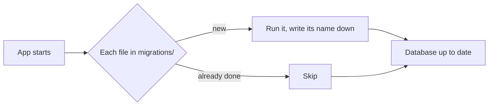

# W08: Data That Stays: SQLite and Migrations

A shop keeps its records in one filing cabinet. When the shop starts selling a new kind of product, nobody throws the cabinet away. They add a new drawer and write in the logbook: "15 October: added a drawer for gift cards." Anyone who opens the logbook knows how the cabinet came to look the way it does. Your app's data works the same way. **SQLite** is the cabinet, one file on disk. **Migrations** are the logbook of changes to its shape. And `app/db.py` is the shop assistant who is the only one allowed to open the drawers.
{: .lesson-intro }

## SQLite in One Minute

SQLite is a database in a single file. No server to install, nothing to keep running. In the starter, that file is `data.sqlite3`, made the first time the app starts. You talk to it with **SQL**: `create table`, `insert`, `select`, `update`, `delete`. [T24: SQLite](t24.html) teaches SQL with clear examples; read its first two sections now if SQL is new.

Python has SQLite built in, through the `sqlite3` module. The stack uses it directly, with no extra library: nothing to learn beyond SQL.

## Migrations: the Logbook

The shape of the data (which tables, which columns) is written in numbered SQL files in `migrations/`. The starter has one:

```
create table notes (
  id integer primary key,
  title text not null,
  created text not null default (datetime('now'))
);
```

That is `migrations/001-notes.sql`. When the app starts, `connect()` in `app/db.py`:

1. Makes a small `migrations` table, if there is none, to remember what was already done.
2. Looks at every file in `migrations/`, in number order.
3. Runs each one that is not in that table yet, and writes its name there.

So a new copy of the app builds the whole database from zero, and an existing one only gets the steps it is missing. Your data stays.



**The one rule:** never edit a migration that has already run. It will not run again, so your change will never reach the database. Write a new numbered file instead.

## Adding a Column

Say each note should have a "done" tick. That is a new migration, `migrations/002-notes-done.sql`:

```
alter table notes add column done integer not null default 0;
```

SQLite has no true/false type, so `0` means no and `1` means yes. Existing notes get `0`.

Then the code that reads notes learns about the new column, in `app/db.py`.

## db.py: the Only Door

Every question the app asks the database is one small typed function in `app/db.py`:

```
@dataclass(frozen=True)
class Note:
    id: int
    title: str
    created: str


def notes(connection: sqlite3.Connection) -> list[Note]:
    """Every note, newest first."""
    rows = connection.execute("select id, title, created from notes order by created desc, id desc").fetchall()
    return [Note(int(row[0]), str(row[1]), str(row[2])) for row in rows]
```

Three habits are visible here:

- **Data has a type.** A `Note` is a dataclass with named fields, not a loose dictionary. The rest of the app writes `note.title`, and the type checker knows it is text ([W09](w09.html)).
- **One function per question.** `notes`, `add_note`, `delete_note`. Routes call these; they never write SQL themselves.
- **Placeholders, always.** `add_note` writes `values (?)` and passes the title separately. Never glue user input into SQL text: with `?`, a title like `'); drop table notes; --` is just a strange note, not an attack.

For the "done" tick, `Note` gains `done: bool`, the `select` reads the new column, and a new function marks a note done.

## Asking Pi

*"Let me tick a note as done. Done notes show with a line through them. Keep the existing notes."*

Then read what Pi made. You should find: a new file `migrations/002-...sql` (not an edit to `001`), changes in `app/db.py` only for SQL, a route and a fragment for the tick, and tests. If you see SQL inside `app/main.py`, ask Pi to move it into `app/db.py`.

## Tests Use Their Own Database

Look at `tests/test_app.py`: every test makes the app with a fresh database in a temporary folder (`tmp_path`). Tests never touch your real `data.sqlite3`. Each one starts empty, so they cannot disturb each other or your notes.

## Your Data Is Precious

`data.sqlite3` is listed in `.gitignore`, so it is never committed or pushed to GitHub. Good for privacy, but it means git is **not** a backup of your data. To copy it safely, even while the app runs:

```
sqlite3 data.sqlite3 ".backup 'backup-2026-10-15.sqlite3'"
```

Keep copies on another disk. [T44](t44.html) explains backups in production.

## This Week's Exercise

1. Read [T24](t24.html), then open `app/db.py` and explain `connect()` in three sentences.
2. Ask Pi for the "done" tick. Check that it wrote a new migration and did not edit `001-notes.sql`.
3. Run the app, tick a note, stop the server, start it again. Is the tick still there?
4. Make a backup of `data.sqlite3` with the command above.

<div class="takeaways">
<h2>Key Takeaways</h2>
<ul>
<li>SQLite is the whole database in one file; Python's built-in sqlite3 talks to it</li>
<li>Migrations are numbered SQL files; connect() runs the ones not done yet and remembers them</li>
<li>Never edit a migration that already ran: add a new numbered one</li>
<li>app/db.py is the only door: typed dataclasses, one function per question, ? placeholders always</li>
<li>Tests use a fresh database; your data.sqlite3 is not in git, so back it up yourself</li>
</ul>
</div>
