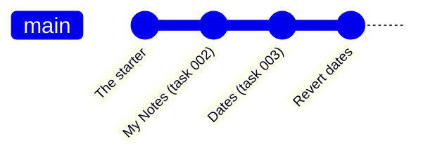

# W11: Git, the Time Machine the Harness Drives

A careful photographer keeps an album: after each good shot, a print goes in with a caption and a date. Years later they can find any moment, compare two, or start again from an old one. **Git** is that album for your project. In most projects, people paste the photos in themselves. In Pi Workbench, the harness does it for you, after each verified request. Your job is to set the album up once, and to know how to flip through it and go back.
{: .lesson-intro }

## Git in Two Minutes

[T19: Git Basics](t19.html) teaches git properly: the three areas, commits, branches, undo. Read it, it is ten minutes. The short version:

- A **repository** is a folder whose history git records (in a hidden `.git` folder).
- A **commit** is one snapshot: which files changed, how, when, by whom, and a message.
- The **history** is the chain of commits, newest on top.

## Set It Up Once

Tell git who you are, once per computer. Use the email you will use on GitHub ([T42](t42.html) shows how to keep it private):

```
git config --global user.name "Your Name"
git config --global user.email "you@example.com"
```

A project made from the starter is already a repository ([W04](w04.html)): `kit/new_project.py` ran these three commands for you. A folder you start yourself needs them once:

```
git init -b main
git add -A
git commit -m "The starter"
```

`-b main` names the main line of history `main`, the name GitHub uses. The first commit is the starting point every later snapshot builds on.

**What stays out:** the starter's `.gitignore` lists `data.sqlite3`, `.venv/` and `__pycache__/`. Your data, the installed packages and Python's caches are never recorded. Secrets never go in either ([T43](t43.html)).

## Who Commits What

| Who | When | What |
|---|---|---|
| The harness | A request is verified | Only the files that request changed, its task and `ROADMAP.md` |
| You | When you choose | Your own edits, from a terminal |
| Pi | Never during a request | Gate sends `git commit` back (rule G-013) |

So when you edit a file yourself, in the Work view or your editor, the harness leaves your edit alone. Commit it yourself when you are happy:

```
git add messages/ja.json
git commit -m "Better Japanese for the empty list"
```

## Flip Through the Album

Four commands answer almost every question. Run them in a terminal in the project folder:

```
git log --oneline     # every snapshot, newest first, one line each
git status            # what changed since the last snapshot
git diff              # exactly which lines changed, not yet committed
git show HEAD         # the newest snapshot: its message and every changed line
```

`HEAD` means "the newest commit". You can use any commit's short id from `git log` instead, like `git show 3f2a91c`.

In a diff, lines starting with `-` were removed and lines starting with `+` were added. Reading Pi's diffs is the best way to learn: you see exactly what a request did, in a few lines.



## Go Back

Every verified request is one commit, so undoing a request is one command:

```
git revert --no-edit HEAD
```

It adds a new commit that undoes the newest one. History is kept, so you can undo the undo. To undo an older request, give its id instead of `HEAD`. [W03](w03.html) showed the same, and the **Undo This Request** button that is coming.

To throw away your own changes that you have **not** committed yet, in one file:

```
git restore app/templates/pages/index.html
```

Careful: that edit is gone for good. Git can only bring back what was committed.

## Try Ideas on a Branch

A **branch** is a parallel line of history. Use one to try something you might throw away:

```
git switch -c try-dark-mode    # a new branch, and move onto it
```

Now send Pi your requests as usual. The harness commits onto this branch. If you like the result, go back and bring it in:

```
git switch main
git merge try-dark-mode
```

If you do not like it, go back to `main` and delete the branch with `git branch -D try-dark-mode`. `main` never saw the experiment.

Always check which branch you are on before asking Pi for work: `git status` says it on its first line.

## Why This Matters So Much

An AI changes code fast. Fast changes without history are frightening: one bad request could break something that worked yesterday, and you would not know what changed. With a snapshot per verified request, nothing is ever really lost, and every change has a reason (its task) and a proof (its tests). That is what makes it safe to let Pi work quickly.

## This Week's Exercise

1. Read [T19](t19.html). Then run `git log --oneline` in your notes project and match each commit to a task file.
2. Run `git show` on Pi's latest commit and read the diff. Explain one `+` line in plain words.
3. Make a branch, ask Pi for a small change on it, then switch back to `main` and see that the change is not there.
4. Edit a word in `messages/en.json` yourself and commit it with your own message.

<div class="takeaways">
<h2>Key Takeaways</h2>
<ul>
<li>Set git up once: your name and email. A project from the starter already has its repository and first commit</li>
<li>The harness commits each verified request; you commit your own edits; Pi never commits during a request</li>
<li>git log, git status, git diff and git show answer almost every question about what changed</li>
<li>git revert undoes a commit with a new commit; uncommitted work cannot be brought back</li>
<li>Branches let you try an idea and throw it away without touching main</li>
</ul>
</div>
