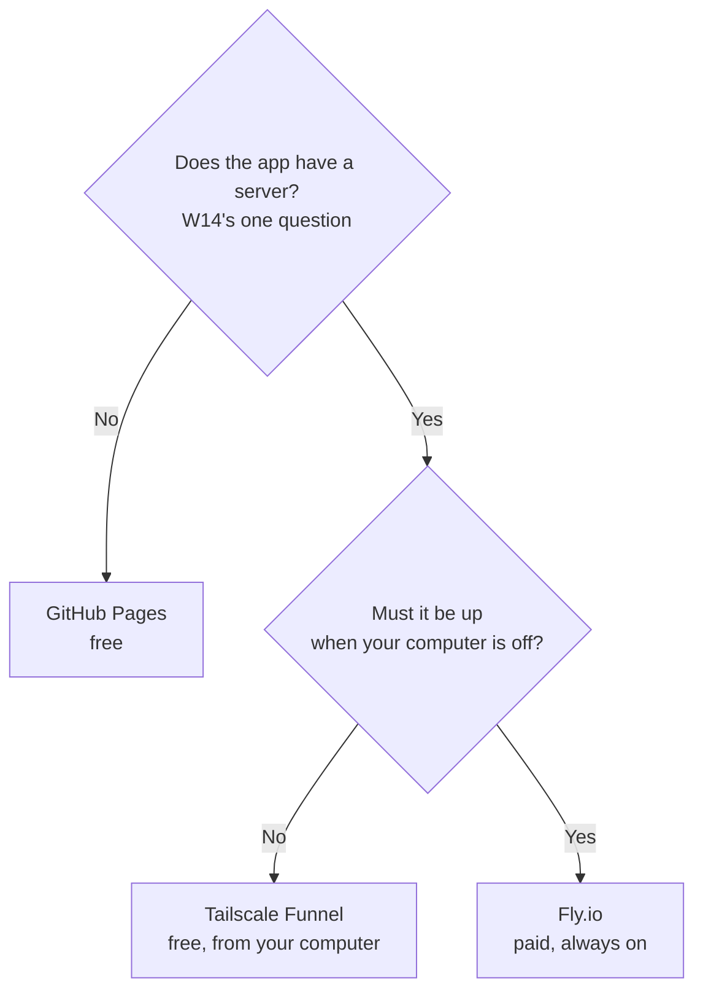

# W16: Putting It Online

Selling at a market, you have three choices. Leave a stack of free leaflets on a public table: no one needs to stand there. Open your own front door and sell from home: free, but only while you are home. Or rent a stall in a covered market that is open every day: it costs rent, but it never closes. Putting your app online is the same choice. Pi Workbench's plan picks one way for each situation, so you do not have to compare twenty hosting companies.
{: .lesson-intro }

## Which Way?



[T44: Putting a Server Online](t44.html) compares the options in more depth, including a rented server (VPS) with Caddy. This lesson follows the plan's three.

**Prices and free tiers change often.** Everything below was true when this lesson was written; check each provider's own page before you rely on it.

## 1. GitHub Pages: Apps with No Server

An app with no server ([W14](w14.html)) is just files. GitHub Pages hosts files for free:

1. Push the project to a **public** repository on GitHub ([W12](w12.html)).
2. On the repository page: **Settings → Pages**, Source **Deploy from a branch**, branch **main**, folder **/ (root)**. Save.
3. After a minute or two, open `https://YOUR-NAME.github.io/REPOSITORY/`.

From then on, `git push` publishes. [A18](a18.html) walks through exactly this.

Pages cannot run Python, keep a SQLite file, or hide a secret. For that, read on.

## 2. Tailscale Funnel: the Free Default for Server Apps

Your app keeps running **on your own computer**, with its SQLite file right there, and **Tailscale Funnel** gives it a public HTTPS address anyone can open.

You already use Tailscale for the phone ([W13](w13.html)); `serve` shares with your own devices, `funnel` shares with everyone. With your app running on port 8000:

```
tailscale funnel 8000
```

Tailscale prints an address like `https://my-laptop.your-tailnet.ts.net`. The first time, it may ask you to enable HTTPS and Funnel for your network, with a link. It lasts while the command runs.

If the workbench's phone access already uses that main address, put your app on another port. Funnel allows only 443, 8443 and 10000:

```
tailscale funnel --https=8443 localhost:8000
```

- **Cost:** free for personal use.
- **Good:** nothing to rent, nothing to upload. Your data never leaves your machine.
- **Bad:** **the machine must stay on**, awake and online. When your laptop sleeps, your app is down. Funnel's bandwidth is limited, so it suits friends, a class or a small team, not a busy public site.

Run the app without `--reload` when others use it, so a half-saved edit does not restart it under them:

```
uv run uvicorn app.main:app --port 8000
```

Pi Workbench will do this step for you soon: a "share publicly" recipe that starts the app and the Funnel and tells you the address.

## 3. Fly.io: Always On

When the app must be up while your computer is off, it needs a computer that is always on. The plan's choice is **Fly.io**, a platform that runs your app in a data centre.

- **Cost:** paid, by usage. For a small app with a small disk, a few dollars a month. There is no free tier for new accounts.
- **A volume for SQLite.** Platforms wipe an app's disk on each deploy. Your `data.sqlite3` must live on a **volume**, a disk that survives deploys, or every update erases your data.
- **Good:** always on, HTTPS included, restarts by itself if it crashes.
- **Bad:** it costs money, and moving your app there takes a few changes (where the database file lives, how the app starts).

The steps today are in Fly.io's own documentation for Python apps: install their `fly` command, `fly launch` in your project, create a volume, and `fly deploy`. Ask Pi to prepare the project for it, and read every change.

Pi Workbench will do this step for you soon: a Fly.io recipe with the volume for SQLite, migrations on deploy and backups set up.

Checked and left out by the plan: platforms whose free tier sleeps and wipes the disk on deploy (SQLite is lost), and hosts that run only Node.js or static files.

## What Changes in Production

"Production" is the real copy other people use. [T44](t44.html)'s last section is required reading. The short version:

- **Secrets** go in environment variables, never in the code.
- **HTTPS** always. All three ways give it to you.
- **Backups** of `data.sqlite3`, on another machine. Restore one once, to know it works ([W08](w08.html) shows the command).
- **Logs**: when someone says "it broke", the server's output tells you what happened.

## This Week's Exercise

1. For each app on your list from W14, choose: Pages, Funnel or Fly.io. Write why in one line.
2. Publish your no-server app on GitHub Pages, if you have not.
3. Share your notes app with `tailscale funnel 8000`, open it on a phone using mobile data (not your Wi-Fi), then stop it with Ctrl+C.
4. Read [T44](t44.html)'s "What Changes in Production".

<div class="takeaways">
<h2>Key Takeaways</h2>
<ul>
<li>No server: GitHub Pages, free, git push publishes</li>
<li>A server app: Tailscale Funnel is the free default; the app and its SQLite file stay on your computer, which must stay on</li>
<li>Always on: Fly.io, paid (a few dollars a month), with a volume so SQLite survives deploys</li>
<li>Funnel allows ports 443, 8443 and 10000; its bandwidth is limited</li>
<li>Prices and free tiers change: check before you rely on them. In production: secrets in the environment, HTTPS, backups, logs</li>
</ul>
</div>
