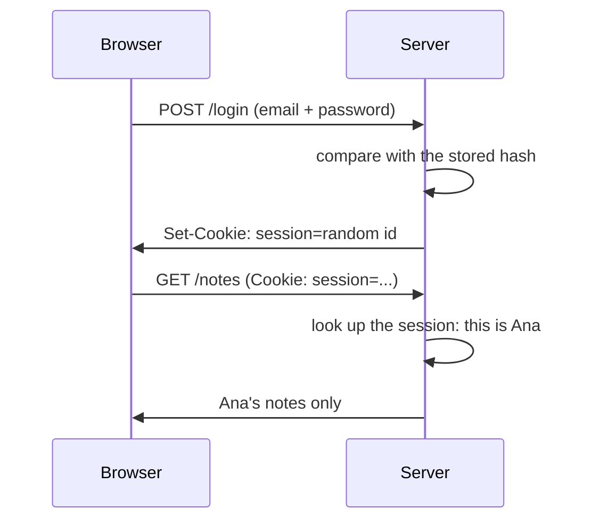

# W17: Logins and Accounts

An office building has two checks. At the front door, a guard looks at your badge: *who are you?* Upstairs, each door has its own lock: *may you enter this room?* Your app needs both once more than one person uses it: **authentication** (who you are) and **authorization** (what you may do). Logins are the part of an app to build most carefully.
{: .lesson-intro }

## First: Your App Is Open Right Now

The starter has no login. On your own computer that is fine. But the moment you share it with `tailscale funnel` ([W16](w16.html)), **anyone with the address can read, add and delete notes.** Before sharing a real app publicly, decide who should get in.

## Do You Need Accounts?

Often, no. Ask:

- **Only you, on your own devices?** Use `tailscale serve` instead of Funnel ([W13](w13.html)). Only devices signed in to your Tailscale network can open it. That is already a strong login, and you wrote no code. (The workbench uses exactly this for your phone.)
- **No shared data at all?** An app with no server ([W14](w14.html)) keeps each person's data on their own device. No accounts needed.
- **Several people, each with their own data, or different permissions?** Then you need accounts. Read on.

## How a Login Works

[T25: Authentication](t25.html) shows the pieces, in JavaScript. The ideas are the same in Python:

1. **Never store passwords.** Store a **hash**: a one-way scramble. At login, scramble what was typed the same way and compare. If your database leaks, the passwords do not. Use a slow, salted hash made for passwords (Python's standard library has `hashlib.scrypt`), never a fast one like plain SHA-256.
2. **A session** is a long random id the server remembers ("this id is Ana, until Friday"). The browser keeps it in a cookie and sends it with every request. The cookie should be `HttpOnly` (page scripts cannot read it), `Secure` (HTTPS only) and `SameSite=Lax`.
3. **HTTPS always.** A password sent over plain `http://` can be read on the way. All three hosting ways in W16 give you HTTPS.

## Authorization: Each Door Has a Lock

Knowing it is Ana is not enough. Every route that reads or changes data must check that **this** note belongs to **Ana**. The classic bug: `DELETE /notes/7` deletes note 7, whoever asks. The fix is in the data, not the page: in `app/db.py`, each query also says `where owner = ?`. Hiding a button is not security; the route must refuse.

Some apps also need **roles**: an admin may delete anyone's post, a member only their own. A role is a column on the user, checked by the route.

## CSRF: the Forged Form

Here is an attack few beginners know. Ana is logged in to your app. She visits a bad website, which secretly sends a form to *your* app's `/notes/7` delete route. Her browser attaches her session cookie, and your app obeys. That is **CSRF** (cross-site request forgery).

The defences: the `SameSite=Lax` cookie above blocks most of it, and a **CSRF token** (a secret value in each form, checked by the server) blocks the rest. With htmx, the token travels in a header on every request.

## Simpler Than Passwords

Passwords are a burden: people forget them and reuse them. Two modern options avoid them:

- **An email link:** type your email, click the one-time link you receive.
- **Passkeys:** the phone or computer proves who you are with a fingerprint or face, and no secret ever crosses the network.

Pi Workbench will do this step for you soon: a sign-in block for the stack (passkeys or an email link, sessions, roles, and CSRF protection for htmx forms), written once, tested, and reused by every project.

## Building It Today, Carefully

Login code is where a small mistake becomes a real harm to real people. If you build one now, keep it small and check everything:

*"Add accounts: sign up and log in with email and password. Hash passwords with hashlib.scrypt and a random salt. Sessions in a sessions table with a random id in an HttpOnly, Secure, SameSite=Lax cookie. Each note has an owner, and every query filters by it. Add tests that one user cannot see or delete another user's notes."*

Then read the tests first. The test "Ben cannot delete Ana's note" is the one that matters most. Ask a friend who knows security to read the code before real people sign up. And never put a real password into the chat or a test: use made-up ones.

## This Week's Exercise

1. Read [T25](t25.html).
2. For your app, answer: who should get in? Which of the three cases above is it?
3. Share your app with `tailscale serve` and check that a device outside your Tailscale network cannot open it.
4. Explain CSRF to a friend in three sentences, using the forged form story.

<h2>Key Takeaways</h2>
<ul>
<li>Authentication asks who you are; authorization asks what you may do. Every data route needs both</li>
<li>A shared app with no login lets anyone change everything: decide who gets in before you share</li>
<li>Only you? tailscale serve is already a login. No shared data? No accounts needed</li>
<li>Store slow, salted password hashes, never passwords; sessions in HttpOnly, Secure, SameSite cookies; HTTPS always</li>
<li>Check ownership in every query, and protect forms against CSRF</li>
</ul>

