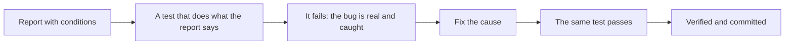

# W19: Finding Bugs with Pi: Reproduce First

A good doctor examines you and runs a test before treating. A bad doctor hears "my stomach hurts" and hands out the first pill that comes to mind. AI models, left alone, are often the bad doctor: they read a bug report, guess a likely cause, and write a confident fix for it. This lesson teaches the good doctor's order, **reproduce first**, and how to make Pi follow it.
{: .lesson-intro }

## Understand Before You Fix

[R03: Problem Solving](r03.html) says most software work is thinking, not typing: understand, plan, then implement. For a bug, "understand" has a very concrete meaning: **see it happen, on purpose, every time.** Until you can make the bug appear when you want, you do not know its cause. You only have a guess.

## A True Story

This happened to Pi Workbench itself, in October 2026. A person reported: "Coming back to Chat from Activity leaves the view lifted, white at the bottom."

Pi read the code and guessed a cause: the chat's scroll position. It changed two functions and added a test. Its answer sounded finished.

The guess was wrong. The real cause was elsewhere: only between 761 and 1100 pixels wide, a hidden line of text for screen readers was placed at the very bottom of the whole page, which made the background scrollable. Any scroll then lifted every window. And the test Pi wrote clicked a button that did not exist on that screen, so it waited forever, with or without the fix.

The real cause was found by **looking**, not reasoning: open the workbench at 1024 pixels wide, send a message, see the window lift, measure which element had scrolled and what it was placed against. Four measurements.

The harness's own lesson file (L-008) lists what Pi lacked: a browser it could drive, the conditions (the width), a rule to reproduce first, and facts instead of guesses.

## Report the Conditions

The report did not mention the width. People rarely think to. A good bug report answers:

- **What did you do?** The steps, in order: "Open a note, click Edit, press Enter."
- **What did you expect?** "The new title is saved."
- **What happened instead?** "The old title comes back."
- **Where?** Phone or computer, which browser, the window size if it is about layout. A screenshot helps: you can attach one in the chat.
- **Every time, or sometimes?**

## Reproduce, Then Fix

Ask for the order explicitly:

*"Bug: on my phone, the Delete button on a note deletes the note below it. Reproduce it first with a failing test, show me the test failing, then fix it."*

What happens then is the harness's Red and Green ([W03](w03.html)), used for its best purpose:

A test that reproduces the bug is a small proof: *this was broken, now it is not, and it will stay fixed*, because the test runs every time from now on.

Watch for the trap from the story: a test that fails **for the wrong reason** (a timeout, a missing button) still counts as "failed". Read the test. Does it do what the report says?

## The Help the Harness Gives

- **A bug guide.** When your words sound like a bug ("broken", "instead of", "not working"), the harness adds a short guide to Pi's prompt: reproduce before fixing, never decide the cause from reading code alone.
- **A browser for page problems.** When your words are about the page (layout, scroll, width, phone, hidden), Pi gets its **browser** tool and a guide: open the page at the size the problem needs (a phone is 390 pixels wide), do the steps, measure what moved and why, then read the code of exactly those elements. It can open pages running on your computer, like your app at `http://127.0.0.1:8000`.
- **Proof of Red.** If Pi skipped the failing run, the harness puts the old code back and checks the test fails without the fix. If it passes anyway, the request is **Not verified**: the test does not test the bug.

## When You Are Stuck

- **Shrink it.** A two-step reproduction beats a ten-step one.
- **Find when it started.** If it worked last week, `git log` lists every change since ([W11](w11.html)). Check out an older commit to see whether the bug was there.
- **Ask for facts.** "Which element scrolled?" is answerable. "Why is it broken?" invites a guess.
- **Doubt a quick "fixed"** whose cause does not explain every condition (why only on phones?).

## This Week's Exercise

1. Read [R03](r03.html). Write its three steps in your own words, for bugs.
2. Break something small in your app on purpose (or find a real bug). Write a report with all five answers above.
3. Send it to Pi with "reproduce it first with a failing test". Read the test before the fix: does it do what your report says?
4. Find the task file and check it has a Red line before the Green line.

<h2>Key Takeaways</h2>
<ul>
<li>Reproduce first: until you can make the bug appear on purpose, its cause is only a guess</li>
<li>Report the conditions: steps, expected, actual, where (device, browser, width), every time or sometimes</li>
<li>A failing test that does what the report says is the proof; the same test passing is the fix</li>
<li>A test can fail for the wrong reason: read it</li>
<li>The harness adds a bug guide, gives Pi a browser for page problems, and proves Red itself when Pi skipped it</li>
</ul>

